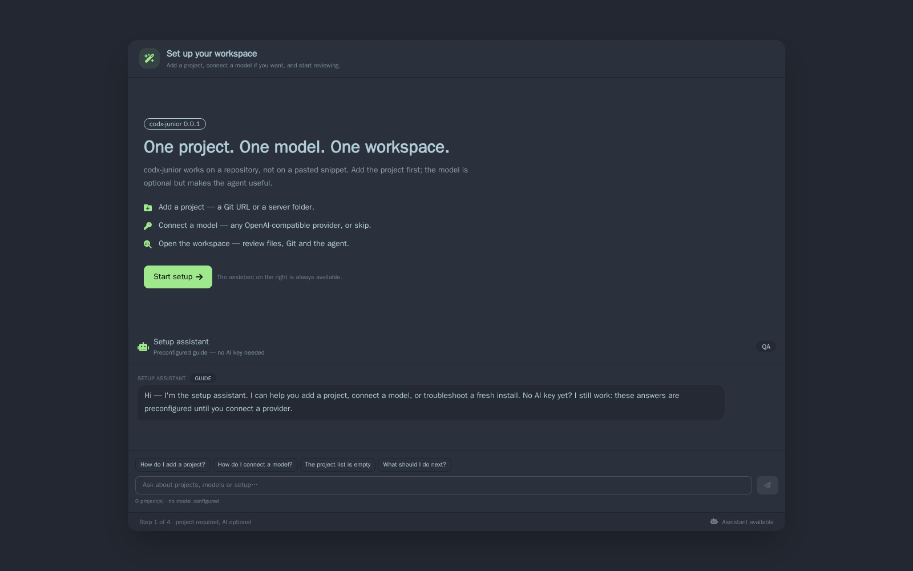
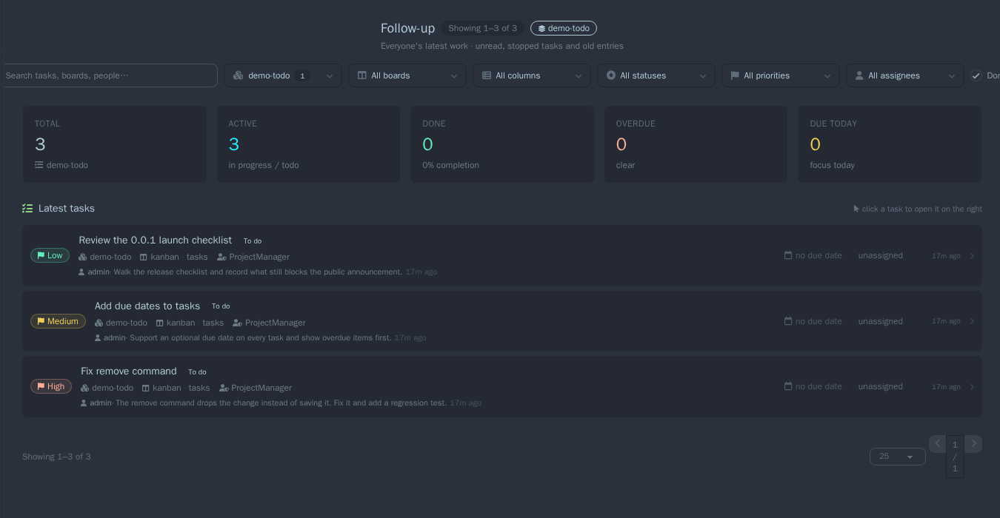
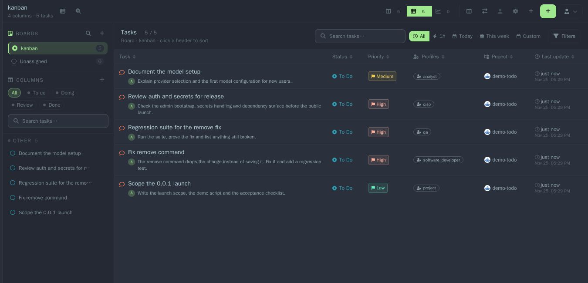
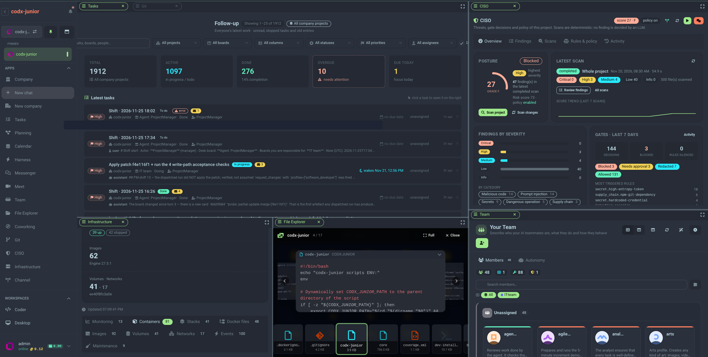

# codx-junior

**The AI developer you host.**

Your repo. Your model. Your machine. codx-junior is a self-hosted AI development
workspace: a project-aware agent reads your code, makes the change, runs the
tests and shows you the diff before you commit.

**0.0.1 is deliberately focused.** It ships the core loop — install, add a repo,
chat, review, commit — in 17 features. The company OS, autonomous agents,
meetings, dev containers and browser desktops are in the codebase but hidden for
this release, so the product you install is one sharp edge rather than a
platform you have to learn.

* **One container** — web UI, FastAPI, background worker and embedded knowledge store.
* **Any OpenAI-compatible provider** — OpenAI, DeepSeek, Gemini, OpenRouter,
  Mistral, Groq, or a self-hosted gateway. Your key, your cost.
* **A real workspace** — project-aware chat, agent tools, profiles, knowledge,
  files, tasks and Git review in one browser tab.
* **A team, not one assistant** — PM, developer, QA and security profiles with
  their own instructions, tools and model; the shared board carries the handoff
  and you review the diff.
* **Review-first** — every tool call and file change is visible; the agent
  proposes, you commit.
* **Self-hosted** — projects, settings, code and prompts stay on your machine.

[GitHub](https://github.com/codx-junior/codx-junior) ·
[What ships in 0.0.1](https://github.com/codx-junior/codx-junior/blob/main/docs/0.0.1.md) ·
[15-minute getting started](https://github.com/codx-junior/codx-junior/blob/main/docs/getting-started.md) ·
[Feature matrix](https://github.com/codx-junior/codx-junior/blob/main/docs/product/v0.0.1-feature-matrix.md) ·
[Issues](https://github.com/codx-junior/codx-junior/issues)

**First run is a wizard, not an empty project list.** Add a Git URL or server
folder, connect a model or skip, and the setup assistant is available even before
an API key exists.







```bash
docker pull codxjuniorai/codx-junior:latest
```

## Quick start

On a Linux machine with internet access, the installer is the supported path. It
installs Docker if needed, writes the settings, starts the container and waits
for the health check:

```bash
curl -fsSL https://raw.githubusercontent.com/codx-junior/codx-junior/main/install.sh \
  | sudo bash -s -- --provider deepseek --key sk-xxxxxxxx
# -> http://<server>:19981
```

Add a domain and an e-mail to get HTTPS through the bundled Traefik:

```bash
curl -fsSL https://raw.githubusercontent.com/codx-junior/codx-junior/main/install.sh \
  | sudo bash -s -- --mode server --domain codx.example.com \
      --acme-email ops@example.com --provider deepseek --key sk-xxxxxxxx
# -> https://codx.example.com
```

Only the provider and its key are required. Providers: `openai`, `deepseek`,
`gemini`, `openrouter`, `mistral`, `groq`, `custom` (any OpenAI-compatible
endpoint; set `CODX_JUNIOR_AI_API_URL` with the `/v1` suffix).

Re-running the installer is the update path: projects and settings are kept.
`install.sh --help` lists every option.

### What ships in 0.0.1

Install and first run · project import · project-aware chat and agent tools ·
the agent team (profiles) · knowledge index · file explorer · vibe coding · tasks/Kanban · Git and
code review · settings · REST/Socket.IO API · responsive shell.

Hidden in 0.0.1: autonomous agents and tickets, human teams and meetings, workspaces
and browser desktops, the company assistant/business dashboard/CISO, budget and
analytics, MCP, plugins, voice, multi-user and the in-app updater. They remain in
the image behind the install-time feature list.

Full release scope and per-feature fixes:
[0.0.1 feature matrix](https://github.com/codx-junior/codx-junior/blob/main/docs/product/v0.0.1-feature-matrix.md).

## The platform behind 0.0.1 (in development)



The advanced build runs autonomous shifts, the CISO gate, infrastructure and the
team panel in one desktop. It is **not** part of 0.0.1; it is the roadmap made
concrete. [See the advanced preview](https://github.com/codx-junior/codx-junior/blob/main/docs/advanced.md).

### Requirements

| | |
|---|---|
| Host | Linux with Docker 20.10+ and the compose v2 plugin |
| Minimum box (pull only) | 2 vCPU / 4 GB RAM / 40 GB disk |
| Recommended | 4 vCPU / 8 GB RAM |
| Disk for the image | ~8–12 GB (the image is intentionally complete) |
| AI provider | one API key for an OpenAI-compatible provider |

## Run the container directly

The installer is recommended because it manages settings, TLS and updates. To
try the image by hand:

```bash
export CODX_JUNIOR_AI_API_KEY=sk-xxxxxxxx

docker run -d --name codx-junior \
  --restart unless-stopped \
  -p 19981:19981 \
  -e CODX_JUNIOR_AI_PROVIDER=deepseek \
  -e CODX_JUNIOR_AI_API_KEY \
  -v codx-junior-settings:/home/codx-junior/.codx-junior \
  -v codx-junior-analytics:/home/codx-junior/analytics \
  -v "$PWD/projects:/home/codx-junior-projects" \
  codxjuniorai/codx-junior:latest
```

Open <http://localhost:19981> and complete the first-boot setup. The API is
served through nginx on the published port; `/api/health`,
`/api/docs` (OpenAPI) and the OpenAI-compatible endpoint are all under `/api`.

### Persistent data

| Container path | What it holds | Keep it |
|---|---|---|
| `/home/codx-junior-projects` | your projects (the only path most users change) | **yes** |
| `/home/codx-junior/.codx-junior` | global settings, users, profiles, provider configuration | **yes** |
| `/home/codx-junior/analytics` | token usage, AI logs, usage metrics | yes, for history |

Everything else is disposable: upgrading is pulling a new image and recreating
the container against the same volumes.

## How it works

The image is one self-contained application container:

| Process | Port | Purpose |
|---|---|---|
| nginx | **19981** (published) | serves the compiled SPA and proxies `/api` |
| FastAPI | 19980 (internal) | REST API, Socket.IO, OpenAI-compatible endpoint |
| Background worker | — | autonomy, indexing, background tasks |
| Embedded LanceDB | — | knowledge/RAG storage, in the API process |

There is **no external database, Redis or vector service**. Knowledge is an
embedded LanceDB directory; an embeddings model is optional, and providers
without one fall back to lexical search. The container also ships the Docker CLI
with compose and buildx so the workspace can build and run project containers.

The image includes the toolchain the product actually uses: Chromium/Playwright,
pandoc, TeX Live, tesseract and ffmpeg. That is why it is large, and why there is
no "slim" variant that silently drops a feature.

## Tags

| Tag | What it is | Use it for |
|---|---|---|
| `latest` | rolling build of `main` | trying the product |
| `vX.Y.Z` | pinned release (for example `v1.2.3`) | production |
| `dind` | Docker-in-Docker wrapper that runs the installer and a nested stack | multiple isolated instances on one host |

`latest` is a moving branch and is not a release. Pin `vX.Y.Z` in anything that
must be reproducible or rollbackable. Images are published by the release
workflow in
[`.github/workflows/release.yml`](https://github.com/codx-junior/codx-junior/blob/main/.github/workflows/release.yml).
Only tags listed on the Docker Hub **Tags** tab exist; a git tag alone does not
publish an image.

### Platforms

The release workflow builds `linux/amd64`. The repository's manual publish
script can also produce a `linux/amd64,linux/arm64` manifest list. Check the
manifest before promising an architecture:

```bash
docker buildx imagetools inspect codxjuniorai/codx-junior:latest
```

## Configuration

Only the provider and key are required. The installer defaults to the `core`
0.0.1 profile (workspace mode, no company wizard); use `--full-featured` for the
company-first product. Common settings:

| Variable | Default | Meaning |
|---|---|---|
| `CODX_JUNIOR_AI_PROVIDER` | — | `openai`, `deepseek`, `gemini`, `openrouter`, `mistral`, `groq`, `custom` |
| `CODX_JUNIOR_AI_API_KEY` | — | provider key; never baked into the image |
| `CODX_JUNIOR_AI_API_URL` | preset | OpenAI-compatible endpoint (required for `custom`; include `/v1`) |
| `CODX_JUNIOR_AI_MODEL` | per provider | override the chat/coding model |
| `CODX_JUNIOR_PROJECTS_PATH` | `/home/codx-junior-projects` | where the container sees projects |
| `CODX_JUNIOR_CONFIG_FOLDER` | `/home/codx-junior/.codx-junior` | settings and users |
| `CODX_JUNIOR_WEB_PORT` | `19981` | published web port (installer) |
| `CODX_JUNIOR_PUBLIC_URL` | — | external URL used in links and redirects |
| `CODX_JUNIOR_DOMAIN` | — | enables the installer's TLS front door |
| `CODX_JUNIOR_ADMIN_USER` | `admin` | first admin, created on first boot only |
| `CODX_JUNIOR_ADMIN_PASSWORD` | generated | first admin password (bcrypt-hashed, never logged) |
| `CODX_JUNIOR_ADMIN_EMAIL` | — | optional login identifier for the first admin |
| `CODX_JUNIOR_WORKSPACE_TOKEN` | — | scoped API key for machine clients |
| `CODX_JUNIOR_ACTIVE_FEATURES` | `core` (installer) | `core` = workspace mode, company OS hidden; `all` = full product; or a comma-separated id list |

Full reference:
[`docs/configuration.md`](https://github.com/codx-junior/codx-junior/blob/main/docs/configuration.md)
and the
[deployment contract](https://github.com/codx-junior/codx-junior/blob/main/codx-junior-installer/cloud/DEPLOYMENT-CONTRACT.md).

## Update and verify

With the installer:

```bash
sudo /opt/codx-junior/bin/codx-junior update
# or, from the checkout:
sudo ./install.sh --update
```

The update pulls the image and recreates the container; projects and settings
are kept. The readiness probe reports the exact build that answered:

```bash
curl -fsS http://127.0.0.1:19981/api/health
# {"status":"ok","version":"...","ref":"...","commit":"..."}
```

A pinned install uses the matching image tag:

```bash
sudo ./install.sh --ref vX.Y.Z --non-interactive </dev/null
```

## Security notes

* Terminate TLS in front of the app. The installer's `server` mode does it with
  Traefik and ACME; do not expose port 19981 directly to the internet.
* Keep provider keys in environment variables or the product's secret store,
  never in a committed file or a derived image.
* Mounting `/var/run/docker.sock` is **optional** and powerful: it enables
  workspaces, browser/desktop sessions and the infrastructure panel, but gives
  the container control of the host Docker daemon. Omit it if you do not need
  those features.
* Data never leaves your host except for the AI provider calls you configure.

## Documentation

* [Docker Hub image and release flow](https://github.com/codx-junior/codx-junior/blob/main/docs/docker-hub.md)
* [Getting started](https://github.com/codx-junior/codx-junior/blob/main/docs/getting-started.md)
* [Architecture](https://github.com/codx-junior/codx-junior/blob/main/docs/guide/architecture.md)
* [Features](https://github.com/codx-junior/codx-junior/tree/main/docs/features)
* [Initial setup](https://github.com/codx-junior/codx-junior/blob/main/docs/initial-setup.md)

## License

Open source — see the repository for the current license and contribution
guidelines. codx-junior is built by a small team and early partners; write to
<join@codx-junior.ai> if you want to run it in your company.
