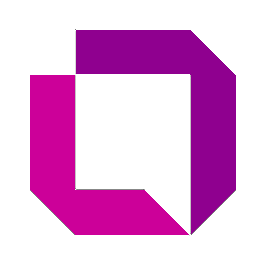
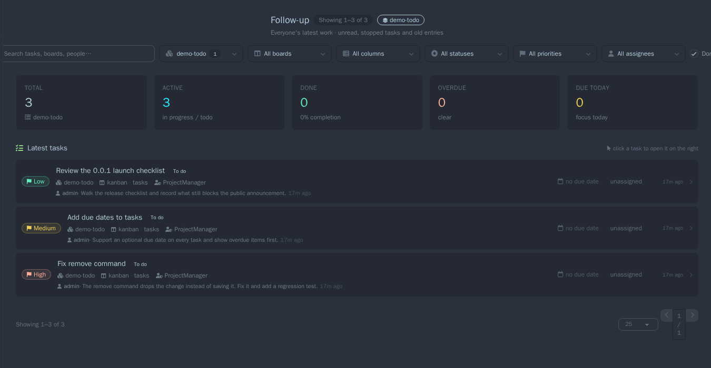
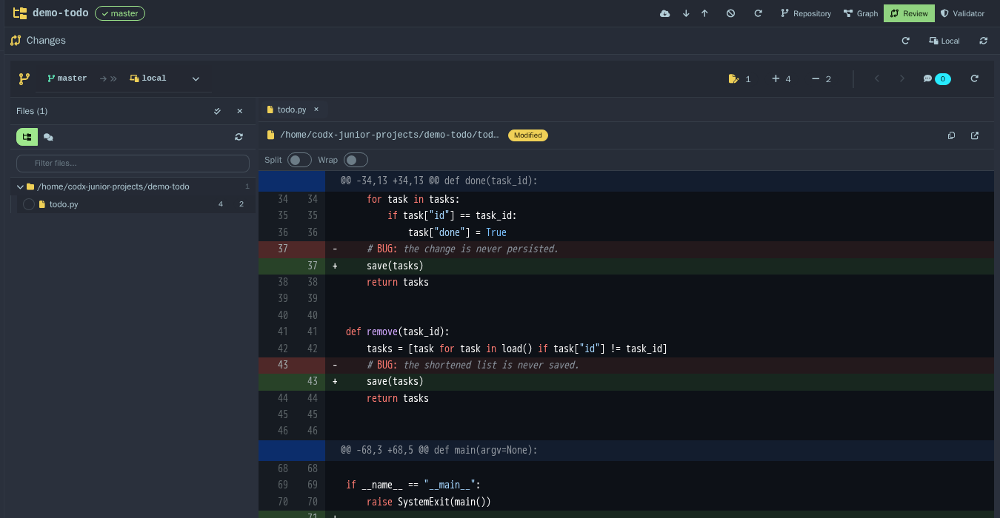
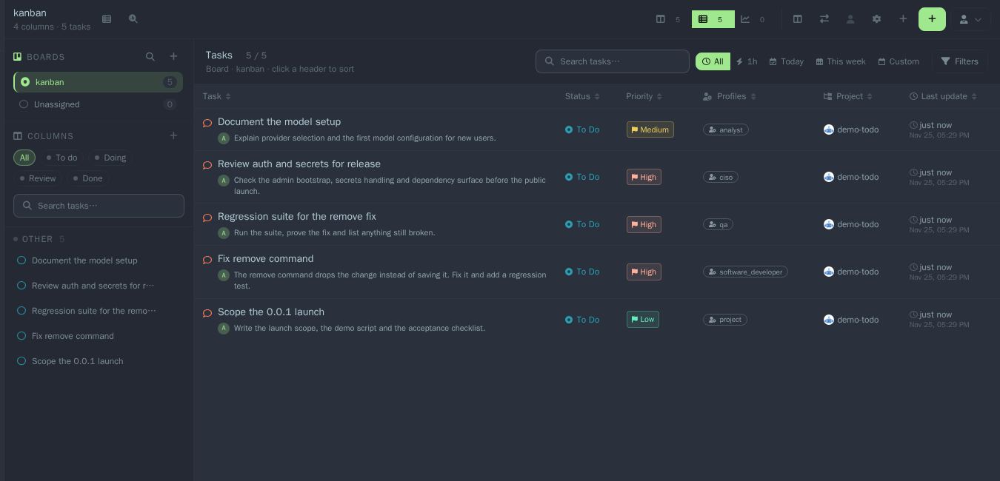
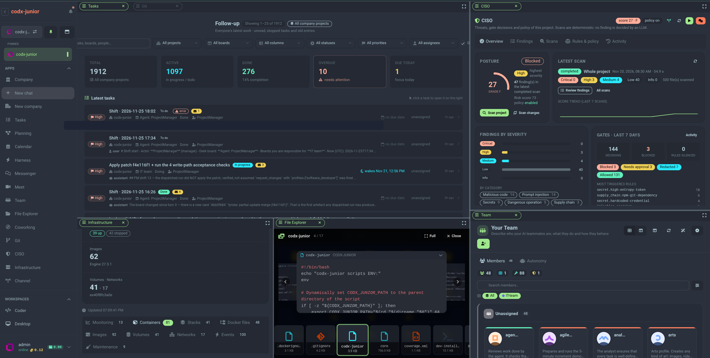

<div align="center">



# codx-junior

**The AI developer you host.**

Your repo. Your model. Your machine. A project-aware agent that reads your code,
makes the change, runs the tests and shows you the diff *before* you commit.

[Website](https://codx-junior.ai) ·
[Docs](docs/index.md) ·
[Wiki](wiki/index.md) ·
[0.0.1 feature matrix](docs/product/v0.0.1-feature-matrix.md) ·
[Docker Hub](https://hub.docker.com/r/codxjuniorai/codx-junior)


</div>

---

> **0.0.1 — first public release.** A focused, self-hosted AI development
> workspace: install one container, connect one model, add one repository, and
> ship a reviewed change. The company OS, autonomous agents, meetings, browser
> desktops and team features are deliberately hidden for this release. They stay
> in the codebase behind the install-time feature list; 0.0.1 is the sharp edge,
> not the whole platform.

## Why codx-junior 0.0.1

AI coding tools are good at producing code. codx-junior is built around what
happens **after** the model has an idea: the context it needs, the review you
keep, and the workspace where the change becomes a commit.

Six concrete differences:

1. **You own the whole loop.**
   One Docker container on your server, one OpenAI-compatible model, one project
   folder. Your code, prompts, keys and knowledge index never leave the machine.
   No seat subscription, no vendor model lock-in.

2. **A team, not a single assistant.**
   PM, developer, QA and security profiles each carry their own instructions,
   tools and model. A task picks the role; the shared board carries the handoff;
   you review the diff. A fullstack change is a vertical slice worked by a team,
   not one mega-prompt.

3. **The project is the context, not the open file.**
   Every chat is bound to a repository and a knowledge index built from it.
   Profiles carry your standards, stack and review rules into every turn, so you
   stop pasting files and re-explaining your architecture.

4. **The agent shows its work.**
   Tool calls, file edits, test runs and diffs are visible in the workspace. The
   agent proposes; you review the diff and make the commit. There is no black-box
   pull request to trust.

5. **One workspace, not another editor tab.**
   Chat, tasks, file explorer, knowledge search and Git review live in the same
   browser workspace, with the repository as the unit of work. Keep your editor
   for editing; use codx-junior for the change.

6. **Open source, inspectable, extensible.**
   AGPL-3.0, Python/FastAPI + Vue, a real REST API and a local-first knowledge
   store. Self-host it for free, read every line, and bring the model you already
   pay for.

### How it compares

| | Editor copilots | Terminal agents | **codx-junior 0.0.1** |
| --- | --- | --- | --- |
| Where it runs | vendor cloud | vendor cloud + local CLI | **your server, one container** |
| Model | vendor's | vendor's | **any OpenAI-compatible** |
| Context | open files | terminal session | **repo index + reusable profiles** |
| Team model | one assistant | one assistant | **role-specific agents + shared board + human review** |
| Review | inline suggestions | diffs in the terminal | **tool log + diff + commit in the browser** |
| Work queue | — | — | **tasks and a Kanban board** |
| Source | closed | closed | **AGPL-3.0** |
| Cost model | per seat | per token | **self-host free + your token cost** |

Terminal agents such as **Claude Code** and **Codex** are excellent at what one
agent can do in a terminal. codx-junior adds the roles, the shared board and the
human review gate around that work — so a fullstack slice can move between
specialists instead of living in one long prompt.

If you already love your editor's autocomplete, keep it. codx-junior is the
workspace around the change, not a faster Tab key.

### What changes in your day

* **A bug fix starts with a sentence, not a search.** You describe the outcome;
  the agent reads the repository, finds the files, patches them and runs the
  tests. You spend the time reviewing, not locating.
* **The work is handed off, not re-prompted.** A vertical slice gets a PM task,
  a developer profile for the API and UI, a QA pass and a security check. The
  board keeps the state; each role keeps its own instructions and model.
* **Your standards travel with the task.** Profiles encode the stack, the test
  command and the review rules once; every chat and task starts from them.
  Knowledge search brings the relevant files before the model asks for them.
* **The diff is the handoff.** There is no "trust me" step between the agent and
  the commit: tool calls, changed files and test output are on screen.
* **The bill is your provider's bill.** No seat tax and no reseller margin: the
  container talks to the model endpoint you configured.

**Who should not use 0.0.1:** teams that need roles and shared channels, anyone
who wants an autonomous agent opening pull requests without review, and hosts
without Docker. Those are the 0.1+ features, not a missing checkbox.

## See it

**A project workspace with tasks, profiles and the agent one click away.**



**Every change is a review: the tool activity, the unified diff and the commit
button in one screen.**



## Meet the team

Fifteen built-in profiles ship with 0.0.1. You do not need to hire or configure
an agent orchestration platform; you pick a role when you create the work.

| Profile | What it owns | What it hands back |
| --- | --- | --- |
| **project / PM** | Scope, acceptance criteria and the task breakdown. | A board card the team can work. |
| **software_developer** | The implementation across backend and frontend. | A diff and the tests that prove it. |
| **qa / qa_automation** | The verification plan and the regression suite. | A test run and a list of what still fails. |
| **ciso** | Secrets, dependencies and the security gate. | Findings and a pass/block verdict. |
| **analyst** | Requirements and architecture context. | A sharper task, less rework. |
| **human (you)** | Direction, trade-offs and the merge. | The final commit. |

**Why this matters for fullstack developers:** a vertical slice is not one
prompt. It is a schema change, an API, a UI, a test pass and a security check.
A single generalist assistant loses the thread between them. codx-junior keeps
the slice on one board and gives each step a role with the right standards — then
puts a human diff in front of the merge.



*The shared board in 0.0.1: every task carries its role — project, developer, QA,
CISO or analyst — plus status, priority and project.*

## What ships in 0.0.1

| Area | What you get |
| --- | --- |
| **Install** | One-command installer, local/server/DIND modes, update path, health check. |
| **First run** | Admin access, workspace setup, project discovery, model connection. |
| **Projects** | Import a folder or clone a repo, switch projects, per-project settings. |
| **Chat & agent** | Project-aware chat with a tool loop: read, search, patch, run commands and tests. |
| **Agent team** | Role-specific profiles (PM, developer, QA, security) with their own instructions, tools and model; the shared board carries the handoff. |
| **Knowledge** | Embedded LanceDB index over the project, searched before the agent acts. |
| **File explorer** | Browse the repo and open files without leaving the workspace. |
| **Vibe coding** | Conversation and live file changes side by side. |
| **Tasks** | A Kanban-style work queue where every card is a task/chat. |
| **Git & review** | Status, branches, unified diffs, commit, PR view and history. |
| **Settings** | Providers, models per purpose, Git identity, environment, project options. |
| **API** | REST + Socket.IO, documented OpenAPI, OpenAI-compatible endpoint. |
| **Everywhere** | Responsive mobile shell, themes, per-user language. |

The full 17-feature release scope — with scores, hide decisions and the exact
fixes each one needs — is in the
**[0.0.1 feature matrix](docs/product/v0.0.1-feature-matrix.md)**.

## What is *not* in 0.0.1

These features exist in the codebase but are hidden by the install-time feature
profile. They are the roadmap, not the promise:

* autonomous agents, autonomous tickets and the company ticket workbench;
* **human** multi-user teams, invitations, messenger, meetings and the company assistant (the AI agent team ships now; human accounts are 0.1);
* dev containers, browser/desktop sessions, computer use and the infrastructure panel;
* the company business dashboard, CISO, budget, analytics and the in-app updater;
* MCP connections, plugins, voice, channel content and external actors;

The release keeps the code and the data model, so 0.1 can turn these on without
forking the product. See [the feature matrix](docs/product/v0.0.1-feature-matrix.md)
for the per-feature decision and the work required before each is enabled.

## The platform behind 0.0.1 (in development)

0.0.1 is the sharp edge. The wider platform is already running in development:
autonomous shifts, the CISO gate, infrastructure, the file explorer and the team
panel in one desktop. This is the roadmap, made concrete.



*Development instance, not part of 0.0.1. The CISO gate is blocked at 27/100 —
the gate doing its job. [See the advanced preview →](docs/advanced.md)*

## Quick start

**Requirements:** Linux with Docker 20.10+ and the Compose v2 plugin, 4 GB RAM
(8 GB recommended), and one API key for an OpenAI-compatible provider
(DeepSeek, OpenAI, Gemini, OpenRouter, Mistral, Groq or a local endpoint).

```bash
curl -fsSL https://raw.githubusercontent.com/codx-junior/codx-junior/main/install.sh \
  | sudo bash -s -- --provider deepseek --key sk-xxxxxxxx
# -> http://<server>:19981
```

The installer writes the settings, starts the container and waits for the health
check. Re-running it is the update path; projects and settings are kept.

```bash
# Local-only (127.0.0.1, no TLS):
./install.sh --mode local --provider deepseek --key sk-xxxxxxxx

# Public server with HTTPS through the bundled Traefik:
sudo ./install.sh --mode server --domain codx.example.com \
  --acme-email ops@example.com --provider deepseek --key sk-xxxxxxxx

# Full product (company OS + company wizard); the default is workspace mode:
sudo ./install.sh --full-featured --provider deepseek --key sk-xxxxxxxx
```

A 0.0.1 install defaults to the `core` feature profile: the app starts in the
project workspace and no company wizard is shown. `--full-featured` (or
`--features all`) opts into the company-first product. See
[the installer guide](codx-junior-installer/README.md#001-feature-profile-workspace-mode-by-default).

Full options: [`install.sh --help`](codx-junior-installer/README.md) and the
[getting-started guide](docs/getting-started.md).

> [!IMPORTANT]
> **First boot.** Sign in as `admin`, set a strong password and add your first
> repository **before** exposing the port to the internet. The complete
> first-run flow is in [Initial setup](docs/initial-setup.md).

### Try the demo loop

1. Add a small repository (or use the bundled `demo-todo` example).
2. Ask: *“The remove command doesn't persist. Fix it and prove it.”*
3. Watch the agent read the code, patch it and run the tests.
4. Review the diff, run the tests again if you want, and commit.
5. Turn the next idea into a task on the board.

That is the whole 0.0.1 promise: **a real change, reviewed, on your machine.**

## How it works

```
browser
  │
  ├── nginx (compiled SPA) ── FastAPI (chat, tools, git, tasks, knowledge)
  │                              ├── SQLite / project files / Git
  │                              ├── LanceDB (embedded RAG)
  │                              └── any OpenAI-compatible provider
  └── one container, one volume for projects, one for settings
```

* **No vendor model server.** Providers are OpenAI-compatible endpoints; the
  model is yours to choose and pay for.
* **No external vector database.** LanceDB is embedded.
* **No multi-container stack.** The API, worker and web UI run under
  supervisord in a single image. Optional desktops/browsers need the Docker
  socket and are hidden in 0.0.1.
* **Your data.** Projects live in a host folder you choose; settings live in a
  volume you own.

## Documentation

| | |
| --- | --- |
| [Public docs](docs/index.md) | Product guide, feature pages and configuration. |
| [0.0.1 feature matrix](docs/product/v0.0.1-feature-matrix.md) | Every feature, dev score, hide decision and required fix. |
| [Wiki](wiki/index.md) | The generated project wiki and its standalone site. |
| [Installer](codx-junior-installer/README.md) | Modes, settings, upgrades and troubleshooting. |
| [Docker image](docs/docker-hub.md) | Tags, architectures and provenance. |
| [API](docs/features/api.md) | REST, Socket.IO and the OpenAI-compatible endpoint. |

### Run the docs locally

```bash
cd docs && npm install && npm run docs:dev
cd wiki && npm install && npm run docs:dev
```

## Development

```bash
git clone https://github.com/codx-junior/codx-junior.git
cd codx-junior
./install.sh --mode local --dev --provider deepseek --key sk-xxxxxxxx
# -> http://localhost:19981 with the live checkout and Vite HMR
```

Repository layout:

| Path | What it is |
| --- | --- |
| `api/` | FastAPI application, background worker, agents, Git, knowledge. |
| `client/` | Vue 3 SPA. |
| `codx-junior-installer/` | Installer, runtime compose files and the demo stack. |
| `docs/` | Public documentation site. |
| `wiki/` | Generated wiki + standalone docs server. |
| `docs/product/` | Release definitions and feature matrices. |

Tests and checks:

```bash
cd client && npm test
cd api && pytest
cd docs && npm test
cd wiki && npm run check:site
```

## Status and scope

0.0.1 is an early, honest release. It is tested for a **single developer on a
single repository**, with a model you provide. The feature matrix records the
known defects that remain before the public launch; the P0 list is deliberately
small and visible. Expect the API and the UI to change between 0.0.1 and 0.1.

If you want the company OS, the autonomous team, or the browser desktops, they
are already in the tree — and they will be turned on feature by feature, not
thrown at you at once.

## License

codx-junior is free software under the **GNU Affero General Public License
v3.0** (AGPL-3.0). See [LICENSE](LICENSE).

---

<div align="center">

**Built for developers who want the leverage of AI without giving up the keys.**

[⭐ Star the repo](https://github.com/codx-junior/codx-junior) ·
[Report an issue](https://github.com/codx-junior/codx-junior/issues) ·
[join@codx-junior.ai](mailto:join@codx-junior.ai)

</div>
