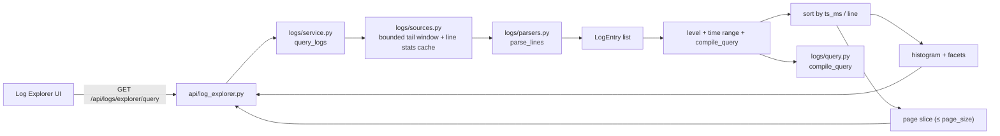

# Log Explorer

> **Purpose.** Server-side exploration of the application log files: filtering,
> pagination, levels, facets, histogram, context and tailing — all computed in
> the API, so the browser never downloads a whole log file.
>
> **Backend:** `codx/junior/logs/{models,parsers,query,sources,service}.py`
> + `codx/junior/api/log_explorer.py` · **REST prefix:** `/api/logs/explorer`
> **Tests:** `api/tests/logs/` (`pytest tests/logs -q`)

---

## 1. Why

The legacy viewer (`client/src/components/LogViewer.vue`) downloaded the whole
file as a `string[]` (`GET /api/system/logs/{name}?log_size=N`) and rendered
every line: with thousands of lines the tab freezes, search only sees what is
already in the DOM, and there are no levels, facets, time ranges, pagination or
context.

The explorer keeps that compatibility surface (`/api/system/logs` is untouched)
and adds a contract designed for large files:

* the API reads a **bounded byte window taken from the END of the file**, never
  the whole file;
* filtering, sorting, aggregation and pagination happen **server-side**;
* the response is capped at `page_size` entries (max 1000, default 100);
* entries carry a stable synthetic id, so detail/context can be re-resolved
  without an index.

---

## 2. Endpoints

All endpoints live under `/api/logs/explorer` and require an authenticated user
(`Depends(get_authenticated_user)`), like the other read-only log endpoints.

| Method & path | Purpose |
|---|---|
| `GET /sources` | List the queryable log files: `{sources: [{id, name, path, size_bytes, mtime, kind, entries_estimate}]}` |
| `GET /query` | Filtered/paged query plus histogram, facets and scan stats |
| `GET /entry/{id}` | One entry with its verbatim `raw` text and parsed fields |
| `GET /context/{id}` | The entries surrounding an entry (`before`, `after`) |
| `GET /tail` | Poll for new content (`since_cursor`, returns the new `cursor`) |

`GET /query` parameters: `source` (repeatable, defaults to the newest file),
`q`, `start`, `end` (epoch seconds/milliseconds or ISO-8601), `level`
(repeatable), `page`, `page_size`, `order` (`desc`|`asc`), `histogram_buckets`.

Response shape (frozen, the UI is built against it):

```json
{
  "entries": [{
    "id": "api.log#1234", "timestamp": "2026-01-02 10:11:12,345", "ts_ms": 1767348672345,
    "level": "error", "logger": "codx.junior.chat", "module": "codx.junior.chat",
    "line": 42, "message": "…", "fields": {}, "continuation_lines": 3,
    "source": "api.log", "raw_preview": "[2026-01-02 10:11:12,345] ERROR [codx.junior.chat:42] …"
  }],
  "total": 512, "page": 1, "page_size": 100, "has_more": true,
  "histogram": [{ "ts_ms": 1767348600000, "total": 37, "by_level": { "error": 4 } }],
  "facets": {
    "level":  [{ "value": "info",  "count": 402 }],
    "logger": [{ "value": "codx.junior.chat", "count": 233 }],
    "module": [{ "value": "codx.junior.chat", "count": 233 }]
  },
  "stats": {
    "scanned_lines": 8123, "scanned_bytes": 524288, "matched": 512,
    "duration_ms": 41.7, "truncated": false
  }
}
```

`truncated = true` means the log is bigger than the scanned window
(`CODX_JUNIOR_LOG_EXPLORER_SCAN_BYTES`, default 8 MiB): the numbers above then
describe the scanned tail, not the whole file.

### 2.1 Request parameters

| Endpoint | Parameter | Type | Default | Meaning |
|---|---|---|---|---|
| `/sources` | — | — | — | No parameters. |
| `/query` | `source` | string, repeatable | newest file | Source id (file name) as returned by `/sources`. |
| `/query` | `q` | string | `""` | Query text, see §3. |
| `/query` | `start` / `end` | string | none | Inclusive range; epoch seconds/milliseconds or ISO-8601. |
| `/query` | `level` | string, repeatable | none | Level filter (`critical`\|`error`\|`warn`\|`info`\|`debug`\|`trace`). |
| `/query` | `page` | int ≥ 1 | `1` | 1-based page number. |
| `/query` | `page_size` | int 1…1000 | `100` | Entries per page (422 above the cap). |
| `/query` | `order` | `desc`\|`asc` | `desc` | Sort order by timestamp. |
| `/query` | `histogram_buckets` | int 1…200 | `24` | Number of histogram buckets. |
| `/entry/{id}` | `source` | string | from the id | Source override when the id lost its `<source>#` part. |
| `/context/{id}` | `source`, `before`, `after` | string, int, int | id, `10`, `10` | Anchored window (each side capped at 500). |
| `/tail` | `source`, `since_cursor` | string, string | newest, none | Poll for new content; send the returned `cursor` back. |

### 2.2 curl examples

```bash
# 1. List the queryable log files (newest first)
curl -s 'http://localhost:19980/api/logs/explorer/sources' \
  -H 'authentication: Bearer <token>'
# -> {"sources":[{"id":"api.log","name":"api.log","path":"/tmp/codx-junior-logs/api.log", ...}]}

# 2. Warnings and errors mentioning "timeout", page 1, 50 entries per page
curl -s -G 'http://localhost:19980/api/logs/explorer/query' \
  -H 'authentication: Bearer <token>' \
  --data-urlencode 'source=api.log' \
  --data-urlencode 'q=timeout' \
  --data-urlencode 'level=warn' \
  --data-urlencode 'level=error' \
  --data-urlencode 'page=1' \
  --data-urlencode 'page_size=50'
```

---

## 3. Query language

Every whitespace-separated term is AND-joined and may be negated with a leading
`-`.

| Term | Meaning |
|---|---|
| `timeout` | case-insensitive substring on the entry raw text |
| `"exact phrase"` | case-insensitive substring, quotes keep the spaces |
| `level=error,warn` | level set membership (levels are normalised) |
| `logger~"chat_.*"` | case-insensitive regex on the logger name |
| `field=value` | exact match on `fields[field]` or a top-level attribute |
| `field~"regex"` | regex match on `fields[field]` or a top-level attribute |
| `-<term>` | negates any of the terms above |

Example: `level=error,warn logger~"codx.junior.(chat|api)" -timeout` finds the
warnings/errors of two modules that do not mention "timeout".

Levels are normalised to `critical | error | warn | info | debug | trace |
unknown` (`FATAL` → `critical`, `WARNING` → `warn`, `EXCEPTION` → `error`, …).

---

## 4. How a query runs



Log files are never loaded whole: `sources.read_tail()` seeks near the end of
the file and reads at most the configured window in 1 MiB chunks. Line counts
(`entries_estimate`) come from a bounded tail sample and are cached per
`(path, size, mtime)`.

Entry ids are `<source>#<line index>`. When only the tail of a very big file is
scanned, the line index is *estimated* from the cached average line length, so
ids stay stable for as long as the file does not change — which is the lifetime
of an id sent back to `/entry` or `/context`.

If an id cannot be resolved any more (the file rotated), the API answers `404`
and the UI simply re-runs the query.

---

## 5. Configuration

| Variable | Default | Meaning |
|---|---|---|
| `CODX_JUNIOR_API_LOGS` | `/tmp/codx-junior-logs` | Folder scanned (same one `/api/system/logs` lists) |
| `CODX_JUNIOR_LOG_EXPLORER_SCAN_BYTES` | `8388608` (8 MiB) | Byte window read per query/tail poll (min 1 KiB) |

Other constants live in `codx/junior/logs/service.py`: `DEFAULT_PAGE_SIZE`
(100), `MAX_PAGE_SIZE` (1000), `FACET_LIMIT` (25), `MAX_TAIL_ENTRIES` (500).

---

## 6. Compatibility

* `/api/system/logs` and `/api/system/logs/{log_name}` are untouched.
* `/api/logs/*` (AI request/response logs, `api/logs.py` +
  `model/logs.py`) is a separate feature and is not modified.
* The router is registered by the dynamic loader in `app.py`
  (`discover_routers()`); `app.py` only logs an error if
  `/api/logs/explorer/*` is missing at startup.
