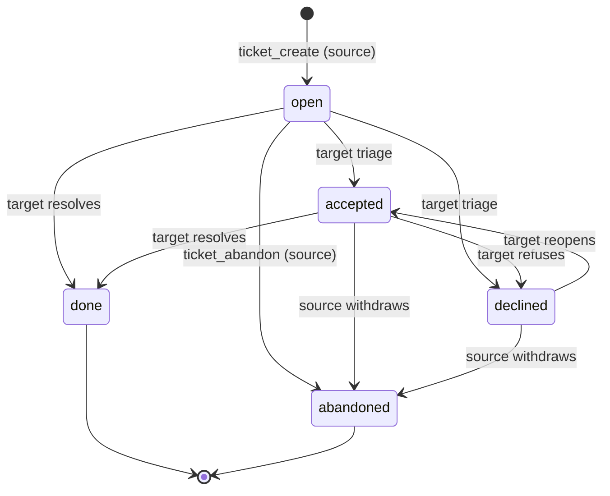

# Cross-project ticketing

A project can **place a ticket** on another project: a request for a bug fix, a
feature or a change that must be implemented in a codebase it does not own.

The reference case is the SaaS platform: while developing `codx-junior-cloud` a
bug is found in `codx-junior`. Instead of editing the other codebase, the
platform places a ticket there, receives an id and keeps using that id to query,
comment on and manage the request. The target project keeps **full control of its
queue**: it reviews the ticket, accepts or declines it, schedules it, assigns
profiles, asks for a human review or implements it right away.

## 1. What a ticket is

A ticket **is a chat** (`Chat` with `mode = "ticket"`), stored by the **target**
project on its `tickets` board:

```
<target-project>/.codx/tasks/tickets/Inbox/<slug>.<ticket-id>.json
```

Because it is a chat, the conversation between the two projects is the protocol:
the requester describes the request, both sides comment, the target answers and
the target's own tooling (boards, profiles, autonomy, orchestration) can process
it like any other card.

The requester keeps a **ledger** with one entry per placed ticket:

```
<source-project>/.codx/tickets/tickets.json
```

The ledger is a fast index (ticket id → target project → last known status); the
ticket chat remains the source of truth and every read refreshes the entry.

## 2. Who may be ticketed

| Relationship | Allowed | Why |
| --- | --- | --- |
| Child project (nested `.codx/project.json`) | ✅ | It lives inside the parent's tree and the parent may already write there |
| Linked project with **read/write** permission (`read_write_project_dependencies`) | ✅ | Placing a ticket writes a chat in the target |
| Linked project with **read-only** permission (`read_project_dependencies`) | ❌ | A read-only link cannot be written |
| The project itself | ❌ | Handle the change directly |

The target is resolved by **name, id or folder name**, and an unknown target
answers with the list of valid ones — the model never guesses.

## 3. Lifecycle



The status lives in **two places that must not be confused**:

* `Chat.status` — the kanban workflow state (`todo`, `doing`, `onhold`, `done`,
  `rejected`), owned by `codx.junior.planning_manager`;
* `Chat.ticket.status` — the ticketing lifecycle (`open`, `accepted`, `declined`,
  `done`, `abandoned`).

The **kanban column is the visible state**: every status maps to a column of the
`tickets` board (`Inbox`, `Accepted`, `Declined`, `Done`, `Abandoned`), so a human
dragging the card to `Accepted` really accepts the ticket — the service
reconciles `Chat.ticket.status` from the column on every read.

## 4. Who decides what

| Action | Source (requester) | Target (queue owner) |
| --- | --- | --- |
| comment | ✅ | ✅ |
| rename / kind / priority | ✅ | ✅ |
| accept / decline / done | ❌ | ✅ |
| abandon (withdraw) | ✅ | ❌ (it declines or closes instead) |

The rule is enforced by `TicketService`, not by the prompt, so an LLM cannot
accept its own request.

## 5. LLM tools

| Tool | Purpose |
| --- | --- |
| `ticket_create(target_project, name, description, kind, priority, reference, profiles, files, tags, assignees)` | Place a ticket and get its id |
| `ticket_update(ticket_id, comment, status, kind, priority, name, profiles, assignees, note)` | Comment and/or move the ticket |
| `ticket_query(ticket_id, direction, status, target_project, limit, include_closed)` | Read one ticket or list the queue of both directions |
| `ticket_abandon(ticket_id, reason)` | Withdraw a ticket this project placed |

`direction` is `outgoing` (placed by this project), `incoming` (placed here) or
`all`.

Example — the platform asks `codx-junior` for a fix:

```
ticket_create(
    target_project="codx-junior",
    name="Login times out after 30s",
    description="## Context\n...\n## Expected\n...\n## Done\n- 2h timeout",
    kind="bug",
    priority="high",
    reference="INC-42",
)
# → ticket_id: c4b9ef9f-c5c2-4f07-b438-0db28ef74711
```

Later:

```
ticket_query(ticket_id="c4b9ef9f-...")        # status: accepted
ticket_update(ticket_id="c4b9ef9f-...", comment="It only happens on 1.4.0")
ticket_abandon(ticket_id="c4b9ef9f-...", reason="fixed in the platform")
```

## 6. HTTP API

| Method | Route | Purpose |
| --- | --- | --- |
| GET | `/api/tickets` | List the tickets of the project (both directions) |
| GET | `/api/tickets/targets` | Projects a ticket can be placed on |
| POST | `/api/tickets` | Place a ticket (returns `ticket_id`) |
| GET | `/api/tickets/{ticket_id}` | Read one ticket |
| POST | `/api/tickets/{ticket_id}/comment` | Append a message to the conversation |
| POST | `/api/tickets/{ticket_id}/status` | Move the ticket (accept / decline / done) |
| POST | `/api/tickets/{ticket_id}/abandon` | Withdraw a placed ticket |
| GET | `/api/tickets/{ticket_id}/ledger` | Raw ledger entry of the requester |

## 7. How a target processes its queue

Nothing special is required: the tickets are on a normal board.

1. Open the `tickets` board of the target project — the `Inbox` column is the
   queue.
2. Move the card to `Accepted` (or call `ticket_update(status="accepted")`), or
   to `Declined` with a comment explaining why.
3. Optionally create a task from the ticket, attach profiles to the card or let
   an autonomous actor own the board.
4. Move the card to `Done` when the change ships: the requester sees it on the
   next `ticket_query`.

## 8. Code map

| Path | Responsibility |
| --- | --- |
| `codx/junior/ticketing/model.py` | `ChatTicket`, `ChatTicketEvent`, `TicketRecord`, lifecycle constants and transitions (pydantic only, so `Chat` can type its field) |
| `codx/junior/ticketing/service.py` | `TicketService`: targets, board bootstrap, ledger, create/update/query/abandon and the ownership rules |
| `codx/junior/ticketing/__init__.py` | Model re-exports (`TicketService` is imported from `.service` to keep imports cycle-free) |
| `codx/junior/tools/ticket_tools.py` | The four LLM tools + their JSON definitions |
| `codx/junior/api/tickets.py` | The HTTP router (auto-discovered under `/api`) |
| `codx/junior/db.py` | `Chat.ticket` field (the ticketing payload of a chat) |
| `tests/test_ticketing.py` | Lifecycle, ownership, board, ledger and tool coverage |

## 9. Invariants

* A ticket id **is** a chat id: one identity, no second lookup table.
* The ticket chat is stored by the **target** (`owner_project_id`), never by the
  requester.
* The target decides `accepted`/`declined`/`done`; the requester only abandons.
* `done` and `abandoned` are terminal: a closed ticket never changes again.
* The column is the visible state; `Chat.ticket.status` mirrors it.
* A ticket never deletes information: abandoning moves the card, it does not
  remove the conversation.

Made with ❤️ by codx-junior
