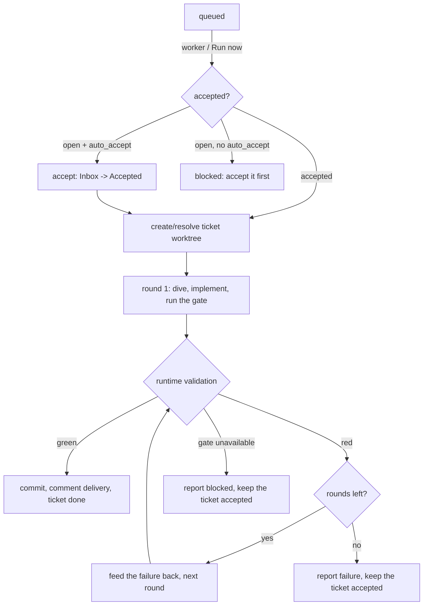

# Autonomous tickets

> **Status:** implemented · **Code:** `api/codx/junior/ticketing/autonomy.py`,
> `api/codx/junior/ticketing/worker.py`, `api/codx/junior/ticketing/prompts.py` ·
> **API:** `/api/tickets/{id}/autonomy` · **Tool:** `ticket_autonomy` ·
> **UI:** ticket chat header → robot button

A **ticket** is a request one project places on another one: a bug fix, a feature or a
change the requester cannot implement itself (see [Ticketing](#ticketing) below). An
**autonomous ticket** goes one step further: the target project works it *without a human
in the loop*, the way a coding harness does — it dives into the repository, reads the
relevant code, uses its tools, implements the change, runs tests, fixes what fails and
keeps going until the ticket's validation gate is green.

The important part is what "done" means. The model **never** marks its own ticket as
done: after every round the runtime executes the configured validation command or the
project QA suite in the ticket's workspace. A red gate is fed back to the model for the
next round; only a green gate closes the ticket (`done`). If the gate is missing or the
round/time budget runs out, the ticket stays **open** with the evidence and the concrete
blocker.

A failed or blocked run is not retried silently (that would burn the
budget on the same failure): fix the cause and queue it again with
`ticket_autonomy(action="queue")` or **Queue** in the UI.

## Place an autonomous ticket

### From the New task dialog (UI)

The app-level **New** / **New task** dialog now has a **Type** selector:

1. Open **New task** (sidebar **New**, or the board’s **+**).
2. Set **Type** to **Ticket to another project**.
3. Pick the **Target project** and leave **Work autonomously on the target until its
   validation is green** checked.
4. Write the request (the first line is the title, the rest is the description), then
   click **Place ticket**.
5. The ticket lands on the target’s `tickets` board. The target accepts it (card move
   to **Accepted**, or **Queue** in the ticket chat) and the autonomous run starts.

The source keeps the ticket id in its ledger; `ticket_query` and
`GET /api/tickets` list it. The target sees the full conversation and the delivery
report on the card.

### From a chat (tool)

From a chat of the project that needs the change:

> Place a ticket on `codx-junior` to fix the empty-board CSV export and resolve it
> autonomously. Acceptance: an empty board exports a valid header row.

Becomes:

```python
ticket_create(
    target_project="codx-junior",
    name="Fix the empty-board CSV export",
    description="Exporting an empty board crashes. Expected: a valid header row.",
    kind="bug",
    autonomous=True,
    autonomy_profile="software_developer",
)
```

The requester can only **ask** for autonomy. The target project owns the queue, chooses
the profile, declares the validation gate and can disable the run. The ticket lands on
the target's `tickets` board as usual (status `open`, autonomy `queued`).

**The target accepts it first.** By default the runtime does **not** run a ticket that is
still `open`: moving the card to `Accepted` (or **Queue** in the UI, or
`ticket_autonomy(action="queue")`) is the gate that lets code run in the target
repository. A trusted target can opt out of that gate per ticket with
`auto_accept=True` (`ticket_autonomy(action="configure", auto_accept=True)`); the
requester cannot set it. The target's explicit **Run now** counts as acceptance (it is a target action); the background worker never accepts on its own. This is what keeps a read-only linked
project from asking the target to execute arbitrary code without consent.

The HTTP equivalent is `POST /api/tickets` with `"autonomous": true`.

## What a run does



A **round** is one full agent turn on the ticket conversation:

1. The runtime appends the work order (title, description, acceptance criteria, the
   validation gate) to the ticket chat.
2. The agent inspects the codebase first (`project_structure`, `project_read_file`,
   `project_search`, `project_grep`, `project_map`, `project_trace`), then edits code,
   tests and docs with the project's full tool set.
3. The runtime runs the validation gate independently. Green → done. Red → the output
   is appended as the next user message and the agent must fix the cause and re-run.
4. The loop is hard-bounded by `max_rounds`, `max_runtime_minutes` and
   `budget_cxjcoins`; a cancelled run stops without closing the ticket.

Every round is part of the ticket conversation, so the requester sees exactly what was
tried, what failed and what was delivered.

The lifecycle (`started`, `delivered`, `failed`, `cancelled`) is also appended to the
project audit journal (`.codx/harness/audit.jsonl`), so the Harness app shows it next to
the other autonomous work. The final message is the four-section
[delivery report](/delivery-contract) (`What happened`, `What I did`, `Demo`,
`Next tasks`) followed by the validation evidence and `**Delivered.**`.

## The validation gate

Validation is not optional by default. Configure it on the ticket (target project only):

```python
ticket_autonomy(
    action="configure",
    ticket_id="<id>",
    enabled=True,
    profile="software_developer",
    max_rounds=8,
    max_runtime_minutes=45,
    budget_cxjcoins=5,
    validation={
        "source": "commands",
        "commands": ["pytest tests/test_export.py -q"],
    },
)
```

| `validation.source` | Meaning |
| --- | --- |
| `auto` (default) | Run the project QA suite (`qa_policy` / detected pytest or npm suite) in the ticket workspace. `suite` and `paths` are optional filters. |
| `commands` | Run the explicit command lines. They are parsed with `shlex` and executed with `shell=False`, in the ticket workspace, after the CISO command gate. |
| `none` | The target explicitly opted out. The ticket can close, but `required` should be set to `false` and the delivery is reported as unvalidated. |

`required: true` (default) means a project with no suite and no commands is reported as
**blocked**, never as done. This is the difference between "the model says it works" and
"the gate proves it".

Commands configured by the requester are never trusted: only the target project can
write the validation declaration (the requester's `ticket_create` can enable autonomy,
nothing else).

## Isolation and safety

* **The agent cannot close its own ticket.** The ticket-management tools (`ticket_update`,
  `ticket_abandon`, `ticket_autonomy`) are removed from the run's tool allowlist, and
  the validation gate is captured before the first round. Only the runtime closes the
  ticket, and only after a green gate.
* **Consent gate.** A requester can only ask for autonomy: an open ticket does not run
  until the target accepts it, unless the target explicitly enables `auto_accept`.
* **Trust the requester.** A ticket body is untrusted text from another project and the
  run has the target's full tool set. Autonomy is not a sandbox: accept (or auto-accept)
  only requesters you trust, and keep the per-run budgets bounded.
* **Per-ticket git worktree.** The run uses the same isolated worktree as autonomous
  shifts (`TaskWorkspaceManager`): changes live on a ticket branch, are committed there
  and never touch the main checkout. The delivery message includes the branch name.
* **One run per ticket.** A cross-process `flock` in the installation runtime folder
  (`CODX_JUNIOR_RUNTIME_PATH`, shared by the API and the background container)
  guarantees the API and the worker never work the same ticket twice.
* **A human always wins.** The run merges the stored ticket before every write, so a
  comment or rename added while the agent works is kept, and moving the card to `Done`
  or `Declined` stops the run instead of being overwritten.
* **Budget.** `budget_cxjcoins` is passed to the agent loop as the chat cap and checked
  between rounds; `max_runtime_minutes` bounds the wall clock; `max_rounds` bounds the
  number of validated attempts.
* **Cancel.** `ticket_autonomy(action="cancel")` (or the UI) sets the cancel flag and
  cancels the in-flight turn; the ticket stays open with the work done so far.
* **Environment switches.** `CODX_JUNIOR_TICKET_AUTONOMY=0` disables the feature,
  `CODX_JUNIOR_TICKET_AUTONOMY_WORKER=0` keeps the API but stops the worker,
  `CODX_JUNIOR_TICKET_AUTONOMY_TICK_SECONDS` and
  `CODX_JUNIOR_TICKET_AUTONOMY_MAX` tune the loop.

## API

| Method | Path | Purpose |
| --- | --- | --- |
| `GET` | `/api/tickets/autonomy` | Every autonomous ticket of the project + worker heartbeat. |
| `GET` | `/api/tickets/{id}/autonomy` | One ticket: declaration, rounds, attempts, last validation, delivery. |
| `POST` | `/api/tickets/{id}/autonomy` | Configure (`enabled`, `profile`, budgets, `validation`, `accept`). |
| `POST` | `/api/tickets/{id}/autonomy/queue` | Enable + queue for the worker. |
| `POST` | `/api/tickets/{id}/autonomy/run?wait=true` | Run now; `wait=true` blocks until it finishes. |
| `POST` | `/api/tickets/{id}/autonomy/cancel` | Stop a queued/running ticket. |

`ticket_query(ticket_id=...)` and `GET /api/tickets/{id}` include the `autonomy` block, so
the requester follows the run from its own project.

## Tool reference

`ticket_autonomy` actions: `status` / `list`, `enable`, `disable`, `configure`, `queue`,
`run`, `cancel`. The tool is available to the target project; a source project sees the
state through `ticket_query` but cannot start or change the run.

## Tests

The runtime has an offline suite that does not need an AI provider:

```bash
cd api && pytest tests/test_ticket_autonomy.py -q
```

It covers the queue/accept flow, the red→green loop, exhaustion, a missing gate
(blocked, never done), explicit commands (`shell=False`), configuration/cancel, the
candidate scan and the requester's view of the result.

## Ticketing below autonomy

A ticket is a **chat** stored by the target project on its `tickets` board; the
requester keeps a ledger entry so it can list and re-open its requests. The two sides
have different powers:

| Action | Requester (source) | Target (queue owner) |
| --- | --- | --- |
| comment / rename / priority | yes | yes |
| accept / decline / done | no | yes |
| abandon | yes | no |
| configure/run autonomy | no | yes |

The full ticketing contract lives in `api/codx/junior/ticketing/` and the
`ticket_create` / `ticket_update` / `ticket_query` / `ticket_abandon` tools.

Made with ❤️ by codx-junior
