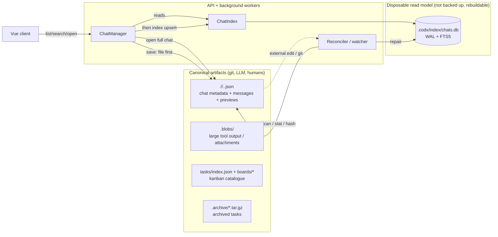

# 03 — Target architecture

> **Implementation:** the core of this design is implemented; see
> [05-implementation.md](05-implementation.md) for the live behaviour, flags and
> remaining items.

> **Core decision:** keep the chat/task JSON files as the canonical, git-tracked,
> LLM-readable source of truth. Add a **per-project, disposable SQLite read
> model** that serves list/filter/sort/search/unread/ACL queries and is updated
> in the same request as the file write. Move per-user state (drafts, read
> position) out of the shared file into that read model. Externalize oversized
> tool output into content-addressed blobs while keeping a short inline preview.



## 1. Principles

1. **Files are truth; the index is a cache.** Delete `chats.db` and everything
   still works after a rebuild. Never store in the DB something that cannot be
   derived from the files (except explicitly user-local state: drafts and read
   position, which are not task content and are not git artifacts).
2. **File first, index second.** A write is: atomic file replace → index
   transaction. If the index transaction fails, the file is still correct; the
   request succeeds and the index is repaired by reconciliation.
3. **All list-style reads hit the index.** No list/search/board/planning/tasks
   code parses chat files. Only "open chat" and explicit exports read the JSON.
4. **Small payloads on the wire.** List responses never carry `tool_events` or
   full messages. A last-message preview (≤ 280 chars) is enough.
5. **Per-user state is per-user.** Drafts and read position are keyed by
   `(chat_id, user)`; ACL is applied at query time.
6. **Every mutation is atomic and serialized.** File writes are per-chat locked;
   index writes are transactions; whole-document saves use an optimistic `rev`.
7. **No new service for the default install.** SQLite is embedded; the pattern
   already exists in `api/codx/junior/atlas/store.py`.

## 2. Storage layout

```
.codx/
  tasks/                              # canonical, git-tracked
    <board>/<column>/<slug>.<id>.json
    .blobs/<sha256>                   # large tool output / attachments (gitignored)
    index.json, boards/<id>/board.json
    .archive/
    .locks/<chat_id>.lock             # per-chat write lock (gitignored)
  index/                              # generated data plane, gitignored
    chats.db                          # SQLite WAL
    chats.db-wal, chats.db-shm
    quarantine/                       # copies of corrupt files (diagnostics)
```

- The index **must live on the same shared volume as `tasks/`**, not on a
  per-process temp path: the API and the background worker (and the two
  containers in some deployments) must see the same database. Add `index` to
  `DATA_PLANE_ENTRIES` (`api/codx/junior/runtime.py:108-132`) and to
  `.gitignore` (both are checked against each other by
  `api/tests/security/ciso_repo_check.py`).
- Every walker must prune `.blobs`, `.locks`, `boards/` and `.archive/`
  (`kanban/model.py:is_store_file` is the reference rule). `.blobs` holds no
  `*.json` files by design, but the rule must be explicit so a future exporter
  cannot turn a blob into a chat.
- **Local filesystem only.** SQLite WAL requires working POSIX advisory locks
  and shared memory. Do not place `chats.db` on NFS/SMB; if the deployment ever
  needs that, use the Postgres option (see [02-options.md](02-options.md)).
- `.blobs` is inside `tasks/` for a simple relative reference, but is
  **gitignored**: tool output is ephemeral agent output, not project knowledge.
  The JSON keeps a preview and a relative `output_ref`; a fresh clone without
  the blob still renders and the LLM can re-run the tool if needed.

## 3. Schema

One database per project. All times are ISO-8601 strings (same format as the
files) so ordering and range filters match the existing API. JSON arrays are
stored as JSON text and read with `json_each` when needed.

**Normalize timestamps on import/write.** The files contain two historical
formats: `str(datetime.now())` ("2026-01-01 10:00:00") and
`datetime.isoformat()` ("2026-01-01T10:00:00"). The index stores ONE normalized
ISO-8601 form (UTC, `T` separator) so string ordering and range comparisons are
correct; the files keep their original format until a natural save. This is the
same class of bug as `_parse_timestamp` in `chat_manager.py:373-405`, fixed once
at the boundary.

```sql
PRAGMA journal_mode = WAL;
PRAGMA synchronous = NORMAL;      -- index is rebuildable; files are truth
PRAGMA busy_timeout = 5000;
PRAGMA temp_store = MEMORY;
PRAGMA foreign_keys = ON;

-- Schema/build metadata -----------------------------------------------------
CREATE TABLE meta (
  key   TEXT PRIMARY KEY,
  value TEXT NOT NULL
);
-- schema_version, project_id, build_id, built_at, source (build|write|reconcile),
-- last_reconcile_at, last_full_build_at, sqlite_version, app_version

-- One row per chat: the projection the UI actually consumes ----------------
CREATE TABLE chats (
  id                    TEXT PRIMARY KEY,
  doc_id                TEXT,
  rev                   INTEGER NOT NULL DEFAULT 1,
  path                  TEXT NOT NULL,          -- relative to <codx>/tasks
  sig                   TEXT,                   -- "mtime_ns:size" (hint only)
  content_hash          TEXT,                   -- sha1 of canonical JSON
  name                  TEXT NOT NULL DEFAULT '',
  description           TEXT NOT NULL DEFAULT '',
  board                 TEXT, board_folder      TEXT,
  column_name           TEXT, column_folder     TEXT,
  status                TEXT, mode              TEXT,
  parent_id             TEXT, root_id           TEXT,
  project_id            TEXT,                   -- target project
  owner_project_id      TEXT,                   -- project that stores the file
  created_at            TEXT, updated_at        TEXT,
  last_activity_at      TEXT,
  chat_index            INTEGER, sort_index     INTEGER,
  pinned                INTEGER NOT NULL DEFAULT 0,
  is_template           INTEGER NOT NULL DEFAULT 0,
  priority              TEXT, due_date          TEXT,
  wake_at               TEXT,
  scheduled_start       TEXT, scheduled_end      TEXT, all_day INTEGER,
  calendar_ids          TEXT,
  progress              INTEGER,
  tags                  TEXT, profiles          TEXT,
  users                 TEXT, assignees         TEXT,
  sprints               TEXT, file_list         TEXT,
  cost                  REAL NOT NULL DEFAULT 0,
  estimation_cost       REAL,
  run_id                TEXT, run_status        TEXT,
  harness               TEXT, harness_status    TEXT,
  harness_instance_id   TEXT, harness_task_id   TEXT,
  external_source       TEXT, external_status   TEXT,
  archived              INTEGER NOT NULL DEFAULT 0,
  archived_at           TEXT, archived_by        TEXT,
  message_count         INTEGER NOT NULL DEFAULT 0,
  pending_count         INTEGER NOT NULL DEFAULT 0,
  last_message_at       TEXT, last_role          TEXT,
  last_user             TEXT, last_content       TEXT,   -- ≤ 280 chars
  last_done             INTEGER, last_error      TEXT,
  cover_image           TEXT,                           -- precomputed first image
  parse_error           TEXT,                           -- corrupt file diagnostic
  indexed_at            REAL NOT NULL
);

CREATE INDEX chats_updated   ON chats(updated_at DESC);
CREATE INDEX chats_activity  ON chats(last_activity_at DESC);
CREATE INDEX chats_board     ON chats(board, column_name, sort_index, updated_at DESC);
CREATE INDEX chats_status    ON chats(status, updated_at DESC);
CREATE INDEX chats_parent    ON chats(parent_id);
CREATE INDEX chats_root      ON chats(root_id);
CREATE INDEX chats_owner     ON chats(owner_project_id, updated_at DESC);
CREATE INDEX chats_archived  ON chats(archived, updated_at DESC);
CREATE INDEX chats_due       ON chats(due_date) WHERE archived = 0;

-- Per-message metadata (no tool_events, no attachments, no huge content) ---
CREATE TABLE messages (
  chat_id       TEXT NOT NULL REFERENCES chats(id) ON DELETE CASCADE,
  doc_id        TEXT NOT NULL,
  seq           INTEGER NOT NULL,               -- insertion order in the chat
  role          TEXT NOT NULL,
  user          TEXT,
  profiles      TEXT,                           -- JSON array (message profiles)
  created_at    TEXT, updated_at TEXT,
  preview       TEXT,                           -- first 280 chars, cards
  content_hash  TEXT,                           -- skip FTS re-index when equal
  hide          INTEGER NOT NULL DEFAULT 0,
  unsent        INTEGER NOT NULL DEFAULT 0,     -- legacy drafts (migrated)
  done          INTEGER NOT NULL DEFAULT 1,
  error         TEXT,
  cost          REAL,
  PRIMARY KEY (chat_id, doc_id)
);
CREATE INDEX messages_seq      ON messages(chat_id, seq);
CREATE INDEX messages_unread   ON messages(chat_id, role, done, hide, seq);

-- Per-user read position (replaces the read_by array) ----------------------
CREATE TABLE chat_reads (
  chat_id       TEXT NOT NULL,
  user          TEXT NOT NULL,
  last_read_seq INTEGER NOT NULL DEFAULT 0,
  last_read_at  TEXT,
  PRIMARY KEY (chat_id, user)
);
CREATE INDEX chat_reads_user ON chat_reads(user, chat_id);

-- Per-user drafts (replaces the single unsent slot in the chat file) -------
CREATE TABLE drafts (
  chat_id     TEXT NOT NULL,
  user        TEXT NOT NULL,
  doc_id      TEXT,
  content     TEXT,
  updated_at  TEXT,
  PRIMARY KEY (chat_id, user)
);

-- Who participates in a chat (created/first user, assignees, profiles) ------
CREATE TABLE participants (
  chat_id TEXT NOT NULL,
  user    TEXT NOT NULL,
  kind    TEXT NOT NULL,          -- creator|assignee|profile|participant
  PRIMARY KEY (chat_id, user, kind)
);
CREATE INDEX participants_user ON participants(user, chat_id);

-- Search: contentless FTS + id map + per-row validity ----------------------
CREATE TABLE search_docs (
  rid      INTEGER PRIMARY KEY AUTOINCREMENT,
  chat_id  TEXT NOT NULL,
  doc_id   TEXT,                  -- NULL for chat-level fields
  field    TEXT NOT NULL,         -- name|description|history|file_list|content|think
  valid    INTEGER NOT NULL DEFAULT 1,  -- 0 = superseded version
  updated_at TEXT
);
CREATE INDEX search_docs_chat ON search_docs(chat_id, valid);
CREATE INDEX search_docs_doc  ON search_docs(doc_id, valid);

CREATE VIRTUAL TABLE search_fts USING fts5(
  text,
  content = '',                   -- contentless: no duplicate of 122 MB of text
  tokenize = 'unicode61 remove_diacritics 2'
);
```

### 3.1 Why contentless FTS, and how updates work

Contentless FTS stores tokens, not the original text: **30.8 MB** for 9,533
messages vs **150 MB** for external-content FTS. The original text stays in the
files and in `messages.preview` (for cards).

SQLite's contentless FTS cannot delete individual rows on every version
(`contentless_delete=1` requires SQLite ≥ 3.43 and is not guaranteed in the
deployed image). Instead:

- Every search row has `valid`. On a content change, the old rows for that
  `(chat_id, doc_id, field)` are set to `valid = 0` and the new version is
  inserted into `search_docs` + `search_fts`; search filters `valid = 1`, so
  superseded versions are invisible.
- **Assistant messages are indexed when finalized** (`done = true` / turn end),
  at most once per throttle window — never on every streamed token, never for
  `tool_events`. User messages are indexed immediately.
- Old rows are compacted by a background **FTS rebuild** (full project, ~4 s at
  2k, ~20 s at 10k) when dead rows exceed a threshold (e.g. 30 %) or nightly.
  Compaction rebuilds the FTS tables in one write transaction (readers keep their snapshot; writers wait during the rebuild).
- `search_index_mode` per project:
  - `metadata` — no message FTS; only name/description/last message. Matches
    today's *actual* search behaviour, 3.9 MB.
  - `contentless` — full history, 30.8 MB, no server-side snippet (returns the
    matched message `preview`). **Default.**
  - `full` — external-content FTS over a `messages_search(content, think)`
    table; 150 MB, supports `snippet()`/`highlight()`. Opt-in for projects that
    want highlighted excerpts and have disk budget.

## 4. Projection contract (what a list row contains)

The client audit established the exact fields consumed by cards, boards, task
tables, planning and search. One row serves them all:

**Required:** `id, doc_id, name, description, mode, status, board, column,
parent_id, project_id, owner_project_id, created_at, updated_at,
last_activity_at, pinned, sort_index, is_template, tags[], file_list[],
profiles[], users[], assignees[], sprints[], cost, estimation_cost, priority,
due_date, wake_at, harness*, run_id, run_status, message_count, pending_count,
process_state, process_error` **plus precomputed** `last_message {role, user,
content ≤ 280, created_at, updated_at, done, error, read_by}`,
`unread_count`, `cover_image`.

**Never needed by a list:** `messages[]`, `status_history`, `check_lists`,
`columns`, `history`, `linked_chat_ids`, `meta_data`, `harness_metadata`,
`harness_usage`, `knowledge_topics`, `chat_links`, `file_path`, tool events,
attachments.

Backward compatibility: `GET /api/chats` keeps returning a **bare array** of
Chat objects; each carries a **slim last message** (`messages: [ {doc_id, role,
user, content≤280, created_at, updated_at, done, error, read_by} ]`) so current
components keep working, plus the new `last_message` / `message_count` /
`unread_count` / `process_state` / `cover_image` fields. Full messages are only
returned by `GET /api/chats?id=`.

## 5. Read flows

### 5.1 List / recent / board / task table / planning / calendar

```sql
-- 1. page of rows (uses chats_updated / chats_board)
SELECT * FROM chats
WHERE archived = 0 AND updated_at >= :from AND updated_at <= :to
ORDER BY updated_at DESC
LIMIT :limit OFFSET :offset;

-- 2. unread + draft presence for the returned ids only (one grouped query)
SELECT m.chat_id,
       SUM(CASE WHEN m.role = 'assistant' AND m.done = 1 AND m.hide = 0
                 AND m.seq > COALESCE(r.last_read_seq, 0) THEN 1 ELSE 0 END) AS unread
FROM messages m
LEFT JOIN chat_reads r ON r.chat_id = m.chat_id AND r.user = :user
WHERE m.chat_id IN (:ids)
GROUP BY m.chat_id;
```

Build the `Chat` objects from rows with `Chat.model_construct` (or
`model_validate` on a slim dict) — never parse a chat file. Filters
(board/column/status/user/type/archived/date) and sorting are SQL; pagination is
`LIMIT/OFFSET`. Measured: 0.09 ms for 50 rows, 0.24 ms for a 200-row board,
0.26 ms for a 30-day filter — vs 2.7–5 s today.

`GET /api/chats/recent` and `/api/tasks` use the same rows; `GET /api/tasks`
keeps its `GlobalTask` model and metrics, computed from SQL aggregates.

### 5.2 Search

```sql
WITH hits AS (
  SELECT sd.chat_id, sd.doc_id, sd.field, bm25(search_fts) AS rank,
         c.updated_at
  FROM search_fts f
  JOIN search_docs sd ON sd.rid = f.rowid
  JOIN chats c       ON c.id = sd.chat_id AND c.archived = 0
  WHERE search_fts MATCH :match
    AND sd.valid = 1
    AND sd.field IN (:allowed_fields)     -- SearchFilters
    AND c.updated_at BETWEEN :from AND :to
)
SELECT chat_id,
       group_concat(DISTINCT field) AS matched_fields,
       min(rank) AS best_rank,
       count(*) AS hit_count,
       max(updated_at) AS updated_at
FROM hits
GROUP BY chat_id
ORDER BY best_rank ASC, updated_at DESC      -- + field weights
LIMIT :limit OFFSET :offset;
```

- **Query semantics:** tokenized `unicode61`, AND of terms, prefix match on the
  last term (`kanb*`), quoted phrases supported. This intentionally replaces
  the accidental substring `in` search (`chat_searcher.py`); if exact substring
  is required, add a `trigram` FTS table for names/descriptions (test its size
  first) or a `LIKE` fallback for queries shorter than 3 characters.
- **Field weights:** `name 3.0, description 2.0, content 2.5, think 1.5,
  history 2.0, file_list 1.0` — same intent as `ChatSearcher.FIELD_WEIGHTS`.
  `relevance_score` is normalized to 0–100 for the API.
- **Filters:** `SearchFilters` flags map to `search_docs.field` (today the API
  reads them and drops them — `api/chat.py:1767`).
- **Time range:** use `updated_at` (business time), not file mtime; document
  the semantic change.
- **Snippet:** contentless mode returns the matched message `preview`; full mode
  returns `snippet(search_fts, ...)`. The client already reads `result.snippet`
  (`RecentChatsQuickAccess.vue:170`) and currently never receives it.
- **Pagination / total:** `LIMIT/OFFSET` + a count query; both are < 10 ms at
  this scale.

Cross-project search: resolve the authenticated user's accessible projects
server-side, query each project's DB (each query < 10 ms), merge by score/time,
then paginate the merged list. Alternatively `ATTACH` up to 10 DBs and use one
`UNION ALL`; the per-project loop is simpler and keeps ACLs explicit.

### 5.3 Open a chat

`GET /api/chats?id=` still loads the file (full fidelity), using the O(1) path
from the index. No tree scan, no list parse. For a 13.4 MB task: ~45 ms JSON +
pydantic validation (est. 50–150 ms); acceptable because it happens once, on
open. Future (O4): lazy-load `messages`/`tool_events`.

### 5.4 Id lookups

`find_by_id` / `find_chat_path` become `SELECT path FROM chats WHERE id = ?`
(< 1 ms), falling back to a scan only when the id is unknown to the index
(e.g. a file just created by `git` before reconciliation).

## 6. Write flows

### 6.1 `save_chat` (whole document)

```
acquire per-chat lock  →  load stored metadata/rev (index or file fallback)
  →  merge (messages by doc_id + updated_at; metadata field-wise)
  →  write file atomically (tmp + fsync + os.replace)
  →  BEGIN IMMEDIATE; upsert chats row (rev+1, projection, last_*, counts)
     diff messages by doc_id/content_hash
     upsert/delete messages rows
     index finalized changed messages in FTS (gen)
     upsert participants
     COMMIT
  →  emit event with per-project seq
```

If the file write fails: nothing changes, return the error. If the index
transaction fails: the file is truth; log, mark the index unhealthy, fall back
to file reads for that project, and let reconciliation repair it. A retry is
safe because upserts are idempotent (`content_hash`/`rev`).

### 6.2 `add_message` / `update_message` (per event)

- Acquire the per-chat lock (short, no AI call inside).
- Reload only what is needed: for `add`, the message is appended; for `update`,
  patch the one `doc_id`. Do not parse the whole file if the in-memory chat is
  authoritative; still write the file (truth) unless the write-behind flag is
  enabled (Phase 3).
- Index: one `messages` upsert, one `chats` aggregate update
  (`message_count`, `pending_count`, `last_*`, `cost`), one FTS row when the
  message is finalized. **No tree scan, no full re-index.**
- Target: < 5 ms index overhead; total write with a ≤ 1 MB file < 80 ms.

### 6.3 Metadata patch

`POST /api/chats/metadata` and all internal `update_chat_metadata` calls become
field-level patches: update only the supplied columns + `rev`, and rewrite the
file once. (Better: a JSON patch merge into the existing file, avoiding
serialization of `messages`; Phase 2.) This removes the "change priority →
rewrite 14 MB" behaviour.

### 6.4 Read receipts and drafts

- `mark_seen` → `INSERT ... ON CONFLICT(chat_id,user) DO UPDATE SET
  last_read_seq = max(last_read_seq, excluded.last_read_seq)`. **No file write.**
- `PUT /chats/draft` → one `drafts` row keyed by `(chat_id, user)`. **No chat
  file write.** Sending consumes (deletes) only the caller's draft.
- Legacy `read_by` arrays and `unsent` messages are imported on rebuild: the
  maximum read seq per user becomes the cursor; unsent messages become drafts
  keyed by their `user` (or a shared key when empty). Files are not rewritten
  just to migrate; the fields become legacy on the next natural save.

### 6.5 Delete / archive / restore

- Delete: write a tombstone (`chats.deleted_at`, `rev`) in the index and remove
  the file; in-flight writers must check the tombstone and refuse to recreate.
- Archive: move the payload into `.archive` **first**, update the archive
  catalogue, then remove the live file; the index row is marked
  `archived=1`. Restore is the reverse. No live writer may resurrect an archived
  task (check `archived` under the per-chat lock).
- Cost roll-up: `UPDATE chats SET cost = cost + :delta WHERE id = :root_id`
  (atomic), then materialize the root file (small after blob externalization);
  the current project-wide `.cost-rollup.lock` is removed.
- **On rebuild**, archived tasks are imported from `.archive/index.json` as
  metadata-only rows (`archived=1`, `path` empty or the archive payload path);
  the `.tar.gz` is never decompressed to build the index. Restore is the only
  operation that materializes the live file again.

## 7. Consistency, reconciliation and rebuild

### 7.1 Write-through, read-after-write

- The file is written before the index row; both are synchronous within the
  request, so a subsequent read sees the new state.
- If the index update fails, the request still succeeds; the index is marked
  unhealthy for that project and reads use the file fallback until reconciled.
- Events are emitted **after** the commit, with a per-project monotonic `seq`
  (`meta` or a dedicated `events` table). Clients ignore older `seq`; this fixes
  the current "two relays, no ordering" problem (`sio/session_channel.py`).

### 7.2 Reconciliation

| Trigger | Action |
|---|---|
| **Startup** | If DB missing / schema mismatch → full rebuild in a daemon thread (serve a file fallback meanwhile). If present → quick `scandir` + stat diff; reindex changed/deleted/added paths. |
| **Local write** | Write-through (no reconcile needed). |
| **Watcher** (`watchfiles`, already a dependency) | Debounce 500 ms; batch changed paths under `tasks/**` (including `.blobs` references); reindex/delete. |
| **Periodic** (60 s) | Compare directory inventory to `chats.path/sig`; reindex changed, mark missing as deleted, adopt unknown files. 0.2–0.5 s per 2k. |
| **Git** | `git checkout/pull` changes mtimes/content; the periodic/watcher path detects it. If `mtime` equals stored (rare), `content_hash` catches it. Never delete a file merely because the index does not know it. |
| **Manual** | Admin endpoint + CLI `chats index rebuild [--project]`; progress events; full rebuild into `chats.db.rebuild` then atomic `os.replace`. |

Rebuild is deterministic: same files → same rows. A rebuild uses
`PRAGMA synchronous=OFF` in one transaction for speed (the index is disposable),
then switches back to `NORMAL`.

### 7.3 Bad data policy

| Case | Policy |
|---|---|
| Corrupt JSON with a valid prefix (the 2 known files) | `raw_decode` the prefix, import it, set `parse_error`, copy the raw file to `index/quarantine/`, log. Never silently drop. |
| Duplicate chat IDs (5 known) | Deterministic winner: keep the row whose `path` is already recorded; otherwise newest `updated_at`, tie-break by path. Record losers in `meta`/log; provide a repair command to move/rename. |
| Chat file with no `id` | Derive from the filename suffix (`<slug>.<uuid>.json`) when valid; else quarantine and log. |
| Dot-prefixed / empty-slug files | Included (scandir, never shell globs). |
| Archived task | `archived=1`, no live file; excluded unless requested. |
| Stale `file_path` inside JSON | Ignore it; the index path is authoritative. |
| `owner_project_id` vs `project_id` | Shard by owner; return both; a project move is one operation that updates `path`, `owner_project_id` and references. |

## 8. Multi-user and ACL

### 8.1 What moves out of the shared file

| Data | Today | Target |
|---|---|---|
| Draft (`unsent`) | one slot per chat, no owner | `drafts(chat_id, user)` |
| Read state (`read_by`) | username list per message | `chat_reads(chat_id, user, last_read_seq)` |
| Unread count | computed per request from all messages | one grouped SQL query for the returned page |
| Typing/presence | socket state | unchanged (ephemeral) |
| Task content | shared, correct | shared, correct |

`read_by`/`unsent` remain readable from old files for compatibility, but are no
longer written. This removes the "read receipt rewrites a 14 MB file" and
"two users share one draft" problems.

### 8.2 Concurrency control

- **Per-chat `flock`** (`tasks/.locks/<chat_id>.lock`, timeout 5 s) around
  load → merge → file write → index commit. Never hold it across an AI call.
- **Optimistic `rev`** on every row. Whole-document clients (`PUT /api/chats`,
  `POST /api/chats`) send the `rev` they read; on mismatch the server merges
  metadata field-by-field/messages by `doc_id` and rejects only genuine
  conflicts (or returns 409 with the current `rev`).
- **Atomic aggregates:** `cost = cost + ?`, counts recomputed in the same
  transaction; no read-modify-write of the root chat for a cost update.
- **Tombstones** for deleted/archived ids so in-flight writers cannot
  resurrect them.

### 8.3 ACL

- The index is **per owner project**; opening it means the caller may read that
  project. Cross-project search resolves `find_all_user_projects(user)` on the
  server and queries only those DBs.
- Client-supplied `project_ids` are **intersected** with the ACL, never trusted
  (`chat_manager.py:826-833` today trusts them).
- `request.state.user` must be populated by the auth layer; today it is never
  assigned, so the permission branch is dead. This is a prerequisite for
  multi-user correctness, independent of the index.
- Returned rows carry `owner_project_id` and `project_id`; the UI needs both
  (project chip and load scope).
- Never put `CodxUser`, tokens, or `USERS` payloads in the index.

### 8.4 Socket.IO

The socket layer currently broadcasts without rooms (`sio/sio.py`,
`session_channel.py`): another user's message and `read_by` can reach clients
that should not see it. With per-user state in the DB, emit targeted events
(`room = project/user/chat`) and a **summary delta** (the projection row) so
list-only consumers patch one row instead of refetching everything. This is
required before raising `WEB_CONCURRENCY` above 1 (the current Socket.IO server
has no shared client manager).

## 9. LLM-friendly payloads: externalize, don't hide

Today a tool event stores its full user-facing output **untruncated**
(`chat_event_bridge.py:347-377`), producing 173.6 MB (44 %) of the store and a
14 MB task. The output is valuable but does not belong in the hot document.

**Blob reference format** (backward compatible — extra fields are ignored by
old readers):

```json
{
  "tool": "bash",
  "status": "done",
  "output": "first 2,000 characters…",
  "output_ref": ".blobs/ab/abcdef…",
  "output_bytes": 8417354,
  "output_sha256": "abcdef…",
  "output_truncated": true
}
```

- Blobs are plain text/bytes files under `tasks/.blobs/<sha256>` (content
  addressed, deduplicated, atomic write). The JSON keeps a readable preview.
- Thresholds are settings: `max_inline_tool_output_bytes` (default 16–32 KB),
  `max_inline_message_content_bytes` (default 256 KB),
  `max_inline_attachment_bytes` (default 64 KB).
- Attachments with `base64_data` move to blobs too (13.3 MB today).
- Git: `.blobs` is gitignored; the task JSON remains the reviewable artifact.
  A clone without the blob loses the old tool output but not the task, its
  metadata or its conversation; the LLM can re-run the tool. Document this in
  the task file docs.
- The blob GC removes unreferenced blobs on rebuild/nightly.

This alone cuts the store from 392 MB to roughly **200 MB**, removes the 14 MB
worst case, and makes a full-file rewrite ~25–50 ms instead of 1.5 s — before
any async/write-behind machinery. **It is the highest-value single change
alongside the index.**

## 10. API contract to preserve

| Endpoint | Contract |
|---|---|
| `GET /api/chats` | **bare array** (not an envelope); each Chat keeps its fields + slim `messages:[last]`; add `last_message`, `message_count`, `unread_count`, `process_state`, `process_error`, `cover_image`. Default 30-day window unchanged. |
| `GET /api/chats/recent` | `{chats, total, page, page_size, total_pages, has_next, has_prev}`; fix `user_id` (currently crashes) and pass `unread_for` from the session. |
| `POST /api/chats/search` | `{results, total, page, page_size, total_pages, has_next, has_prev}`; both result shapes (`[Chat]` for empty query, `[{chat, relevance_score, matched_fields}]` otherwise); add real `snippet`. |
| `GET /api/chats?id=` | full Chat with all messages; unchanged (except no tree scan and no write on read). |
| `POST/PUT /api/chats/message` | keep the whole-chat response for compatibility; optionally add `?response=delta` returning only the changed message + summary. |
| `POST /api/chats/metadata` | field patch; returns the Chat. |
| `GET/PUT/DELETE /api/chats/draft` | same payload; now per-user and DB-only. |
| `PUT mark-seen` | same response; cursor update, no file write. |
| `GET /api/tasks`, `/api/kanban`, planning, calendar, metrics | same shapes; data from the index. |
| `page_size` caps | 100 (`/chats*`), 25/100 (`/tasks`), 40/100 (kanban search) — do not change. |
| Ordering | `updated_at DESC` for lists; board columns `sort_index`/`pinned`/`updated_at`; keep stable tie-breakers. |

Security fixes that ship with the index: restrict `GET /chats?file_path=` to the
tasks tree; remove the duplicate `mark-seen` route; populate
`request.state.user`; enforce ACL on `project_ids`.

## 11. Failure modes

| Failure | Behaviour |
|---|---|
| Index missing | Start a background rebuild; list/search use the file fallback (slow but correct) until ready. |
| Index corrupt / schema mismatch | Same; old DB kept aside for diagnostics; rebuild into a shadow DB and swap. |
| Index stale (crash between file and index) | Reconciler stat/hash-diffs the file; repair. Reads may be stale for ≤ 60 s (watcher usually 5 s). |
| Index write error | File write stands; project marked degraded; file fallback; retry/reconcile. |
| SQLite busy/locked | `busy_timeout=5000` + retry; on persistent failure, degrade to file reads. |
| Disk full | File write fails first (truth is safe); index may lag; health endpoint reports. |
| NFS / unsupported FS | Detect at startup (or via setting) and disable the index; document Postgres for multi-host. |
| Rebuild interrupted | Shadow DB discarded; old DB still serves; retry. |
| Duplicate ids / corrupt files | Deterministic winner + quarantine + health warning; no silent data loss. |
| Cross-process cache | No shared in-memory cache is required; each process reads the DB (WAL). In-process caches must be keyed by `rev`/hash and are optional. |

## 12. Observability

- `GET /api/chats/index/health` (admin): schema version, chats/messages/FTS
  rows, DB size, parse errors, duplicates, last reconcile, last rebuild,
  rebuild duration, stale count.
- Metrics: list/search/save latency (p50/p95), index hit/miss, file-fallback
  count, reconcile duration, rebuild count, FTS dead-row ratio, per-project DB
  size.
- Logs: project id, chat id, index action (`build|upsert|delete|reconcile`),
  duration, parse errors. Never log message content.
- A CI performance gate on a synthetic corpus (see
  [04-roadmap.md](04-roadmap.md)) so regressions are caught before users feel
  them.

## 13. Deliberately out of scope (for now)

- Replacing files with a database, or making the DB authoritative.
- Splitting every chat into a directory of message files (O4) — only if write
  latency remains a problem after blobs.
- Semantic/vector search in the core — optional layer on top of O3.
- Multiple uvicorn workers — requires a shared Socket.IO manager first.
- Postgres/multi-host — only when the deployment demands it.
