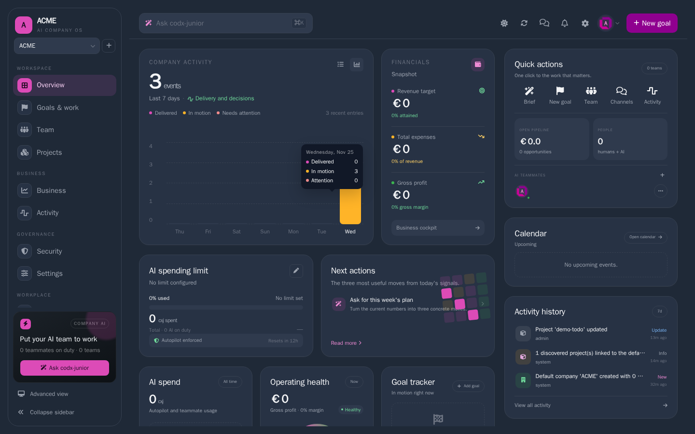
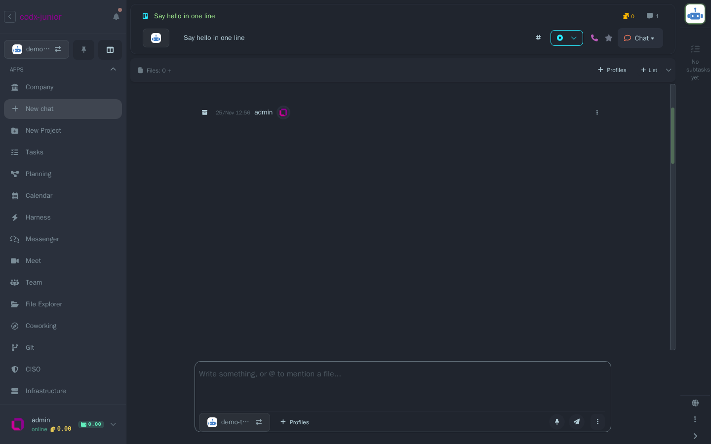
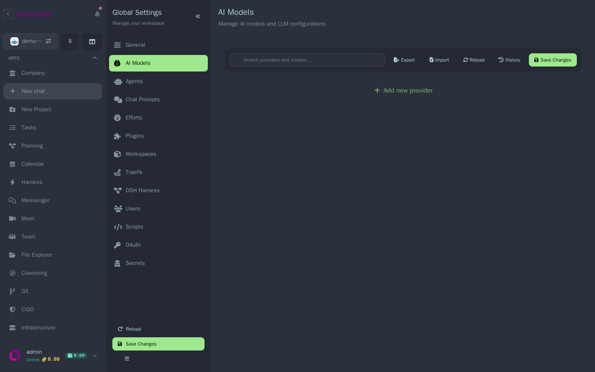
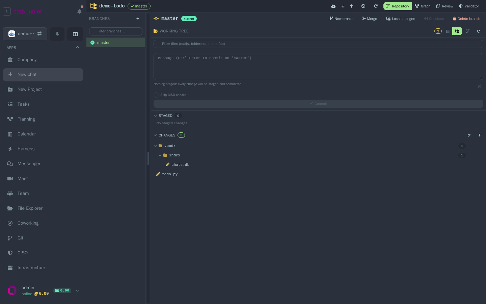

# codx-junior 0.0.1 — release definition & feature matrix

**Role:** Product Manager · **Status:** proposal for the first public release
**Basis:** fresh local install (`ph001`, image `codxjuniorai/codx-junior:latest`, built 2026-11-25T10:08Z), used as a new user through the browser (Playwright), the REST API and a test repository; source review of repository HEAD `798515b` (2026-11-25T10:59Z).
**Machine-readable data:** [`features-0.0.1.json`](features-0.0.1.json) · [`v0.0.1-feature-matrix.csv`](v0.0.1-feature-matrix.csv)

---

## 1. What 0.0.1 is

> **codx-junior 0.0.1 — the AI developer that works in your repository.**

Install it on a machine you own, connect an OpenAI-compatible model, point it at a Git
repository, and talk to an agent that reads the code, edits files, runs the tests and shows
you the diff before you commit. That is the product. Everything else is optional and hidden.

**Target user for the launch:** a developer or a small team who already has a model key and
wants an AI teammate on their own hardware. They judge the release in the first ten minutes,
on one repository, with one real change.

**The one loop 0.0.1 must nail:**

```
install → connect model → add repo → chat → agent changes files → run tests
        → review diff → commit → (optionally) track the work on a board
```

**What 0.0.1 is not** (and must not look like):

* not a company operating system (business KPIs, org units, journal, company files);
* not an autonomous AI workforce (actors on shifts, unattended tickets);
* not a collaboration suite (teams, channels, meetings, calendar, voice);
* not a browser/desktop hosting product (workspaces, co-browsing, computers, infra panel);
* not a plugin marketplace or an integration catalog (plugins, MCP, Slack/WhatsApp).

Those features stay in the tree, behind the install-time feature list described in §5.
Keeping the code is deliberate: we want to keep developing them without shipping them.

### Launch story (for the ProductHunt post)

**Tagline:** *Your repo. Your model. Your AI developer.*

**Three bullets:** one command on your own machine · an agent that reads, edits and tests your
code · every change shown as a diff before you commit.

**First comment:** what is deliberately not in 0.0.1 (company OS, autonomous workforce,
meetings, browser desktops) and that it is still in the codebase behind the feature list, so
the roadmap is visible without bloating the first release.

### Why this cut

The product currently exposes 13 company sections, 60+ client routes, 527 documented API
paths and 25 API tags. A new user cannot tell what the product is for. A 0.0.1 that ships
17 focused features and hides the other 32 is a sharper promise than a 0.0.1 that ships
everything at 70% quality.

### Success criteria

1. A new user reaches a first AI answer in **under 10 minutes** from the install command.
2. A first reviewed commit happens in **under 15 minutes**, without reading the docs.
3. **Zero 5xx** responses on the core routes in §3.1 on a fresh install.
4. The 5-minute demo in §6 is reproducible on a clean VM by someone who has not seen the product.
5. A `core` install shows **no hidden navigation item, route or API** (see §5).
6. The release image is built from the release tag and `/api/health` reports that commit.

---

## 2. How to read the matrix

**Dev score (1–10)** — how useful the feature is *to a developer using codx-junior*, not how
hard it is to build:

| Score | Meaning |
| :---: | --- |
| 10 | Without it there is no product; the core loop stops. |
| 7–9 | Strong, release-defining value; must be reliable if shipped. |
| 4–6 | Useful for a team or an advanced workflow; not needed to prove the promise. |
| 1–3 | Niche, experimental, or a different product line. |

**Hide in 0.0.1** — `No` means it is part of the install-time `core` feature set. `Yes` means
the code stays but the installer hides it: no nav entry, no route, no API surface. The reason
is in the cell.

**Fix needed (how)** — the change required before the row can honestly be called "shipped".
`P0` blocks the release; `P1` blocks the feature; `P2` is a known defect to schedule.
`Not in 0.0.1` means no work is needed for this release; the note says what would be needed
before enabling it later. In the JSON manifest, `status` records how the row was assessed:
`verified` (exercised on the fresh instance), `source` (reviewed in code/routes only) or
`not-tested` (needs a model/provider to evaluate).

---

## 3. Feature matrix

### 3.1 Shipping in 0.0.1 (17 features)

**Get started**

| Feature | Description | Dev score | Hide in 0.0.1 | Fix needed (how) |
| --- | --- | :---: | --- | --- |
| **Installer & lifecycle** `install` | One command installs, configures, starts, updates and reports the single-container instance (provider, port, projects folder, data dir). | 10 | No — ships | P0: `--admin-user/--admin-password` are written to the env file but ignored by the running image; a placeholder `admin` is created and the first password typed claims it. Honour the installer account, or generate a one-time setup token, then test the exact install command. Also make the release build use the release tag instead of a stale `latest`. |
| **Project import & switching** `projects` | Import an existing folder or clone a Git repository, configure its settings, switch the active project and keep its knowledge fresh. | 10 | No — ships | P0/P1: a project created through `POST /api/projects` is absent from `GET /api/projects` until the container restarts (discovery cache is not invalidated). Invalidate the snapshot or force a rescan after create/clone. Write `.codx/` into `.git/info/exclude` on project creation: the first commit currently includes `.codx/db`, chat turns and locks. Create an initial commit and configure the Git identity. |
| **First-run workspace wizard** `onboarding` | Guided core first run: add a project, connect an OpenAI-compatible model or skip, setup assistant with preconfigured QA (AI chat once configured), then the project list. | 9 | No — ships | P0 fixed in source for 0.0.1 `core`: the shell gates on project count and renders `WorkspaceWizard`, not an empty Top projects screen. The assistant answers from QA until a provider/model is saved. The company wizard remains for `--full-featured`. Tests: fresh core create → list → settings 4xx → wizard/assistant contract. |
| **Login, session & password** `auth` | Username-or-email login, signed session cookie, password change and admin-only account administration. | 8 | No — ships | P0: on a fresh public install the seeded `admin` has no credential and the first password typed becomes the admin password. Require the installer password or a one-time setup token, and force a password change after the first login. (Creating additional users is covered by `multi-user`, hidden in 0.0.1.) |
| **Workspace shell & navigation** `workspace-shell` | Top-level shell that resolves the default workspace, links projects and exposes the project workspace at a stable URL. | 7 | No — ships | Reduce the shell to the 0.0.1 set. The project workspace currently opens the Follow-up task list, not a chat, and its sidebar lists 20+ apps (Harness, Messenger, Meet, Coworking, CISO, Infrastructure, Coder, Desktop, Traefik); make the project the default landing (drop the 'Advanced view' wording) and keep New chat, Tasks, Files, Git and Settings. Hide the other company sections through the feature registry, rename 'Company' to 'Workspace', and fix the duplicate default company (two `ACME`, both `is_default`) plus the `counts.humans = 0` inconsistency. |

**Build**

| Feature | Description | Dev score | Hide in 0.0.1 | Fix needed (how) |
| --- | --- | :---: | --- | --- |
| **Agent tool loop** `agent-tools` | The agent reads and patches files, searches the repo, runs commands/tests, fetches pages and can create tasks or sub-chats. | 10 | No — ships | Not exercised end-to-end without a provider key. Before 0.0.1: verify file read/write/patch, terminal, test run and web fetch against a real model; render every tool call and result in the chat; make destructive commands require confirmation; add a per-turn step limit and a clear failure state. |
| **Chat with the agent** `chats` | Project-aware conversation with the agent: modes, profiles, attachments, streaming, tool calls, cancellation and history. | 10 | No — ships | P0: with no model configured, `POST /api/chats` returns 200 and the user message alone; nothing tells the user the turn never ran. Validate the provider/model before the turn and return `409 model_required` (or render a blocking 'Connect a model' card). Exercise the full turn with a real provider before release. |
| **Agent team & profiles** `profiles` | A team of role-specific agents (PM, developer, QA, security) with their own instructions, tools and model; a task picks a role and the shared board carries the handoff. | 9 | No — ships | P1: the built-in team catalogue and per-task profile selection work (verified). Make the role picker obvious in chat/task creation, show the profile on every task card and document the default team (PM, developer, QA, security). Human multi-user teams remain hidden until the create-user flow works. |
| **Knowledge (RAG) index** `knowledge` | Index the project into embedded LanceDB and retrieve relevant files and documents before the agent answers. | 8 | No — ships | P1: after creating a project the collection is created but stays at `row_count: 0` with 3 files pending; nothing tells the user indexing never started. Pick a working default embeddings model (the image ships the local embeddings stack), start indexing after project creation, and show progress plus a retry/error state. |
| **File explorer & viewer** `file-explorer` | Browse the project tree, open a file read-only and jump to it from a chat reference without leaving the workspace. | 7 | No — ships | P2: verify it is rooted at the project (not the host), hides `.codx`, secrets and binaries, and opens files referenced in chat. Add a large-file guard and a read-only default. |
| **Vibe coding view** `vibe-coding` | Conversation, live file changes and the running app preview side by side so the user can watch the agent build. | 7 | No — ships | Keep the chat + diff panes; the preview depends on a dev workspace that 0.0.1 hides. Degrade gracefully to a 'start a workspace' link instead of an empty frame, and verify the diff pane refreshes after every tool write. |

**Plan & track**

| Feature | Description | Dev score | Hide in 0.0.1 | Fix needed (how) |
| --- | --- | :---: | --- | --- |
| **Shared team board & tasks** `kanban` | The team's shared queue: every card is a task/chat with a role, priority, checklist and the agent run that produced the change. | 8 | No — ships | P1: creating a task succeeds and it appears in `GET /api/tasks`, but `GET /api/tasks/boards` stays empty and a new chat shows up as a task with `status: ""`. Bootstrap a default board/column, normalise the initial status to `todo`, and decide whether a plain chat is a task (the current conflation makes both lists noisy). |

**Review & ship**

| Feature | Description | Dev score | Hide in 0.0.1 | Fix needed (how) |
| --- | --- | :---: | --- | --- |
| **Git & code review** `git-review` | Branch list, status, staged/unstaged changes, file and PR diffs, commit, pull/push, merge/conflict helpers and GitHub issues. | 9 | No — ships | P0: the first commit fails with 'Author identity unknown' until a Git identity is configured; the wizard never asks for it. P1: `GET /api/git/repo/commits` and `/git/repo/branch/commits` return `[]` while `/git/repo/graph` lists the same commit; fix the commit-list query and add a contract test. Prevent `.codx/` from being committed. |

**Operate**

| Feature | Description | Dev score | Hide in 0.0.1 | Fix needed (how) |
| --- | --- | :---: | --- | --- |
| **Global & project settings** `settings` | Providers, models per purpose, Git identity, environment variables, knowledge options, scripts, preview URL, MCP and per-project permissions. | 7 | No — ships | P1: the global settings endpoints return 500 on a project-less fresh install; make sections independent of the project session. The AI Models screen is the only path to make the product usable and it opens empty with a single 'Add new provider' link; seed a one-click provider preset (DeepSeek/OpenAI) and link to it from the no-model chat. Verify save/reload/history. |

**Extend**

| Feature | Description | Dev score | Hide in 0.0.1 | Fix needed (how) |
| --- | --- | :---: | --- | --- |
| **REST & Socket.IO API** `api` | The FastAPI surface under `/api` (527 documented paths), Socket.IO events and the OpenAI-compatible endpoint. | 6 | No — ships | P2: the OpenAPI document is the de-facto contract, but route ordering leaks (`/companies/onboarding` parsed as an id), errors mix 200-with-error and 4xx, and `/api/features` does not exist. Add the feature endpoint, standardise errors, and publish a small, versioned 'core' subset for 0.0.1 instead of advertising every experimental router. |

**Everywhere**

| Feature | Description | Dev score | Hide in 0.0.1 | Fix needed (how) |
| --- | --- | :---: | --- | --- |
| **Mobile shell** `mobile` | Purpose-built phone/tablet shell with a tab bar, launcher and full-screen routes; desktop keeps the sidebar/dockview shell. | 4 | No — ships | Low risk. Re-check the tab bar and launcher after hidden features are removed; they must not link to a hidden section or an empty screen. Add a visual smoke test for one phone viewport. |
| **Themes & languages** `themes-i18n` | DaisyUI themes, dark/light switching, per-user language and the company-shell translations. | 3 | No — ships | None for 0.0.1. Keep as-is and ensure hidden sections do not leave untranslated nav keys. |


### 3.2 Hidden in 0.0.1 (31 features)

**Build**

| Feature | Description | Dev score | Hide in 0.0.1 | Fix needed (how) |
| --- | --- | :---: | --- | --- |
| **Wiki** `wiki` | AI-maintained documentation site generated from the project and kept up to date in the background. | 6 | Yes — A wiki is not created by default and generation needs a model; not core to the first demo. | Not in 0.0.1. Before enabling: add a 'Create wiki' action, generate the first pages from the project, and show a clear state when no wiki model is configured. |
| **@codx file mentions** `mentions` | Write `@codx` in any project file and the background worker edits, explains or improves it in place. | 5 | Yes — Background watcher + write-in-place is hard to explain in a five-minute demo. | Not in 0.0.1. Before enabling: debounce, a visible diff/undo, and a per-project opt-in. |

**Plan & track**

| Feature | Description | Dev score | Hide in 0.0.1 | Fix needed (how) |
| --- | --- | :---: | --- | --- |
| **Autonomous agents (actors)** `autonomous-agents` | Profiles with initiative that take shifts, schedule follow-ups and work inside a weekly availability window. | 5 | Yes — High-risk autonomy; a bad first impression for a new user. | Not in 0.0.1. Before enabling: hard budget/step limits, a pause switch, a full audit trail and a supervised 'propose only' mode. |
| **Autonomous tickets** `autonomous-tickets` | Cross-project requests that the target project works end to end (dive, implement, test, validate) until the gate is green. | 4 | Yes — Depends on autonomous agents plus the ticket lifecycle; both hidden. | Not in 0.0.1. Before enabling: one supervised end-to-end run with a green QA gate and a rollback path. |
| **Company tickets** `company-tickets` | Cross-project delivery tickets with unattended runs, review and a ledger of each delivery. | 4 | Yes — Autonomous delivery is not reliable enough to demo; kanban covers planning in 0.0.1. | Not in 0.0.1. Before enabling: run the full ticket lifecycle against a real repo and reconcile the docs (`/api/companies/{id}/tickets`) with the actual `/api/tickets` route. |

**Team & company**

| Feature | Description | Dev score | Hide in 0.0.1 | Fix needed (how) |
| --- | --- | :---: | --- | --- |
| **Users, roles & invites** `multi-user` | Admin/user roles, project permissions, GitHub OAuth, wallets and spending limits per user. | 6 | Yes — 0.0.1 is a single-developer release; human invites/roles need the create-user fix. The AI team uses profiles and needs no extra accounts. | Not in 0.0.1. Before enabling: add an admin-only create-user endpoint (username, email, password, role, project grants) and tests; today `PUT /api/users` requires the body username to equal the caller, so a new account is rejected with 500. |
| **CISO & security posture** `company-security` | Security score, scans, findings, detector rules, policy and the gate journal. | 4 | Yes — Valuable later, but it adds a whole workflow and no scan has run on a fresh install. | Not in 0.0.1. Before enabling: run a scan on a real repo, seed the policy, and gate commits with an explicit 'security review' step. |
| **Company assistant** `company-assistant` | The company's own chat with starter prompts, streaming, tools, voice and role-aware permissions. | 4 | Yes — A second assistant next to the project chat creates the 'which chat?' confusion 0.0.1 must remove. | Not in 0.0.1. Before enabling: one entry point, shared history and a clear scope difference from project chats. |
| **Teams & messenger** `teams` | Teams, categories, channels and DMs shared by humans and agents, with a generated team from a plain-language need. | 4 | Yes — This is the human multi-user team (invites, channels, messenger). The AI agent team ships in 0.0.1 via profiles + the shared board; human teams are 0.1. | Not in 0.0.1. Before enabling: fix admin create-user, then test a two-human channel with one agent and the review handoff. |
| **Company files & coworking spaces** `company-files` | Company-owned storage plus read-only virtual folders for every linked project and mapped host folder. | 3 | Yes — Overlaps the file explorer and needs the workspace backend. | Not in 0.0.1. Before enabling: folder permission tests and a clear 'project vs company' file model. |
| **Calendar & scheduling** `calendar` | Project calendars, events, quick scheduling and snooze for scheduled runs. | 2 | Yes — Support surface for meetings/agents; not core. | Not in 0.0.1. Before enabling: verify the scheduled-task integration and timezone handling. |
| **Channel content creator** `channel-creator` | Generate video, short, podcast, wiki, slides or a document from a brief and source material. | 2 | Yes — Marketing content generation, not a developer feature. | Not in 0.0.1. Before enabling: verify each format's build pipeline and the media storage quota. |
| **Company business dashboard** `company-business` | Revenue, margin, pipeline and business KPIs for the company. | 2 | Yes — This is the 'shapeless' company-OS surface, not a developer tool. | Not in 0.0.1. Keep the code; revisit only when the AI-cofounder product line is funded. |
| **Company meetings** `meetings` | Live calls with people and profiles: transcript, recording, minutes and tasks created from the meeting. | 2 | Yes — Experimental media stack, not a developer release feature. | Not in 0.0.1. Before enabling: verify WebRTC/transcription on a clean host and the recording consent flow. |
| **External actors & outreach** `external-actors` | Ask people outside the platform questions from a task, with a global directory and email/manual relay. | 2 | Yes — Email deliverability and consent are whole products; MVP only. | Not in 0.0.1. Before enabling: define consent, rate limits and a reply audit. |
| **Slack & WhatsApp channels** `slack-whatsapp` | Mirror external Slack and WhatsApp conversations into codx-junior channels. | 2 | Yes — Design only; no runtime integration exists. | Not in 0.0.1. Do not advertise until the integration is implemented and documented. |

**Run & operate**

| Feature | Description | Dev score | Hide in 0.0.1 | Fix needed (how) |
| --- | --- | :---: | --- | --- |
| **Workspaces (dev containers)** `workspaces` | Docker Compose dev containers with VS Code, a virtual desktop and the app's preview published through Traefik. | 7 | Yes — Requires the Docker socket and is the highest-risk surface for a first release. | Not in 0.0.1. This is the first 0.1 feature: require `--coworking`, ship one known-good template, test create/start/stop/preview on a clean host, and remove the dead default workspace from a project-less install. |
| **Desktop window manager** `desktop` | A window manager inside the browser where chats, apps, boards and settings open as tabs/windows with saved layouts. | 5 | Yes — Alternative shell that multiplies UI surface; keep the single workspace shell for 0.0.1. | Not in 0.0.1. Before enabling: verify layout persistence and that every panel is reachable from the simple shell. |
| **Browser use & co-browsing** `browser-use` | One Chromium page shared by the user (live view) and the AI (CDP tools). | 4 | Yes — Needs the Docker socket and Chromium images; demo value is lower than the core repo loop. | Not in 0.0.1. Before enabling: verify browser sessions on a host without a pre-pulled image and add a hard 'no socket' error. |
| **Computer use** `computer-use` | Desktop/VM sessions with live view, screenshots, control leases, recordings and scripts. | 4 | Yes — Experimental, privileged and heavy. | Not in 0.0.1. Before enabling: define the security boundary and cost controls, then test one image end to end. |
| **Coworking machines** `coworking` | Whole Linux desktops, Windows/macOS VMs and remote VNC/SSH machines shared by the user and the AI. | 3 | Yes — Depends on Docker privileges; not a 0.0.1 promise. | Not in 0.0.1. Before enabling: threat-model the socket mount, add session quotas, and verify the control lease. |

**Operate**

| Feature | Description | Dev score | Hide in 0.0.1 | Fix needed (how) |
| --- | --- | :---: | --- | --- |
| **In-app self-update** `self-update` | Detect and apply a new codx-junior release from inside the app. | 5 | Yes — The installer is the supported update path for 0.0.1. | Not in 0.0.1. Before enabling: sign/verify the image, keep a rollback tag and never update without a backup. |
| **Budget & cxjcoins** `budget` | Wallets, spending limits, cxjcoin pricing per model and per-user budgets. | 4 | Yes — Not needed to prove the core loop; pricing tables are empty on a fresh install. | Not in 0.0.1. Before enabling: seed a documented price list, show the cost of the current turn, and fail closed when a limit is exceeded. |
| **Infrastructure panel** `infra` | Docker containers, images, volumes, networks, stacks, builds, shells and maintenance from the UI. | 4 | Yes — Returns 503 without the Docker socket and is an admin power tool. | Not in 0.0.1. Before enabling: require `--coworking`, verify every action on a real host and add confirmations for destructive operations. |
| **Log viewer & API monitoring** `logs` | Tail, filter and inspect API/agent logs, request traces and the log explorer. | 4 | Yes — Support tool; useful after the core loop is stable. | Not in 0.0.1. Before enabling: verify it reads the container's real log path and redacts secrets. |
| **Usage analytics** `analytics` | Token, call and cost dashboards by user, project and model, plus decision and chat-session logs. | 4 | Yes — Support/ops surface, not a 0.0.1 developer feature. | Not in 0.0.1. Before enabling: verify every chart has data after a real AI turn and that `/api/analytics/*` never 500s on an empty database. |

**Extend**

| Feature | Description | Dev score | Hide in 0.0.1 | Fix needed (how) |
| --- | --- | :---: | --- | --- |
| **MCP connections** `mcp` | Project-scoped Model Context Protocol servers (CRM, helpdesk, billing, custom APIs) granted to profiles. | 6 | Yes — Strong dev value but adds a configuration surface and a security review; 0.1 headline. | Not in 0.0.1. Before enabling: connection test, tool discovery, per-profile grants and a clear secrets story. |
| **Image generation & vision** `images` | Generate images, analyse screenshots and attach images to chats. | 3 | Yes — Depends on a vision/image model that a fresh install does not have. | Not in 0.0.1. Before enabling: provider capability detection and a clear 'no image model' state. |
| **Plugins** `plugins` | Load Python plugins that add UI and API behaviour from a file. | 3 | Yes — Arbitrary code execution before the core is stable. | Not in 0.0.1. Before enabling: sandboxing, a signature/allow-list and a review of the plugin store. |
| **Voice conversation** `voice` | Talk to codx-junior, hear the answer and keep every turn in the chat, including meeting speech. | 2 | Yes — Stereo/mic permissions and latency make it a poor first demo on unknown hardware. | Not in 0.0.1. Before enabling: test on Chrome/Firefox/Safari with a real mic and add a text fallback. |

**Everywhere**

| Feature | Description | Dev score | Hide in 0.0.1 | Fix needed (how) |
| --- | --- | :---: | --- | --- |
| **Suggested replies** `suggested-replies` | The model offers likely answers as buttons instead of forcing the user to type. | 3 | Yes — Nice-to-have, model-dependent, not part of the first-run 'wow' path. | Not in 0.0.1. Before enabling: verify the button payloads round-trip as normal messages and do not leak hidden reasoning. |


---

## 4. Release blockers

These are the defects found while exercising the fresh instance. They are ordered by what
would hurt a launch demo the most, not by how hard they are to fix.

| # | Sev | Blocker | Evidence (fresh instance) | Fix |
| :---: | :---: | --- | --- | --- |
| B1 | P0 | **The installer's admin account is ignored; the first password typed wins.** | Installer was given `--admin-user founder --admin-password …`. `users.json` contains only `admin` with no e-mail; after the first login, `bootstrap_admin_from_env(apply=False)` reports `"an admin account already exists: admin"`; logging in as `admin` with the chosen password returns 200 and creates the credential. The docs describe this "first password becomes the admin password" behaviour, but it is unacceptable on a public host. | Run the env bootstrap after the placeholder seed and guard it with a cross-process lock; never treat an uncredentialed placeholder as an existing admin. On a non-loopback bind require `CODX_JUNIOR_ADMIN_PASSWORD` or print a one-time setup token. Add an install test that logs in with exactly the installer credentials. |
| B2 | P0 | **The first-run wizard cannot open on the published image.** | `GET /api/companies/onboarding` returns `404 {"detail":"Company 'onboarding' not found"}`: the dynamic `/companies/{company_id}` route is declared first in the image. The current source client (`App.vue`) waits on this call, so the wizard cannot open; the published SPA has no gate at all and drops the user into the company OS (screenshot in §7.4). | Rebuild the release image from the release commit (the source declares the onboarding route before the dynamic one), add a route-order contract test, and assert the endpoint in the release checklist. |
| B3 | P0 | **Two default companies are created at boot.** | `GET /api/companies` returns two `ACME` records, ids `cmp-167c…` and `cmp-d5d9…`, both `is_default: true`, created 1 ms apart. The user is a member of both. | Make `ensure_default_company` idempotent under concurrency (per-instance lock + unique default constraint) and merge duplicates in a migration. Add a boot test with two workers. |
| B4 | P0 | **A chat with no model silently does nothing.** | `POST /api/chats` returns 200 with the user message and **no assistant message, no error field**. In the UI the message is posted, the URL becomes a chat and the thread stays empty with no spinner, no error and no 'connect a model' CTA (screenshot below). | Validate provider/model before the turn; return `409 {"code":"model_required"}` and render a blocking "Connect a model" card that links to Settings → AI Models. Never return 200 for a turn that did not run. |
| B5 | P0 | **The first commit fails on a new project.** | `POST /api/git/repo/commit` returns `400 Author identity unknown … unable to auto-detect email address`. Only after setting Global settings → Git identity does the same call return 200. The wizard never asks for it. | Add Git name/e-mail to the first-run wizard (or default to the admin e-mail) and set it before the first commit. Fail the project step with an actionable message if it is missing. |
| B6 | P1 | **A newly created project is not listed until restart.** | `POST /api/projects?project_path=…` returns 200; `GET /api/projects` keeps returning `[]`; after `docker restart` the project appears. | **Fixed in source:** `create_project()` calls `update_project_snapshot(new_project)` so the next list sees it; verified create → list on a fresh `core` instance. Regression: `api/tests/test_workspace_setup.py`. |
| B7 | P1 | **`.codx` internals are committed to the user's repository.** | The first commit contains 18 files including `.codx/chat_turns/*.lock`, `.codx/db/…/*.json` and `.codx/project.json`. | On project creation, append `.codx/` to `.git/info/exclude` (do not modify the user's `.gitignore`) and verify with `git status`. Add a test that a fresh project's first commit contains only user files. |
| B8 | P1 | **Git history endpoints return an empty list.** | After commit `bfa1a1e`, `GET /api/git/repo/commits` and `/api/git/repo/branch/commits` return `[]`; `GET /api/git/repo/graph` lists the same commit, and `/api/git/repo/status` is clean. | Fix `get_commit_list` (branch/HEAD resolution and output parsing) and add a contract test that a commit made through the API is visible in both the list and the graph. |
| B9 | P1 | **An admin cannot create a user.** | `PUT /api/users` with a new `username: dev` returns 500: the handler rejects any body whose username differs from the caller. The UI exposes a Users screen, so the feature appears present. | Add an admin-only create-user endpoint (or allow admins to create in `PUT`), with username/e-mail/password/role/project grants. Hide the Users screen in 0.0.1 until it is tested. |
| B10 | P1 | **Knowledge indexing never starts.** | `GET /api/knowledge/status` after project creation and >10 minutes: `row_count: 0`, `pending: 3` (`README.md`, `todo.py`, `test_todo.py`). The collection exists and is `ready`. | Choose a working default embeddings model (the image ships the local embeddings stack), start indexing after project creation, expose progress/errors and a Retry action. Do not show "indexed" until rows > 0. |
| B11 | P1 | **Core settings endpoints 500 on a project-less install.** | `GET /api/profiles`, `/api/teams` and `/api/settings` return 500 when no project session exists; the same calls return 200 once a project is active. The first-run gate is supposed to prevent this state (see B2). | **Fixed in source for `/api/settings`:** no session now returns `422` with an actionable `codx_path_required` detail; the client no longer appends the literal `codx_path=undefined`. Verified fresh instance (422), then 200 once a project exists. Profiles/teams remain follow-up. |
| B12 | P1 | **The published image lags the source.** | Image built `2026-11-25T10:08Z`; HEAD is `2026-11-25T10:59Z`; the image lacks the onboarding route that exists in source, while `CODX_JUNIOR_BUILD_COMMIT=unknown`. | Build the release image from the tagged commit, pass `CODX_JUNIOR_BUILD_VERSION/REF/COMMIT`, have the installer assert the reported commit, and fail the release if the tag and the health payload disagree. |
| B13 | P2 | **Smaller inconsistencies found.** | `counts.humans = 0` while `members` lists `admin`; `GET /api/tasks/boards` is `{"boards":[],"teams":[]}` after creating a task; a new chat appears in `/api/tasks` with `status: ""`; docs say `/api/companies/{id}/tickets` but the route is `/api/tickets`; `/api/dsh/status` is `ok:false` while `enabled:true`. | Fix counts; bootstrap a default board/column; normalise status; reconcile the docs and the route; make `enabled` reflect a real, configured integration. |

---

## 5. Install-time active features

0.0.1 keeps every feature in the codebase but exposes only a named set. The installer is the
single place where the set is chosen, so a developer instance can run `all` while a customer
or demo instance runs `core`.

### 5.1 Contract

| Surface | Value |
| --- | --- |
| Environment variable | `CODX_JUNIOR_ACTIVE_FEATURES` |
| Default for 0.0.1 installs | `core` |
| Development / CI | `all` |
| Custom set | comma-separated ids from `features-0.0.1.json`, e.g. `core,mcp,workspaces` |
| Installer flag | `--features <core\|all\|csv>` (default: `core`) |
| Inspect | `codx-junior config` prints the feature profile and the resolved ids |
| Machine-readable | `GET /api/features` → `{version, profile, active:[…], hidden:[…], manifest_hash}` |

The resolved `core` list for 0.0.1 is:

```bash
CODX_JUNIOR_ACTIVE_FEATURES=install,onboarding,auth,workspace-shell,projects,chats,agent-tools,profiles,knowledge,vibe-coding,file-explorer,kanban,git-review,settings,api,mobile,themes-i18n
```

Unknown ids must **fail the install** with the list of valid ids; silently ignoring a typo is
how a hidden feature reappears in a demo. An empty/unset variable means `all` for backward
compatibility with existing developer instances; the 0.0.1 installer always writes an
explicit value.

### 5.2 What "hidden" means

A hidden feature is hidden at three layers, so it cannot leak through a deep link, the
desktop app catalog or a direct API call:

1. **Navigation** — `CompanyView` sections, `DesktopSidebar`, `config/apps.js`, the mobile
   launcher and the settings tabs filter by `features.isActive(id)`.
2. **Routing** — every route carries `meta.feature`; the router guard redirects a hidden
   route to the workspace home with a toast. Unknown legacy URLs resolve to the home, not a
   blank screen.
3. **API** — each router that belongs to a hidden feature declares
   `dependencies=[Depends(require_feature("<id>"))]`; a hidden route answers **404**, not 403,
   so the surface is not advertised.

Hidden code stays in the tree and in the image. `all` must reproduce today's product exactly.

### 5.3 Implementation sketch

| File | Change |
| --- | --- |
| `codx-junior-installer/install.sh` | `--features` parsing, validation against the manifest, write `CODX_JUNIOR_ACTIVE_FEATURES` to the instance env file and `installation.env`, show it in `config`, preserve it on upgrade. |
| `api/codx/junior/features.json` | Copy of `docs/product/features-0.0.1.json` (single source of truth for ids and the default profile). |
| `api/codx/junior/features.py` | Load the manifest, resolve `core`/`all`/CSV, `is_active(id)`, `require_feature(id)`, fail fast on unknown ids. |
| `api/codx/junior/api/features.py` | `GET /api/features`; no auth beyond a normal session (it is not a secret). |
| `client/src/store/features.js` | Load once before the first route resolves; expose `isActive`, `hidden`, `profile`. |
| `client/src/router/index.ts` | `meta.feature` on each route and a guard. |
| `client/src/components/company/CompanyView.vue` | Filter `SECTIONS`, `NAV_GROUPS` and `WORKPLACE_LINKS`. |
| `client/src/config/apps.js` | Filter desktop apps by feature. |
| Tests | A snapshot of nav/routes for `core` and `all`; an API test that a hidden router returns 404; an install test that `--features core` writes the env and that `--features nope` fails. |

### 5.4 Acceptance

* Fresh `core` install: the sidebar shows Projects, Chats, Tasks and Settings only; the
  company/business/team surfaces are gone; no visible item leads to a hidden screen.
* Fresh `all` install: identical to the current product; used by developers and CI.
* `curl /api/features` returns the same active ids the UI uses.
* `CODX_JUNIOR_ACTIVE_FEATURES=core,mcp` on a running instance (after restart) exposes MCP
  and nothing else extra.
* Upgrading preserves the chosen set; deleting the env value falls back to `all`.

---

## 6. The 5-minute launch demo

Pre-requisites: a clean Linux VM with Docker, one model key, one small Git repository
(`demo-todo`, a Python CLI with a broken `remove` command and three tests).

| Time | Beat | What the audience sees |
| :---: | --- | --- |
| 0:00 | "One command." | `install.sh --provider deepseek --key …` finishes, health is green. |
| 0:50 | "One repo." | Open the URL, log in, wizard: workspace name, Git identity, model, pick `demo-todo`. |
| 1:40 | "One conversation." | Ask: *"`remove` doesn't persist and has no test. Fix it and prove it."* The agent reads `todo.py`, `test_todo.py`, patches both and runs `pytest`. |
| 3:10 | "You stay in control." | Show the tool calls, the file diff and the green test run; then the diff view and commit. |
| 4:10 | "The work is visible." | Create a task on the board ("Add due dates"), show it in `todo` with the profile and priority. |
| 4:40 | "Your data, your model." | Close on: one container, projects and keys on your machine, any OpenAI-compatible provider. |

Do **not** demo in 0.0.1: company dashboards, meetings, voice, browser desktops, autonomous
actors, tickets, plugins or MCP. They are hidden for a reason.

---

## 7. Test evidence

### 7.1 Environment

| Item | Value |
| --- | --- |
| Instance | fresh `ph001`, installer local mode, port 19990, `--no-ai`, fresh data/projects dirs |
| Image | `codxjuniorai/codx-junior:latest`, built `2026-11-25T10:08Z`, `BUILD_COMMIT=unknown` |
| Source | `798515b` (2026-11-25T10:59Z), 95 uncommitted files |
| Auth | installer requested `founder`; actual account `admin`; first login with the chosen password succeeded |
| Project | `demo-todo`, a Python CLI with three pytest tests (two deliberately broken methods) |
| AI | no provider key, so model-dependent output was not evaluated |
| Browser | Playwright 1.65 + Chromium headless shell, 1440×900, admin session |

### 7.2 What was exercised

| Flow | Result |
| --- | --- |
| Install → health | 200, container healthy, settings and projects written |
| Login with installer username | 401 (account not created); login as `admin` with the chosen password → 200 |
| Companies | two default `ACME` companies, both `is_default` |
| Onboarding | 404 on the published image |
| Project create | 200; not listed until restart; after restart visible and linkable |
| Project link to company | 201; snapshot shows 1 project, 1 member |
| Kanban task create | 200; task listed in `/api/tasks`; `/api/tasks/boards` empty |
| Chat without a model | 200, user message only, no error |
| Profiles / teams / settings without a project | 500 / 500 / 500 |
| Profiles with a project | 200, built-in catalogue loads |
| Git status | 200, sees the user files and `.codx` internals |
| First commit | 400 (no Git identity); 200 after setting Global settings → Git; 18 files committed incl. `.codx` |
| Commit history | `[]` from `/git/repo/commits`; the same commit is in `/git/repo/graph` |
| Code-review diff | 200 with the correct unified diff after editing `todo.py` |
| Knowledge | collection ready, `row_count: 0`, 3 files pending |
| Create user (admin) | 500 |
| Advanced endpoints | `/api/tickets` 200; `/api/ciso/overview` 200 (no findings yet); `/api/infra/summary` 503 (no Docker socket); `/api/dsh/status` `ok:false` |
| Feature registry | `GET /api/features` 404 (not implemented) |
| UI tour | login → `/acme` company OS → `/acme/workspace/demo-todo` → chats, kanban, git, knowledge, global settings: all render, zero console errors, zero failed requests |
| UI: company projects | `demo-todo` listed as available/linked; the company home shows financials, calendar, meetings and teammates |
| UI: workspace home | `/acme/workspace/demo-todo` opens the Follow-up task list, not a chat; the sidebar lists 20+ apps (Harness, Messenger, Meet, Coworking, CISO, Infrastructure, Coder, Desktop, Traefik) |
| UI: chat without a model | message posted, empty thread, no error, no CTA; the composer stays active |
| UI: global settings | 12 tabs (General, Updates, AI Models, Agents, Chat Prompts, Efforts, Plugins, Traefik, Users, Scripts, OAuth, Secrets); AI Models has no provider and only "Add new provider" |

### 7.3 Limits of this test

* **No model key** was used. Chat, tools, summaries, wiki generation and knowledge indexing
  were not evaluated for output quality; only their empty/error states were.
* **Compiled UI vs source:** the browser tour drove the image's compiled SPA, not the
  current `client/dist` bundle. The image is ~1 hour older than the source (B12), so a route
  that works in the source can still be missing from the image; Playwright itself ran in a
  sidecar Node container because the workspace sandbox cannot launch Chromium directly.
* The running image predates the current source by ~1 hour; §4 B12 lists what that changes.

### 7.4 Visual evidence

**A new user lands on the AI Company OS, not on a developer workspace.** This is the
company home of the fresh instance: revenue targets, financials, calendar, meetings,
teammates and business activity, with the project workspace hidden behind "Advanced view".



**Without a model, a chat post is silent.** The message is stored, the thread is empty and
there is no error or call to action.



**The AI Models screen is the only way to make the product work**, and it starts empty with
a single "Add new provider" link. Nothing from the empty chat points here.



**The Git view is one of the stronger screens**, but `.codx/index/chats.db` is listed as a
change, i.e. internal state would be committed with the user's code.



---

## 8. Decisions needed before the release

| # | Decision | Recommendation |
| :---: | --- | --- |
| D1 | Is the top-level object a "Company" or a "Workspace"? | Ship a thin **Workspace** shell: one default workspace, Projects/Chats/Tasks/Settings. Keep the company data model, hide the vocabulary. |
| D2 | Multi-user in 0.0.1? | **No.** Single developer/admin; hide Users/roles/teams until create-user works. |
| D3 | Is an AI key mandatory at install? | **Yes** for the supported path. Keep `--no-ai` for evaluation, but the app must show a blocking "Connect a model" state, not a silent chat. |
| D4 | Default demo provider/model and who pays for the public demo? | Confirm before the ProductHunt post; the demo must not use a personal key with no spend cap. |
| D5 | Public demo: shared instance or one per visitor? | One isolated instance per visitor (dind) with a hard time/token budget; a shared instance makes B1 a takeover risk. |
| D6 | Feature profile name and flag spelling | `core` / `all` with `--features` and `CODX_JUNIOR_ACTIVE_FEATURES`. Freeze the ids in `features-0.0.1.json` so the installer and the UI cannot drift. |
| D7 | What is the 0.1 headline? | **Workspaces** (run the app, not only edit it) and **MCP** (connect the agent to real systems). Both are hidden here for a reason, not abandoned. |

---

## 9. Release checklist

- [ ] B1–B5 fixed and covered by tests.
- [ ] B6–B12 fixed or explicitly waived with a written reason.
- [ ] `core` install on a clean VM: no hidden nav, no hidden API, no 5xx on the core loop.
- [ ] `all` install on a developer machine: today's product still works.
- [ ] Image built from the release tag; `/api/health` reports the tag and commit.
- [x] Installer writes `CODX_JUNIOR_ACTIVE_FEATURES=core` and `codx-junior config` shows it.
- [ ] The 5-minute demo runs twice in a row on a clean VM, with the same commands.
- [ ] Docs updated: initial setup matches the wizard that actually ships, and the hidden
      features are not linked from the 0.0.1 docs home.
