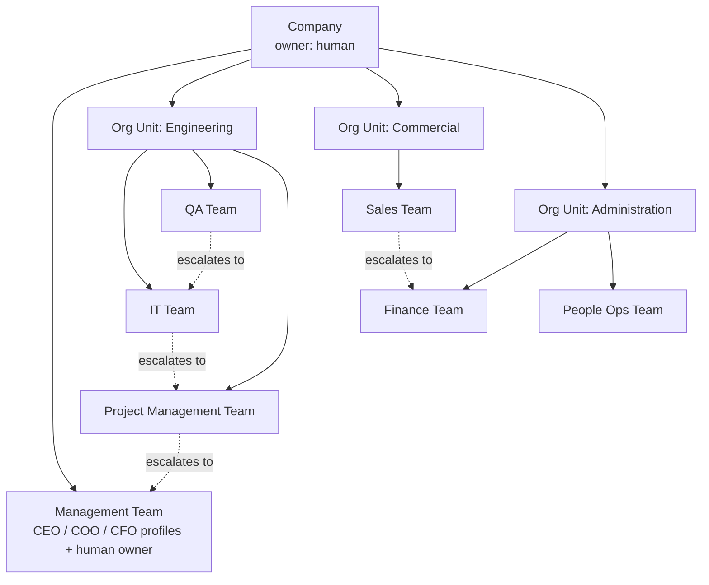
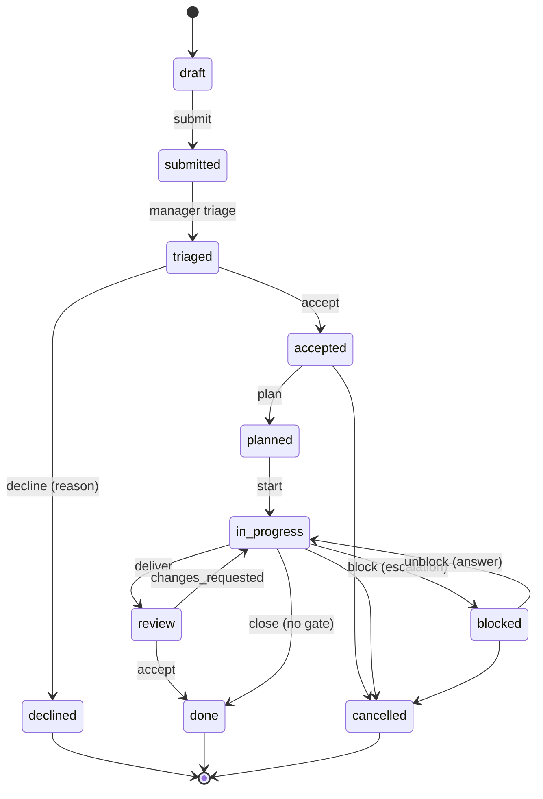
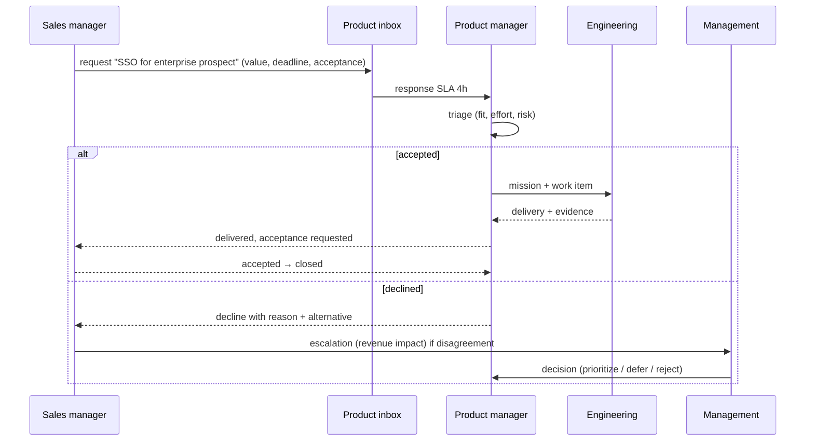
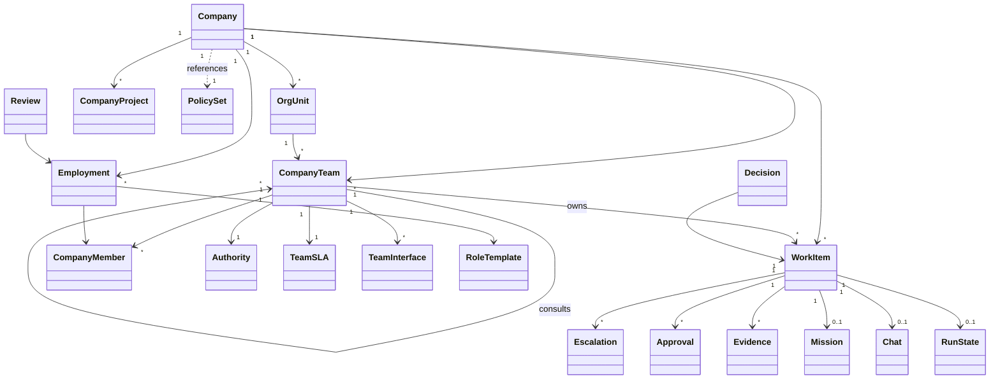
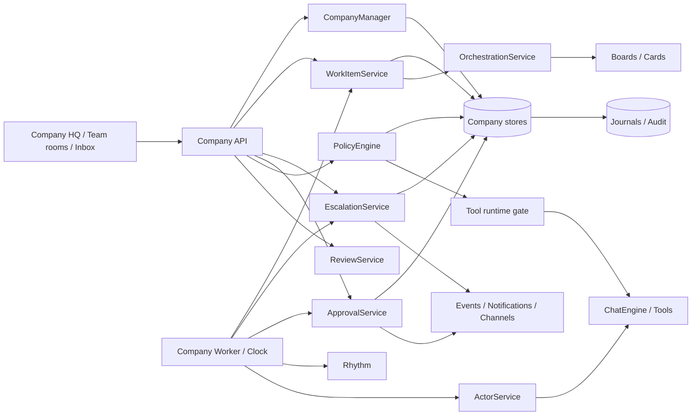

# From a multi-AI workspace to an AI company

**Transformation blueprint for codx-junior**

| | |
| --- | --- |
| **Status** | Proposal — for review and decision |
| **Date** | 2026-11-19 |
| **Audience** | Product, engineering, design, operations, and the first pilot companies |
| **Scope** | Company model, teams, autonomous profiles, work routing, escalation, human supervision, governance, UX, runtime, rollout |
| **Codebase reviewed** | `codx-junior` at `dba24f4` (`api/`, `client/`, `docs/`, `.codx/`) |
| **Owner** | Product/architecture (to be assigned at approval) |
| **Review cadence** | At every phase gate; decisions are re-opened if an assumption is invalidated |
| **Reading time** | ~2 hours end to end; the [executive summary](#1-executive-summary) and the [decisions](#11-open-decisions) fit in 15 minutes |

> **One sentence.** codx-junior already has the atoms of an AI company — profiles, hybrid teams, missions, autonomous shifts, budgets, approvals and an audit trail — but it has no **company operating system**: no reporting lines, no team inbox, no manager that answers, no escalation protocol, no cross-team work objects, no authority model, and no place where a human can stand next to an AI teammate and work. This document defines that operating system and the path to build it.

> **Decision requested.** Approve the target operating model and [decisions 1–3 and 6–8](#11-open-decisions); sponsor [phase 0](#102-phases); nominate the internal IT/QA/PM/Management company as pilot A. The first proof — QA escalating to IT, IT to Project Management, Project Management to Management, with the clock and the audit visible — is six weeks away; the enforced pilot (policy + approvals) is nine.

---

## How to read this document

| If you need to… | Read |
| --- | --- |
| Decide whether to fund the programme | [1](#1-executive-summary), [1.6](#16-sequence-and-effort-summary), [10.7](#107-team-and-effort), [11](#11-open-decisions) |
| Understand what exists today and why it is not enough | [2](#2-today-how-teams-and-autonomous-profiles-actually-work) |
| Design the org, roles and escalation chain | [3.2](#32-the-org-graph), [3.4](#34-managers-and-the-chain-of-command), [3.8](#38-the-escalation-protocol) |
| Build the domain/services | [5](#5-domain-model-changes), [6](#6-runtime-and-architecture), [7](#7-tools-and-prompts) |
| Design the UX | [8](#8-user-experience) |
| Review security/compliance | [9](#9-governance-and-security) |
| Plan the delivery | [10](#10-implementation-plan), [12](#12-appendices) |

File paths in this document are relative to the repository root; the code review is based on commit `dba24f4`.

---

## Table of contents

1. [Executive summary](#1-executive-summary)
2. [Today: how teams and autonomous profiles actually work](#2-today-how-teams-and-autonomous-profiles-actually-work)
3. [Target operating model](#3-target-operating-model)
4. [End-to-end workflows](#4-end-to-end-workflows)
5. [Domain model changes](#5-domain-model-changes)
6. [Runtime and architecture](#6-runtime-and-architecture)
7. [Tools and prompts](#7-tools-and-prompts)
8. [User experience](#8-user-experience)
9. [Governance and security](#9-governance-and-security)
10. [Implementation plan](#10-implementation-plan)
11. [Open decisions](#11-open-decisions)
12. [Appendices](#12-appendices)

---

## 1. Executive summary

### 1.1 The goal

codx-junior should become an **AI company** that a human can run and supervise:

- **Independent teams** with a charter, a board, an inbox, a budget, tools, knowledge, a schedule and a **manager accountable for answering and escalating**.
- **A chain of command** that matches how a company works: a QA team can escalate to IT, IT to Project Management, Project Management to Management, and a commercial team can escalate to Finance or Legal when the issue is functional rather than hierarchical.
- **Any kind of company**, not only software: commercial, marketing, administration, finance, legal, support, operations, people — each company defines its own org chart from its needs and its templates.
- **Humans working next to their AI mates**: joining a team room, joining a live shift, taking over a task, approving a decision, answering an escalation, reviewing a delivery — without becoming a copy/paste operator.
- **Autonomy with supervision**: every team and every action class has an explicit autonomy level, authority limit, budget, quality gate and audit trail. Autonomy is earned and revocable.

### 1.2 What exists today (short version)

The repository already implements a surprising amount of the substrate:

| Capability | Where it lives today | Maturity |
| --- | --- | --- |
| Reusable AI roles with instructions, tools, model, knowledge and guardrails | `Profile`, `ProfileManager` (`api/codx/junior/profiles/`) | **Strong** |
| Project teams: lead + members + charter, composed into instructions | `.codx/teams/<Name>/*.team` + `*.md`, `TeamManager`, `team_management` / `team_context` | **Good, but documentation-only** |
| Company entity with org units, hybrid teams, linked projects and missions | `api/codx/junior/company/models.py`, `manager.py`, `store.py` | **Good foundation** |
| Mission dispatch to a durable orchestration run | `CompanyManager.dispatch_mission` → `OrchestrationService` | **Working** |
| Autonomous profiles ("actors") with shifts, schedules, budgets, boards and reports | `api/codx/junior/autonomy/` | **Working, single-agent** |
| Company autopilot (dispatch auto missions, sync status, enforce daily budget) | `company/autopilot.py`, `CompanyManager.cycle` | **Working, shallow** |
| Mission approval gate | `Mission.approval_status`, team `requires_approval` | **Basic boolean** |
| Hybrid company roles (admin/manager/member) and human roster | `model/user.py`, `management` in `api/company.py` | **Working** |
| Human + AI channels, DMs, mentions and company chats | `mode="channel"` chats, `CompanyChatPanel`, Messenger | **Working** |
| Shared browser / co-desktop with explicit human handoff | `computer/`, `browser/`, `docs/features/computer-use.md` | **Strong primitive** |
| Budget ledger, wallets, analytics | `model/wallet.py`, `analytics/` | **Working** |
| Security gates, secret redaction, pre-commit and audit | `security/ciso/` | **Strong precedent** |
| Append-only harness audit and durable workers | `harness/audit.py`, `orchestration/worker.py` | **Working** |

### 1.3 The gap in one page

What is missing is not another agent. It is the **company layer** between the org chart and the work:

1. **Hierarchy is decorative.** `OrgUnit.parent_id` builds an org chart, but `CompanyTeam` has no `reports_to`, no superior team, no functional line, and no escalation target. The org chart cannot route a single decision.
2. **A lead is not a manager.** `CompanyTeam.lead` is a member reference. Nothing wakes that lead when the team is blocked, nothing gives it an inbox, an SLA, an authority limit or a decision to make. There is no "team manager" runtime.
3. **Missions ignore the roster.** `dispatch_mission` picks **one** supervisor profile from the team (the lead, with `orchestrator` fallback) and hands the roster to the prompt as context. The supervisor then assigns steps ad hoc. QA, security, review and DevOps do not participate by rule; they participate if the model remembers them.
4. **There is no cross-team work object.** Missions go team → project. Tasks are project chats. A request from Sales to Product, a handoff from Engineering to QA, an IT dependency blocking a release, or an escalation from QA to IT has no first-class object, no SLA, no owner and no audit.
5. **Escalation does not exist as a primitive.** `project_manager(action="request_help")` writes a comment and does not trigger anything. A card moved to `Blocked` is a human convention. The actor prompt literally says *"Do not ask questions: no human will answer during the shift"* (`autonomy/prompts.py`), and the orchestration supervisor prompt says *"Do not ask the user questions"*. The system is designed to guess, not to ask.
6. **Approvals are one boolean.** A mission can require approval, and one user can approve it. There is no policy matrix, no amount/risk threshold, no segregation of duties, no timeout, no escalation on timeout, no approval for tool actions.
7. **Authority is undefined.** A team has a budget, but no `can_approve_up_to`, no `can_deploy`, no `can_contact_external`, no `can_hire`, no `max_risk`. A profile granted a tool can use it subject to the tool list and the guardrails, but there is no authority envelope behind the grant.
8. **AI employees have no lifecycle.** The team generator creates profiles in one shot. There is no hiring request, no probation, no performance review, no promotion (more authority), no coaching, no retirement, no offboarding checklist.
9. **Company functions are IT-centric.** `profile_advisor.ROLES` and `TEAM_PRESETS` cover IT, engineering, product, data, security, support and design. There is no sales, marketing, finance, administration, legal, operations or people pack, and the only company template is `saas` (plus `blank`).
10. **Humans cannot join the work.** The company shell is manager-first and assistant-driven; the messenger is a chat; the board is a project view. There is no personal inbox of approvals/escalations, no live shift accompaniment, no takeover/handback, no presence, no "ask a human" that blocks and resumes.
11. **There is no company rhythm.** Actors have individual schedules. There is no standup, weekly planning, delivery review, monthly business review, or company digest generated by the company itself.
12. **Scale and evidence are thin.** The company is one JSON document plus one journal; missions grow without bound and the journal is not rotated; the spend ledger is bounded but not queryable; there is no query/index layer; and `api/tests/` has no direct company-manager or team-manager test suite (only indirect references from `test_autonomy.py`).

### 1.4 The transformation in five pillars

| Pillar | What it adds | Why it matters |
| --- | --- | --- |
| **1. Org graph** | Reporting lines, functional lines, team managers, deputies, authority, charters, interfaces, SLAs | Makes the org chart executable |
| **2. Work protocol** | `WorkItem` (mission/request/handoff/review/incident/task) with lifecycle, SLA, evidence, links to missions/cards/runs; escalations and approvals as protocol objects attached to it | Gives every cross-team interaction an owner and a clock |
| **3. Escalation** | Structured escalation packets, answer contracts, timeouts, auto-escalation, decision log, top-at-human | Turns "blocked" into a managed decision |
| **4. Supervision** | Policy engine, approval matrix, budgets, quality gates, audit, agent lifecycle, performance | Makes autonomy safe and measurable |
| **5. Co-working** | Human inbox, team rooms, join/takeover/handback, presence, notifications, company calendar | Lets humans work *with* the AI, not around it |

### 1.5 What changes for the user

**A company owner** describes the business once. codx-junior proposes an org chart (units, teams, managers, roles, authority, policies, first missions), the owner edits and approves, and the company starts running a daily rhythm. The owner's home screen is an **attention inbox**: approvals, escalations, SLA risks, reviews, and a daily digest — not a settings screen.

**A team manager (human)** sees the team inbox, the board, the SLAs and the escalations. They can answer a decision in one click, delegate it to an AI deputy, take over a task, or escalate to their own manager. They can join a live AI shift and steer it.

**An AI manager** is a profile with a new actor role (`team_manager`) and an agenda made of work items, escalations and approvals. It answers within SLA, assigns work, escalates beyond its authority, runs the team standup, and writes the report. It cannot approve its own request, exceed its authority, or reach the top of the chain: the top is always a human.

**A team member (human or AI)** gets work from the inbox. An AI worker that is blocked raises an escalation with a context packet instead of guessing. A human worker can hand work to an AI teammate, or take work from one, with an explicit handoff object.

### 1.6 Sequence and effort (summary)

| Phase | Outcome | Duration (≈3 engineers + design) |
| --- | --- | --- |
| **0 — Foundations** | Schema v2, hierarchy fields, work-item store, policy skeleton, feature flags, migration, audit | 2 weeks |
| **1 — Org + work + escalation** | Team managers, team inboxes, requests, escalations, QA→IT→PM→Management pilot | 4 weeks |
| **2 — Authority + approvals** | Policy engine, approval matrix, segregation, budgets per team, authority-aware tools | 3 weeks |
| **3 — Human co-working + rhythm** | Inbox, join/takeover, presence, standups, reviews, digest, notifications | 4 weeks |
| **4 — Company functions + HR** | Function packs, company architect, hiring/onboarding, performance reviews | 4 weeks |
| **5 — Hardening + GA** | Scale, multi-company, templates, security tests, rollout | 3 weeks |

**≈ 20 weeks** for the full programme; a usable pilot (phases 0–2) in **≈ 9 weeks**. The estimate assumes the existing actor and orchestration runtimes are reused, not rebuilt. Section [10](#10-implementation-plan) details scope, exit criteria and risks.

### 1.7 Non-goals

- **Not a new agent framework.** The actor and orchestration runtimes stay; the company layer wraps them.
- **Not full HR or payroll.** `Employment` tracks AI employees and the human accountability around them; human HR/payroll remains in the customer's systems.
- **Not autonomous legal, financial or medical advice.** Regulated decisions default to human sign-off; the AI prepares, routes and records.
- **Not unlimited autonomy.** The top of every chain is human; L4 is opt-in, capped and reviewed.
- **Not a replacement for the board or the chat.** Work stays visible on boards and discussable in chats; the company layer adds accountability, not another silo.
- **Not a multi-tenant SaaS rewrite.** Multi-company membership is supported, but billing, provisioning and tenant isolation are separate programmes.

---

## 2. Today: how teams and autonomous profiles actually work

This section is a factual review of the current implementation. It is deliberately explicit about what is real, what is partial and what is only a convention in a prompt, because the transformation must not build on assumptions.

### 2.1 The three layers that share the word "team"

The codebase uses "team" for three different things. They are not connected at runtime.

| Layer | Model | Storage | What it is for | What it is **not** |
| --- | --- | --- | --- | --- |
| **Project team** | `Team` / `TeamMember` (`api/codx/junior/model/team.py`) | `.codx/teams/<Name>/<Name>.team` + `<Name>.md` | A composition of profiles under a lead, with a charter. Used by `team_context` and `team_management` to compose instructions. | It does not own a board, inbox, budget, schedule or work. It is a reusable prompt. |
| **Company team** | `CompanyTeam` (`company/models.py`) | `<companies_root>/<id>/company.json` | A hybrid roster (users + profiles) inside an org unit, linked to projects, with autonomy level and budget. The unit missions are assigned to. | It has no runtime, no manager shift, no inbox, no SLA and no escalation. |
| **Agent team (profile list)** | `Profile.team` | `.codx/profiles/<Name>/<Name>.profile` | A list of profile names the model may use for new tasks. Injected as a `### TEAM` prompt section. | It is a suggestion to the model, not an assignment. |

**Consequence.** Creating a team today produces a nice charter and a roster that can be mentioned, but it does not create an operating unit. Nothing routes work to it, nothing wakes its lead, and nothing stops another team from editing its cards.

> `Profile.team` is **not** membership and the transformation does not remove it: it stays a prompt hint. `Employment` (section 5.5) becomes the authoritative "who belongs to which company team" record.

### 2.2 Profiles: the atom of an AI employee

A profile (`api/codx/junior/model/profile.py`, `profiles/profile_manager.py`) carries:

- identity (name, avatar, description, category);
- instructions (Markdown), linked profiles, project **enrichment** (`enrich.md`) and **knowledge** files;
- model, tools (including MCP tools and `*`), knowledge usage, chat mode;
- **guardrails** (input/output/scope/tool allow-list and risk threshold);
- **voice** settings;
- an optional **`actor`** block (autonomy);
- API exposure (OpenAI-compatible).

Profiles are the right primitive for "an AI employee's brain". They are **not** an employment record: there is no team membership that grants authority, no level, no manager, no probation, no performance history and no lifecycle state. The same profile can be in ten teams and fifty projects with identical powers.

The **profile advisor** (`company/profile_advisor.py`) can map a plain-language need to roles. Its catalog is IT-heavy: `it_lead`, `developer`, `frontend_developer`, `backend_developer`, `qa_engineer`, `devops_engineer`, `security_engineer`, `data_analyst`, `designer`, `product_manager`, `technical_writer`, `support_engineer`. Presets: IT, Engineering, Product, Data, Security, Support, Design. There is no commercial, finance, admin, legal, operations or people role, and no notion of level, authority or KPI.

### 2.3 Project teams: a charter, not an operating unit

`Team` (`model/team.py`) has `name`, `description`, `goal`, `avatar`, `lead`, `members` (`profile`, `role`, `responsibility`, `order`), `tools`, `llm_model`, `use_knowledge`, `tags`, `content` (the charter) and `project_id`.

`TeamManager` (`teams/team_manager.py`) stores the team as two files and resolves it on demand:

- `ordered_members()` puts the lead first;
- `resolve_team()` expands each member with its linked profiles, unions the tools, picks a model and composes the instructions;
- `compose_instructions()` renders a header, a roster table, the charter and each profile's instructions.

Two tools use it:

- `team_management` (CRUD + roster + `set_lead` + `reorder_members`);
- `team_context` (read-only resolution: "act as this team").

The IT team in this repository is a good example (`.codx/teams/IT-team/IT-team.team`): 12 profiles, `ProjectManager` as lead, roles for analyst, backend, frontend, QA, QA automation, CISO, reviewer, repository, DevOps, wiki and TaskManager. Its charter already describes hand-offs and says *"Escalate, never guess"* — but the hand-offs and the escalation are **prose**, not machinery. There is no guarantee that QA sees a card before `Review`, that CISO is consulted for an auth change, or that an escalation reaches a human.

### 2.4 Company: the right container, half-wired

The company domain (`company/models.py`) is the most ambitious part of the system and the right place to build on.

```text
Company
├── Organization (OrgUnit tree: department / function / division)
├── Teams (CompanyTeam: hybrid roster, lead, org unit, projects, budget, autonomy)
├── Projects (linked codx-junior projects)
├── Missions (objective, team, project, approval, run)
├── Chats (company channels hosted by linked projects)
├── Spend (append-only ledger)
└── Autonomy (AutonomyPolicy)
```

**`OrgUnit`** has `id`, `name`, `kind`, `description`, `parent_id`, `lead_kind/lead_name`, `responsibilities`, `color`, `icon`, `order`. The `parent_id` is validated against cycles (`manager.py`, `_validate_org_parent`). It builds an org chart. It does **not** define who reports to whom in the work sense: teams point at an org unit, but an org unit is not a decision-making node with an inbox.

**`CompanyTeam`** has `id`, `name`, `description`, `purpose`, `org_unit_id`, `lead_kind/lead_name`, `members` (`CompanyMember`: kind `user`/`profile`, name, role, title, responsibility, order, active), `project_ids`, `autonomy` (`manual`/`supervised`/`autonomous`), `tools`, `tags`, `budget_cxjcoins`, `requires_approval`, color/icon, timestamps. The lead is always kept in the roster (`ensure_lead`).

It has **no** `reports_to`, `parent_team`, `deputy`, `status`, `sla`, `authority`, `inbox_board`, `desk_board`, `charter`, `interfaces`, `kpis`, `capacity`, `escalation_policy` or `member level`.

**`Mission`** has `title`, `objective`, `acceptance`, `status` (`draft`/`ready`/`running`/`paused`/`blocked`/`review`/`done`/`cancelled`), `priority`, `team_id`, `project_id`, `owner`, `dispatch_mode` (`manual`/`auto`), `source`, budget/spend, `requires_approval`, `approval_status` (`not_required`/`pending`/`approved`/`denied`), `approved_by/at/note`, `due_date`, `run_id`, `run_status`, `progress`, `result`, `last_error`, tags, timestamps. Transitions are enforced by `MISSION_TRANSITIONS` (`models.py`).

**`Company`** has `mission`/`vision`/`values`, `owner`, org units, teams, projects, missions, chats, spend, `AutonomyPolicy` (`enabled`, `level` off/supervised/autonomous, interval, max concurrent missions 1–20, max per cycle 1–10, daily budget, `require_human_acceptance`, cycle bookkeeping).

The **company store** (`company/store.py`) is one folder per company: `company.json` + `journal.jsonl`, atomic writes and a per-company file lock. The **company manager** (`company/manager.py`, ~3.4k lines) implements CRUD, validation, mission dispatch/sync/accept/reject/approve/deny, budgets, snapshots, autonomy cycles and the journal. The **company assistant** (`company/assistant.py`, ~4k lines) is a deterministic intent router (create team, add person, create mission, approvals, budget, status) with an LLM fallback.

### 2.5 Mission dispatch: one supervisor, a roster in the prompt

`CompanyManager.dispatch_mission`:

1. validates the mission destination (team exists, project linked);
2. checks approval (`_mission_needs_approval`);
3. checks hard budgets (project, team, mission);
4. builds a **mission brief** (`build_mission_brief`) with company mission/vision/values, objective, acceptance, project, org unit, the full team roster with roles and responsibilities, due date and previous error;
5. calls the dispatcher.

The default dispatcher (`_default_dispatcher`) starts a durable orchestration run:

```python
profiles = self._project_profiles(settings, team)   # team lead first, then fallbacks
config = RunConfig(
    budget_cxjcoins=mission.budget_cxjcoins,
    supervisor_profiles=profiles,                    # <-- only the lead survives
    board=company_board,
    sprint=f"Mission: {mission.title}",
    verification="supervisor",
    created_by="company",
)
```

`_project_profiles` collects the lead and the AI members, then **returns only the first one** (`selected[:1]`). So the "team" is context for the supervisor, not a set of participants. The orchestration supervisor (`orchestration/prompts.py`) plans 2–5 steps, assigns a `profile` to each step, and a background worker runs them in parallel when independent. The supervisor verifies results and finishes. This is a good execution engine, but it is **single-supervisor, model-decided staffing**.

### 2.6 Autonomous profiles (actors): initiative without a manager

An **actor** is a profile plus an `actor` block (`autonomy/models.py`, `ActorConfig`):

| Field | Meaning |
| --- | --- |
| `enabled` | The profile takes shifts |
| `role` | `coworker` (owns a job) or `manager` (curates boards) |
| `policy` | `full` or `board_only` |
| `session` | `single` or `until_done` |
| `board` / `boards` | Desk (reports) and watched boards (agenda) |
| `interval_minutes` | Fallback cadence (5 min–30 days) |
| `mode` | `active` or `dry_run` |
| `budget_cxjcoins` / `daily_budget_cxjcoins` | Per shift / per day |
| `max_runtime_minutes`, `max_turns`, `max_agenda`, `max_tasks` | Bounds |
| `instructions` | Standing orders |
| `wake_at`, `notify`, `schedule` | First wake, live events, weekly availability |

A **shift** (`autonomy/service.py`) is bounded: build the agenda from tasks whose `wake_at` is due, create a **shift card** on the desk board, run one or more agent turns, write a `## Shift report`, move the card to `Done`, consume the wakes of tasks it closed, record cost. A weekly schedule keeps actors out of hours when nobody can review. A per-actor `flock` prevents two workers running the same actor. The prompt is explicit: *"Do not ask questions: no human will answer during the shift. Take the conservative option, write down the doubt as a task or a comment, and go on."*

```mermaid
flowchart LR
    W[Actor worker tick] --> D{Due?}
    D -- no --> W
    D -- yes --> L[Per-actor flock]
    L --> S[Shift card on desk board]
    S --> A[Agenda: board tasks with wake_at due]
    A --> T[Agent turn(s) with tools]
    T --> R[Shift report on the card]
    R --> C[Consume closed wakes + record cost]
    C --> N[Next wake / state]
```

**What this is good at:** bounded, auditable, budgeted initiative; durable follow-ups (`wake_at`); a report per shift; a clean separation between API (writes intent) and background worker (executes).

**What it cannot do:** answer a question, ask its manager, request approval, hand work to another team, negotiate an SLA, or escalate. The only "help" tool is `project_manager(action="request_help")`, which writes a comment and stops. There is no event that wakes a manager when the comment is written.

### 2.7 Orchestration: durable runs, isolated workers

`api/codx/junior/orchestration/` implements a board-native run:

- `OrchestrationService` owns run lifecycle, plan, budget, steps, pause/resume/stop, reports;
- a **supervisor** turn plans/verifies/replans through the `orchestrator` tool;
- every step becomes a **child task card** on a board and in a sprint;
- a **worker** executes ready steps in parallel (respecting `depends_on`), each in its own chat with a self-contained contract;
- budget admission, per-step timeout, stagnation detection, stale-step recovery, durable `flock`, worker heartbeat, watchdog;
- a delivery report with `## What happened`, `## What I did`, `## Demo`, `## Next tasks`.

This runtime is a strong execution substrate for company missions **if** the company layer can define who must participate, what gates are mandatory, and where a blocked step escalates. Today it cannot: the supervisor decides staffing, and a blocked step is reported, not escalated.

### 2.8 Tasks, boards and chats: the visible surface

A task is a `Chat` (`api/codx/junior/db.py`) with `board`, `column`, `status`, `priority`, `due_date`, `progress`, `assignees` (**human usernames**), `profiles` (**AI profiles**), `wake_at`, `schedule`, `schedule_context`, `sprints`, `parent_id`/`root_id`, `messages`, `meta_data`. Tasks are stored under `.codx/tasks/<board>/<column>/`. `project_manager` (one tool, 15 actions) creates/moves/updates tasks, comments, requests changes, requests help and archives.

This is the **visibility layer**: every step of a run, every shift, every mission is a card. The transformation should keep this invariant — *if it matters, it is on a board* — and add company-level work items that project onto cards.

### 2.9 Humans today

- **Company roles:** `CodxUser.companies` holds `CompanyMembership(company_id, role, title, joined_at)`. Roles: `admin` (add users/settings), `manager` (manage teams/projects/missions via assistant), `member` (follow). Global roles: `admin`, `company_admin`, `manager`, `user`. `workspace_mode` selects the company shell or the project workspace.
- **Company shell:** one screen plus an always-present assistant. Tabs are translated into assistant prompts. `CompanySimpleHome`, `CompanyOverviewPanel`, `CompanyTeamsPanel`, `CompanyPeoplePanel`, `CompanyMissionsPanel`, `CompanyChatPanel`, `CompanyActivityPanel`.
- **Messenger:** project teams, categories, channels, DMs; a channel is a `mode="channel"` chat, so agents can read/answer; company chats are channels hosted by linked projects.
- **Co-working:** browser and co-desktop sessions are **one machine shared by user and AI**, with a live view, an explicit control handoff, and a "the AI pauses when the human types" protocol (`docs/features/computer-use.md`, `docs/features/browser-use.md`). This is the strongest existing precedent for human-AI collaboration and should be generalized to work items.
- **Notifications:** Socket.IO events (`EventManager`, channels such as `codx-junior`, `chat-event`, `message-event`, `codx-junior-actors`), plus in-app notifications.

What a human **cannot** do today: open a personal inbox of decisions, answer an escalation, approve a tool action, join a specific AI shift on a task, take over a task with a recorded handoff, review an AI employee's performance, or see the company's decision log.

### 2.10 Governance today

| Control | Current state | Gap for an AI company |
| --- | --- | --- |
| **Budgets** | Wallets, spending limits, cxjcoins ledger, company/project/team/mission budgets, actor shift/day budgets, hard checks | No per-period team budget, no reservation/settlement, no forecast, no approval for over-budget |
| **Approvals** | Mission `requires_approval` + team flag; `approve_mission`/`deny_mission` | No policy matrix, no thresholds by amount/risk, no tool-action approvals, no timeout/escalation, no segregation |
| **Quality** | Orchestration verification, QA profiles, CISO review as prompt convention | No mandatory gates by work class/path, no gate verdict object, no block on missing evidence |
| **Security** | Guardrails (input/output/scope/tools), CISO gates (file write, prompt, commit, tool output), secret redaction, vault | No per-team data boundary, no agent credentials/scopes, no policy for external content in escalation packets |
| **Audit** | Company `journal.jsonl`, harness `audit.jsonl`, CISO audit, wallet ledger, status history | Not unified by work item/decision; no decision log; no export/retention policy |
| **Override** | Pause an actor, disable autopilot, ignore schedule, admin force flags | No company/team kill switch, no "break glass" audited override, no per-agent revocation |
| **Performance** | Actor state (shifts, cost, stop reason), mission spend | No KPIs, scorecards, reviews, probation or retirement |

### 2.11 What the current system does well (keep it)

1. **Profiles as reusable brains.** The separation between identity/instructions/tools/knowledge and the runtime is right. Do not turn profiles into employees; add an employment record that *references* a profile.
2. **Boards as the source of visibility.** Every shift, step and mission becomes a card. Keep it.
3. **Durable, budgeted, single-writer execution.** `flock`, heartbeat, crash recovery, hard budget gates. Keep it.
4. **API writes intent, worker executes.** Keep the split.
5. **Policy as data, decided deterministically.** The CISO gate and guardrails prove the pattern. Extend it.
6. **Two-step generate/apply.** The team generator never writes blindly and never overwrites existing profiles. Reuse it for hiring and company architecture.
7. **Append-only journals.** Company, harness, CISO. Extend them into a decision-grade audit.
8. **The company shell's assistant-first philosophy.** A manager should not learn a tab tree. Keep the assistant, but add the inbox and the org chart as first-class surfaces.

### 2.12 Evidence from the repository's own operation

The `.codx` boards in this checkout show the system being used as an AI company already, and show exactly where it breaks:

- The **IT team** board has a 12-profile charter with hand-offs and "escalate, never guess". Its cards are worked by actors and managed by a board manager. The hand-offs are prose.
- The **ProjectManager** actor has a desk board `Agent: ProjectManager` with shift cards and checkpoints. A real shift report reads: *"all three `doing` cards have `wake_at: null` — this is exactly why they freeze and never get picked up again"* and *"Missing → escalate"*. The actor is diagnosing the absence of a company layer in its own reports: lost follow-ups, no escalation target, cards that freeze.
- A **kickoff card** requires "the profile that owns it" and acceptance evidence per card. The team understands accountability; the runtime does not enforce it.
- The **IT team kickoff** was assigned to `ProjectManager` + `TaskManager`, not to a manager actor with an inbox; the work was done by a `software_developer` actor on a shift. Ownership is implicit.

These are not failures of the model. They are missing primitives.

### 2.13 Root causes (the five that matter)

1. **No accountable node between the company and the task.** The company has teams, the project has cards, but no object says "this team owns this outcome, this manager answers for it, this is its SLA".
2. **No protocol for needing something from someone else.** Requests, handoffs, escalations and approvals are all ad-hoc comments.
3. **No authority model.** Autonomy is a boolean-ish level; authority is whatever tools the profile has.
4. **No human-in-the-loop surface.** Humans can chat and watch, but cannot decide, approve, join or take over in a structured way.
5. **No company clock.** Actors wake individually; the company has no day, week or month.

---

## 3. Target operating model

### 3.1 Design principles

1. **The org chart must be executable.** Every box has an owner, an inbox, an authority envelope, a budget and a clock. If a box cannot receive work and answer for it, it is decoration.
2. **One accountable owner per outcome.** A work item has exactly one owning team and one accountable manager. Contributors are many; owners are one.
3. **Independence with contracts.** Teams own their board, inbox, budget, tools and schedule. They interact through requests, handoffs and escalations — never by silently editing each other's work.
4. **Ask before guessing.** When an AI lacks information, authority or a decision, it raises an escalation with a context packet and waits. The current "never ask" policy is reversed for decisions; it remains for reversible details inside the mandate.
5. **Autonomy is earned, scoped and revocable.** Level, authority and budget are explicit, per team and per action class, with probation and audit.
6. **Humans are first-class participants, not approvers of last resort.** A human can join, steer, take over and hand back at any point.
7. **Policy is data, enforcement is code.** Rules live in versioned documents; a deterministic engine decides allow/deny/require-approval. The model is told its authority, but never trusted with it.
8. **Everything that matters is on a board and in a journal.** Visibility is not a reporting feature; it is the substrate.
9. **The top is always human.** An AI may escalate to the top; it may never be the top.
10. **Small, reversible increments.** The transformation ships behind flags, preserves existing missions/actors/boards, and can be rolled back phase by phase.

### 3.2 The org graph



**Entities.**

| Level | Entity | Responsibility | Has |
| --- | --- | --- | --- |
| Company | `Company` | Legal/economic unit, owner, mission/vision/values, policy set, budget, linked projects | Owner (human), management team, policy, calendar, audit |
| Unit | `OrgUnit` | A department/function/division that groups teams and owns a P&L or a capability | Lead, parent, responsibilities, teams, budget envelope, KPIs |
| Team | `CompanyTeam` | The operating unit that owns outcomes and work | Manager, deputy, roster, charter, board, inbox, SLA, authority, budget, tools, schedule, interfaces, KPIs |
| Member | `CompanyMember` + `Employment` | A human or AI employee in a team | Roster reference (`CompanyMember`) plus level, lifecycle, capacity, authority and schedule (`Employment`) |
| Project | `CompanyProject` | Where work is executed (repository, workspace, environment) | Owner team, budget, access policy |
| Work | `WorkItem` | A unit of accountable work | Owner team, assignee, status, SLA, evidence, links |

**Two axes of reporting.**

- **Line (hierarchical)**: `CompanyTeam.reports_to_team_id`. One parent per team (a tree, validated acyclic, max depth 5). The line decides priorities, resources, scope and people.
- **Functional (expert)**: `CompanyTeam.consults` — a list of team references with a domain (`security`, `legal`, `finance`, `brand`, `data`, `people`). The functional line decides standards and can block on compliance, but does not own the outcome.

This is a **matrix organization**, which is what real companies use for exactly the QA→IT→PM→Management and Sales→Finance cases.

**Management team.** A reserved `CompanyTeam` with `kind="management"` (or a flag `is_management=true`), whose manager is the **company owner (human)** and whose members are the executive profiles (CEO/COO/CFO/Chief of Staff, advisory). It is the top of every line chain and the final approver for high-risk decisions.

**AI manager sponsorship.** An AI manager must have a human **sponsor** (`sponsor_kind/name`), normally the manager of its parent team. The sponsor is notified when the AI manager escalates to the top, and is accountable for its authority. No AI manager is unsponsored.

### 3.3 The team independence contract

Every team signs (stores) a **charter** with these ten clauses. The runtime enforces the ones marked *enforced*; the rest are prompt/policy.

| # | Clause | Enforcement |
| --- | --- | --- |
| 1 | **Scope.** What the team owns, what it explicitly does not own, and its deliverables. | Prompt + policy (work item validation) |
| 2 | **Board.** The team has one or more boards; only its members and its manager write to them. | *Enforced* (tool policy + board ownership) |
| 3 | **Inbox.** External work enters only through the team inbox (requests, escalations, handoffs, approvals) or a mission assigned by a superior. | *Enforced* (no direct card creation in another team's board) |
| 4 | **Authority.** Maximum spend, risk, environments, external communication, hires and policy exceptions. | *Enforced* (policy engine) |
| 5 | **Budget.** A period budget and a per-work-item cap; hard stop and alert thresholds. | *Enforced* (budget service) |
| 6 | **SLA.** Response and resolution targets by priority; auto-escalation on breach. | *Enforced* (company clock) |
| 7 | **Interfaces.** The requests the team accepts, their input schema, expected output and turnaround. | *Enforced* (request validation) |
| 8 | **Quality gates.** Mandatory reviews/evidence before delivery. | *Enforced* (gate service) |
| 9 | **Escalation.** Line target, functional consults, timeouts, deputy order. | *Enforced* (escalation service) |
| 10 | **Reporting.** A standup, a weekly report and a monthly review, in the team room and on the company dashboard. | Prompt + rhythm worker |

**Write boundary rule.** A team may create cards on its own boards. To make another team do something, it creates a **request** (or a **handoff**), which appears in the other team's inbox and on its board as an *inbox card* owned by the receiving team. The receiving team's manager accepts or declines. This single rule is what makes teams independent without making them silos.

**Isolation matrix (default).**

| Resource | Own team | Another team | Company / unit |
| --- | --- | --- | --- |
| Boards and cards | Read/write | Read only when `visibility="company"`; write only via request/handoff | Read aggregate |
| Work items | Create/own/close | See summary; request/comment; escalate | See all (role-scoped) |
| Profiles / AI employees | Use its members | Use only shared profiles or explicit grant | Catalog read |
| Knowledge | Team + project knowledge | Explicit grant | Company knowledge |
| Budget | Spend within envelope | No access | Aggregate + audit |
| Members | Manager manages roster | No access | Admin manages |
| Approvals | Request within authority | Approve only if target/functional | Owner/admin per matrix |
| Escalations | Raise | Receive if target | Management/owner |
| Audit | Team events | Own events only | Full export (auditor/owner) |

### 3.4 Managers and the chain of command

#### 3.4.1 Who is a manager

A team has exactly one **accountable manager**:

| Configuration | When to use | Runtime |
| --- | --- | --- |
| `manager_kind="profile"` (AI) | High-volume, well-defined team; 24/7; routine decisions | Actor with `role="team_manager"`, agenda from the team inbox, SLA-bound |
| `manager_kind="user"` (human) | Small team, high judgment, external-facing, regulated | Human inbox + notifications; may have an AI **deputy** that triages |
| `manager_kind="user"` + `deputy` (AI) | Hybrid: human accountable, AI chief-of-staff | Deputy answers within policy; escalates to the human for decisions outside its envelope |

There are only two `manager_kind` values (`user`/`profile`); "hybrid" is a configuration of a human manager with an AI deputy, not a third enum value.

The manager is **not** the best individual contributor. The manager's job is: answer, triage, assign, unblock, escalate, report, protect focus, enforce quality, manage budget and people. The AI manager prompt must forbid doing the team's work (except triage), matching the current `role="manager"` actor prompt but with an inbox and an answer contract.

The team also has:

- a **deputy** (member ref) who answers when the manager is unavailable (vacation, schedule, conflict);
- a **sponsor** (human) for AI managers;
- optional **leads** by area (e.g. QA lead, backend lead) who are technical authorities, not the accountable manager.

#### 3.4.2 Chain of command

```text
Member → Team manager → Parent team manager → ... → Management team manager (human owner)
```

Resolution rules, in order:

1. **Explicit target** on the escalation (a named team or member).
2. **Functional target** if the reason is a domain (`security` → CISO team; `legal` → Legal; `finance` → Finance; `people` → People Ops).
3. **Line target**: the manager of the requester's own team; when the requester *is* that manager or the escalation is about the team's own decision, the manager of `team.reports_to_team_id`.
4. **Deputy** of the resolved target when that manager is unavailable (schedule, absence, conflict) and the deputy is authorized; the escalation level does not change.
5. **Skip level** if the target does not answer within the escalation timeout; record the skip.
6. **Management** at the top; its manager is always a human (or a committee with a human chair).
7. **Company owner** as the ultimate authority; a `Board`/`Advisors` pseudo-team can be configured for decisions that need multiple humans.

The chain must be **visible** in the UI and in every escalation packet ("this is level 2 of 4; next: Project Management; timeout: 2h").

#### 3.4.3 What the manager must answer

Every escalation/request must be answerable with one of a small set of **structured actions**:

| Action | Effect |
| --- | --- |
| `approve` | Approves the requested action (within authority) |
| `deny` | Denies with a reason; the requester may escalate or replan |
| `decide` | Chooses an option (with rationale); unblocks the work |
| `provide_info` | Supplies the missing information/credential/access |
| `assign` | Assigns the work to a member/team |
| `reprioritize` | Changes priority/deadline/scope |
| `take_over` | The manager (or a human) takes ownership |
| `delegate_down` | Sends it back with a narrower scope and a new owner |
| `escalate_up` | Forwards to the next level with the packet plus a recommendation |
| `request_more_info` | Asks the requester a specific question (does not close) |

Anything else is conversation, not a decision. The service records the action, the rationale and the authority check.

### 3.5 Authority and decision rights

Authority is a **first-class object**, not a tool list.

```python
class Authority(BaseModel):
    max_spend_cxjcoins: float = 0          # per work item
    period_spend_cxjcoins: float = 0       # per period (inherits team budget)
    max_risk: Literal["low","medium","high","critical"] = "low"
    can_approve: List[str] = []            # request, mission, deploy, external_send, data_access, hire, policy_exception
    can_deploy_envs: List[str] = []        # dev, staging, prod
    can_write_paths: List[str] = []        # repo globs / project ids
    can_access_projects: List[str] = []
    can_contact_external: bool = False
    can_hire: bool = False
    can_change_policy: bool = False
    requires_approval_for: List[str] = []  # overrides on top of the policy
    escalation_timeout_minutes: int = 120
    sla: Dict[str, int] = {}               # priority -> minutes
```

**Inheritance.** A team's authority is capped by its parent's; a member's authority is capped by the team's. The effective authority is `min(team, member)` per numeric dimension, the **intersection** for lists (`can_approve`, `can_deploy_envs`, `can_write_paths`) and `AND` for booleans; `requires_approval_for` is additive. It is never the union. The company can grant an exception (audited, time-boxed).

**Enforcement points.**

1. **Before a tool call** in `ChatEngine`/tool runtime: `PolicyEngine.check(action, context)`. A denied tool returns an explanation; a `require_approval` result creates an `Approval` and blocks the turn (with a resumable state).
2. **Before a work-item transition** (accept, dispatch, close, deploy, send external): the service checks the actor's authority.
3. **Before a budget charge**: the budget service reserves and settles.
4. **Before a policy write**: only company admin/owner, with a change record.

The model is shown a compact "your authority" block in the system prompt so it does not attempt forbidden actions, but the enforcement never depends on the model.

### 3.6 Autonomy levels

Replace the three-value `CompanyTeam.autonomy` with five levels, mapped for backward compatibility:

| Level | Name | What AI may do | Human role | Requirements |
| --- | --- | --- | --- | --- |
| **L0** | Manual | Nothing without a human instruction per step | Does the work, AI assists | Default for new/high-risk teams |
| **L1** | Assisted | Drafts, analysis, suggestions; no writes with external effect | Reviews and executes/approves every effect | Tool profile read-only or dry-run |
| **L2** | Supervised | Executes within its team board and authority; human reviews before external/irreversible effects | Reviews gates, samples work, answers escalations | Default for most teams |
| **L3** | Delegated | Executes and closes work within authority/budget; human reviews by sampling and exception | Audits, handles exceptions, approves above threshold | ≥ 2 weeks probation, clean quality record, budget cap |
| **L4** | Autonomous | Executes and closes, including cross-team requests within interfaces; human only on incidents/authority breach | Owns policy, audits, strategic decisions | Explicit board decision, insurance-like caps, kill switch, quarterly review |

**Mapping:** `manual` → L0/L1, `supervised` → L2, `autonomous` → L3 by default; L4 is opt-in per team and per action class.

**Per action class.** A team can be L3 for `analysis` and `code_change` but L1 for `deploy` and `external_send`. The policy stores a matrix:

```json
{
  "team_id": "team-qa",
  "autonomy": {
    "analysis": "L3",
    "test_execution": "L3",
    "code_change": "L2",
    "deploy": "L1",
    "external_send": "L0"
  }
}
```

**Earning autonomy.** Promotion is a decision with evidence: 30 days at the current level, SLA adherence ≥ 95%, first-pass quality ≥ 90%, zero unresolved security findings, budget variance < 10%, human sponsor approval. Demotion is immediate and audited.

### 3.7 The work model

#### 3.7.1 One accountable object, several execution projections

```text
WorkItem (company store)  ── projects ──►  Mission (company)
        │                                   └── Orchestration Run (project)
        │                                        └── Step cards (board)
        ├────────────── projects ──►  Task card (Chat)
        ├────────────── projects ──►  Chat / team room thread
        └────────────── links ─────►  Evidence, approvals, escalations, decisions
```

The `WorkItem` is the **accountability envelope**. It is not a replacement for missions or cards; it is the object that says who owns the outcome, what the SLA is, what evidence closes it and where it escalated. A mission gets a `work_item_id`; a card gets `work_item_id`; an escalation always references a work item.

**Not every card needs a work item.** A project-internal chore that stays inside one team, consumes no company budget and needs no approval can remain a plain card. The rule is: **any work that crosses a team boundary, consumes a company budget, needs an approval, is reported to the company, or must meet an SLA gets a work item.** This keeps the company layer meaningful instead of turning every checklist item into a ticket.

#### 3.7.2 Work item types

| Kind | Created by | Owner | Typical SLA | Closes when |
| --- | --- | --- | --- | --- |
| `mission` | Management, company owner, autopilot (policy) | A team | Due date | Accepted by requester, review passed |
| `request` | Any team/member | Receiving team | Accept: P0 15m / P1 1h / P2 4h / P3 1d | Requester accepts delivery or cancels |
| `handoff` | A team transferring ownership | Receiving team | Accept: 1 business day | Receiver accepts and owns; or rejects → escalation |
| `review` | A team delivering | Reviewer/QA team | 1 business day | Verdict recorded |
| `incident` | Monitoring, human, agent | On-call team | Acknowledge 15m; mitigate P0 1h | Postmortem accepted |
| `task` | A team manager | Team member | Per team | Acceptance + evidence |

**Priority** is `P0` (critical, drop everything), `P1` (high), `P2` (normal), `P3` (low). Map to the existing `low/medium/high/critical` for display.

> **Escalations and approvals are protocol objects, not work-item kinds.** An `Escalation` always references a work item (if the issue has no work item yet, create a `request` first); an `Approval` references its subject (work item, mission, tool action, hire, policy change). This avoids duplicating the accountability envelope and keeps their state machines independent.

#### 3.7.3 Work item lifecycle



Kind-specific states are enforced by a transition table (like `MISSION_TRANSITIONS`), not by free-form status strings. `blocked` is only reachable with an open escalation or a declared external dependency, and only leaves `blocked` when the escalation is resolved.

#### 3.7.4 SLA and the company clock

Every work item gets `sla_due_at` computed from its kind, priority and team SLA at creation/triage. The **company clock** is a background loop that:

- marks `at_risk` at 75% of the SLA;
- escalates at 100% (to the manager's manager, with the packet);
- escalates again at 150% (skip level);
- notifies the human sponsor at the top;
- records every step in the work-item timeline.

SLA clocks pause outside the team's working hours (configurable) and during declared blackout/holiday periods. A manual "pause SLA" is audited and time-boxed.

#### 3.7.5 Evidence

Closing a work item requires **evidence**, typed and linked:

| Evidence kind | Example | Required for |
| --- | --- | --- |
| `test` | `pytest tests/test_company.py -q` output | Code changes |
| `command` | deployment command + output | Deployments |
| `url` | staging URL + screenshot | UI changes |
| `file` | artifact path + hash | Documents/assets |
| `diff` | branch/commit/PR | Code changes |
| `approval` | approval id | Anything gated |
| `review` | review verdict | Anything reviewed |
| `log` | incident log/timeline | Incidents |
| `external` | customer confirmation | External commitments |

The `project_manager` and orchestration runtimes already produce most of these (reports, verification, diffs, tests); the work item aggregates them instead of re-deriving them.

### 3.8 The escalation protocol

#### 3.8.1 When to escalate

| Reason | Example | Target |
| --- | --- | --- |
| `blocked` | Missing access, dependency, environment | Line manager |
| `needs_decision` | Two valid designs, scope ambiguity, trade-off | Line manager |
| `authority_exceeded` | Spend above limit, production deploy, external send | Next authority level |
| `sla_breach` | Automatic on timeout | Next level |
| `quality_dispute` | Author and reviewer disagree | QA lead / line manager |
| `risk` | Security, legal, privacy, financial exposure | Functional team (CISO/Legal/Finance) |
| `resource` | Budget, people, time | Line manager → Management |
| `external` | Customer/vendor commitment | Accountable manager + human |
| `conflict` | Two teams claim/deny ownership | Common ancestor manager |

The agent prompt must be explicit: *if the action is outside your authority, if two interpretations have materially different cost/risk, or if you are blocked for more than the retry budget, raise an escalation with a context packet and stop the turn.* The old "do not ask questions" rule is narrowed to **reversible details inside the mandate**.

#### 3.8.2 The context packet

An escalation is only as good as its packet. The tool requires:

```json
{
  "work_item_id": "wi-...",
  "reason": "needs_decision",
  "severity": "P1",
  "summary": "Payment webhook retries can double-charge; fix requires a schema change.",
  "what_i_tried": [
    "Reproduced with 2 concurrent webhooks",
    "Read api/payments/webhook.py",
    "Tested idempotency key approach on a branch"
  ],
  "evidence": [
    {"kind": "log", "ref": ".codx/logs/webhook-trace.txt"},
    {"kind": "diff", "ref": "branch fix/webhook-idempotency"}
  ],
  "options": [
    {"id": "A", "label": "Add idempotency key", "impact": "2 days, schema migration", "risk": "medium"},
    {"id": "B", "label": "Disable retries", "impact": "loses reliability", "risk": "high"}
  ],
  "recommendation": "A",
  "requested_action": "decide",
  "deadline": "2026-11-20T17:00:00Z",
  "if_no_answer": "Release 1.4 stays blocked; customer comms drafted."
}
```

The service validates the packet (required fields, evidence reachable, options distinct), stores it, and renders it in the human inbox and in the manager's agenda.

#### 3.8.3 The answer contract

The answer is structured and applied by code, not by prose:

```json
{
  "escalation_id": "esc-...",
  "action": "decide",
  "option_id": "A",
  "rationale": "Idempotency is the durable fix; schedule the migration in the next release.",
  "conditions": ["migration reviewed by CISO", "rollback plan attached"],
  "authority_check": {"allowed": true, "limit": "engineering_manager", "remaining": 12.5}
}
```

A manager cannot answer with an action outside its authority; the service returns `escalate_up` as the only valid action in that case. A manager cannot answer its own request (segregation). A human answer is always allowed at or above the required authority (the human is the top of the chain).

#### 3.8.4 Timeout and auto-escalation

Every escalation has a chain and a timer:

```text
level 0: QA manager            timeout 2h
level 1: IT manager            timeout 4h
level 2: Project Management    timeout 1d
level 3: Management (human)    timeout 2d
then: company owner + attention queue + digest
```

On timeout, the service:

1. appends an `auto_escalated` event with the elapsed time and the unanswered packet;
2. forwards to the next level (or marks `expired` at the top);
3. notifies the requester and the human sponsor;
4. keeps the work item `blocked` (never silently unblocks);
5. records the SLA breach in the team's metrics.

**Urgent path.** A P0 escalation (or a P1 with a critical customer impact) writes a wake intent immediately, so the manager shift starts at the next tick instead of waiting for its cadence. Outside the manager's schedule, the deputy or an on-call override is used; the override is audited and visible in the digest.

**Response vs resolution.** A breach of the **response** SLA (acknowledge/accept) escalates the open escalation. A breach of the **resolution** SLA while the escalation is acknowledged and being worked raises a new escalation or reopens the work item with the elapsed time; the manager is notified before it happens at 75% of the clock. This distinction is stored on the escalation (`response_due_at`, `resolution_due_at`) so the clock never escalates a team that answered on time but is still working.

#### 3.8.5 Anti-patterns to prevent

- **Ping-pong**: an escalation cannot be forwarded down the same chain without a new decision/reason; the service detects loops.
- **Rubber stamping**: approval requires reading the packet (UI shows evidence; API requires an explicit rationale for risk ≥ medium).
- **Escalation as a way to avoid work**: each team has an escalation rate KPI; a manager can decline and send back with a narrower scope.
- **Shadow escalation**: a DM to a human is not an escalation; only the object moves the clock and the audit.

### 3.9 Cross-team requests and handoffs

#### 3.9.1 Request

A request is the normal way to ask another team for something. It has:

- requester (member/team), owner team, title, objective, acceptance, priority;
- the **interface** it uses (`team.interfaces`), validated (e.g. "design asset request" requires brand, format, deadline);
- a proposed budget (optional) and deadline;
- a response SLA (accept/decline) and a delivery SLA.

The receiving manager can `accept`, `decline` (with reason), `request_info` or `reassign` within the response SLA. If declined, the requester may escalate to the common manager. Acceptance creates a work item on the receiver's board and a link back to the requester.

#### 3.9.2 Handoff

A handoff transfers ownership, not just work:

```json
{
  "from_team": "team-eng",
  "to_team": "team-qa",
  "work_item_id": "wi-...",
  "deliverable": "Release 1.4 candidate",
  "acceptance": "All P1 tests pass; no open security findings; demo URL works",
  "evidence": [{"kind": "diff", "ref": "release/1.4"}, {"kind": "test", "ref": "pytest -q"}],
  "known_issues": ["flaky checkout test"],
  "next_steps": ["run regression", "sign off"],
  "deadline": "2026-11-21T17:00:00Z"
}
```

The receiver accepts (ownership moves; the work item's `owner_team_id` changes) or rejects with a reason (the sender keeps ownership and must fix or escalate). A handoff checklist is policy-driven (tests, docs, security, rollback).

### 3.10 Reviews and quality gates

**Gate types:** `code_review`, `qa`, `security` (CISO), `manager_review`, `human_approval`, `acceptance`, `external_approval`.

**Verdicts:** `pass`, `warn` (with a written gap), `changes_requested`, `block`.

**Policy:** each work class maps to required gates:

```json
{
  "work_class": "code_change",
  "paths": ["api/**", "client/**"],
  "gates": [
    {"type": "qa", "team": "team-qa", "required": true},
    {"type": "security", "team": "team-ciso", "when": "paths match auth|secrets|deps"},
    {"type": "code_review", "team": "team-eng", "required": true},
    {"type": "human_approval", "role": "company_manager", "when": "risk >= high"}
  ],
  "close_requires": ["qa.pass", "code_review.pass", "evidence.test"]
}
```

A work item cannot move to `done` while a required gate is missing or failed. The existing orchestration `verification` and the CISO gate are reused as gate implementations; the company layer adds the *policy* and the *verdict object*.

### 3.11 The company calendar (operating rhythm)

| Cadence | Event | Owner | Output | Participants |
| --- | --- | --- | --- | --- |
| Daily (start) | Team standup | Team manager | Report: yesterday/today/blockers/SLA risks | Team members (humans optional) |
| Daily (end) | Status sweep | Team manager | Updated work items, escalations due, handoffs | — |
| Weekly | Team planning | Team manager | Priorities, capacity, accepted requests | Team + sponsor |
| Weekly | Delivery review/demo | Team manager + QA | Demo evidence, accepted/rejected increments | Humans invited |
| Weekly | Company review | Management | Cross-team health, escalations, budget, risks | Managers + owner |
| Monthly | Business review | Management | KPIs, cost, revenue/ops metrics, decisions | Owner + unit leads |
| Quarterly | Strategy/OKR | Owner + management | Objectives, authority/autonomy changes, hiring plan | Humans |

The calendar is data (`CompanyEventDef` with an RRULE), executed by the **rhythm worker**. Each event creates a work item on the owner's board and notifies participants. Humans can join, comment or take over. The existing `autonomy.recurrence` vocabulary (`every friday at 12:00 @Europe/Madrid`) and the `schedule` field on tasks are the technical basis.

### 3.12 Human participation model

| Mode | What the human does | What the AI does | Surface |
| --- | --- | --- | --- |
| **Observe** | Watches a team room, board, shift or run | Works normally | Team room, run view, live turn |
| **Join** | Enters a live shift/run, comments, steers | Pauses on direct message, incorporates feedback | "Join" on a shift/card |
| **Pair** | Alternates turns with an agent on one work item | Waits for the human when policy says "ask before acting" | Pair mode on a work item |
| **Take over** | Becomes the controller/owner | Stops after the current safe point, becomes assistant | "Take over" (atomic lock) |
| **Hand back** | Writes a handoff note + acceptance | Resumes with the note as context | "Hand back" |
| **Decide** | Answers an escalation with a structured action | Applies the answer, resumes | Inbox / escalation center |
| **Approve** | Approves/denies a gated action | Proceeds or replans | Approvals center |
| **Review** | Reviews a delivery, gives a verdict | Fixes or closes | Review queue |
| **Coach** | Gives feedback that becomes a rule/enrichment | Learns via profile rules/knowledge | Employee card → coach |
| **Manage** | Sets priorities, authority, budget, hiring | Executes within the envelope | Team settings / manager inbox |

**Presence.** Every member has a presence: `available`, `busy`, `in_shift`, `in_meeting`, `offline`, plus working hours. Agents respect human availability for questions (route to deputy/async inbox outside hours) and show their own shift state.

**Controller lock.** A work item/chat has a `controller` (`ai`, `human`, `pair`) and a `controller_since`. Takeover is an atomic compare-and-set; the previous controller gets an event and must stop at the next safe point. This mirrors the existing browser/co-desktop control lease and should reuse its protocol.

### 3.13 Governance model (summary)

The detailed model is in [section 9](#9-governance-and-security). In one page:

- **Policy set** (versioned, per company, with unit/team overrides): authority, approvals, autonomy, budgets, quality, security, communication, data, HR, calendar, escalation.
- **Policy engine** evaluates every consequential action: `allow`, `deny`, `require_approval`, with reasons and obligations. Fail-closed for high risk.
- **Approval matrix** by action/amount/risk/team/environment, with segregation, quorum for critical, timeout and escalation.
- **Budgets** per company/unit/team/member/work item/period, with reservation, settlement, alerts and hard stops.
- **Audit** unified by work item and decision, with hash-chained journals and export.
- **Human override**: pause team/company, revoke authority, kill switch, break-glass with reason and audit.
- **Risk register** and incident management linked to work items.
- **Performance**: KPIs, scorecards, reviews, probation, promotion/demotion, retirement.

### 3.14 The AI employee lifecycle

An AI employee is not a profile. It is a **membership** that references a profile:

```text
Employment
├── company_id, team_id, member (kind=profile, name)
├── role_id (from the role catalog), level, title
├── manager (member ref), sponsor (human)
├── authority (capped by team), budget
├── schedule (working hours), capacity
├── status: hired → onboarding → probation → active → coaching → suspended → retired
├── objectives (OKRs/KPIs) and review history
├── onboarding checklist (knowledge, tools, guardrails, buddy, first task)
└── offboarding checklist (revoke tools/credentials, archive, reassign work)
```

**Hiring flow:** need → role request → approval (authority + budget) → profile generation (reuse `teams/generator.py`, never overwrite) → employment record → onboarding → probation (2 weeks, L1/L2) → activation.

**Promotion** means more authority/autonomy, not a new profile. **Retirement** disables the actor, revokes tools, archives the profile (never deletes history), reassigns open work and records why.

### 3.15 Company functions: beyond IT

A company defines its org from **function packs**. Each pack is data: org unit, teams, role templates, interfaces, KPIs, SLAs, default policies, required connectors, sample missions.

| Function | Typical teams | Roles | Core tools / connectors | Primary KPIs |
| --- | --- | --- | --- | --- |
| **Management** | Management, Strategy, PMO | CEO/COO/CFO (advisory), Chief of Staff, Strategy analyst, Project manager | Reports, finance, mission control, calendar | Goal attainment, budget variance, decision latency |
| **Product** | Product, Design, Research | Product manager, analyst, designer, researcher | Docs, analytics, browser, knowledge | Discovery-to-delivery time, adoption |
| **Engineering / IT** | IT, Platform, DevOps | IT lead, developers, DevOps, SRE, security engineer | Code, git, docker, browser, logs | Lead time, change failure rate, uptime |
| **QA** | QA, Automation | QA lead, test engineer, automation engineer, explorer | Test runners, browser, issue tracker | Escape defects, first-pass yield, coverage |
| **Commercial / Sales** | Sales, SDR, Sales Ops | Sales lead, account executive, SDR, sales engineer, sales ops | CRM, email/WhatsApp, calendar, proposals, external actors | Pipeline, conversion, cycle time, discount compliance |
| **Marketing** | Content, Growth, Brand | Marketing lead, content writer, SEO, designer, campaign manager | CMS, social, analytics, images | Reach, conversion, brand consistency |
| **Customer Success / Support** | Support, Onboarding, Community | Support lead, support agent, onboarding specialist | Helpdesk, knowledge, email, external actors | First response, resolution, CSAT, escalation rate |
| **Finance / Administration** | Finance, Billing, Procurement | Controller, accountant, billing specialist, procurement | Accounting/billing MCP, spreadsheets, docs | Close cycle, invoice accuracy, spend compliance |
| **Legal / Compliance** | Legal, Privacy, Compliance | Counsel (human), contract analyst, compliance officer | Docs, knowledge, web | Contract turnaround, compliance findings |
| **People / HR** | Recruiting, People Ops | Recruiter, people partner, L&D | ATS, docs, calendar | Time-to-hire, onboarding completion, retention |
| **Operations** | Ops, Facilities, Vendor mgmt | Ops manager, coordinator | Calendar, email, ticketing | SLA, cost per operation |
| **Data** | Data, Analytics, BI | Data lead, analyst, data engineer | Warehouse/SQL, notebooks, BI | Data freshness, report adoption |

**Example — a 12-person design agency.**

```text
Management (owner, CFO advisor)                 owner = human
├── Delivery (design manager)                   reports to Management
│   ├── Designers (2 humans, 1 AI designer)
│   ├── Brand reviewer (AI)                     gate: brand consistency
│   └── QA (AI)                                 gate: assets + accessibility
├── Sales (sales lead)                          reports to Management
│   ├── SDR (AI)                                outreach, first contact needs approval
│   └── Account executive (human + AI assistant)
└── Finance & Admin (controller)                reports to Management
    ├── Billing (AI)                            invoices, no autonomous payments
    └── Admin assistant (AI)                    scheduling, vendors
```

The chain is explicit: Designers escalate to Delivery; Delivery escalates to Management; Sales escalates to Finance for discount/payment exceptions and to Management for revenue commitments; Finance escalates to Management for spend above its envelope. The owner is the top of every chain and the only approver of policy changes.

**Company architect.** A new company is created from a short brief (business, goals, size, risk appetite, budget, existing projects/tools). The architect proposes:

1. org units and teams with reporting lines;
2. managers (AI/human/hybrid) and sponsors;
3. role templates per team, with authority and KPIs;
4. policy set (approvals, budgets, autonomy, quality, security);
5. interfaces and SLAs;
6. first 5–10 missions and a 30/60/90 plan;
7. required MCP connectors and external channels;
8. a simulation plan (dry-run day) before go-live.

It follows the existing **suggest → review → apply** pattern: nothing is written without confirmation, existing profiles are never overwritten, and all policies start in `draft` with conservative values.

---

## 4. End-to-end workflows

Each workflow below is written so it can become an acceptance test. The actors are abbreviated: **H** human, **M** manager (AI or human), **W** worker (AI/human), **S** system/company clock.

### 4.1 Bootstrap a company from a need

```mermaid
sequenceDiagram
    actor Owner
    participant Assistant
    participant Architect
    participant Manager as CompanyManager
    participant Runtime as Actors/Orchestration
    Owner->>Assistant: "I run a 12-person design agency. I need sales, delivery, finance and admin."
    Assistant->>Architect: suggest(brief)
    Architect-->>Assistant: org + teams + roles + policies + 30/60/90 plan
    Assistant-->>Owner: proposal (editable, nothing written)
    Owner->>Assistant: approve selected teams, adjust budget and risk
    Assistant->>Manager: apply(proposal, mode=draft)
    Manager-->>Owner: company created; 4 teams; 9 roles; policies draft; 6 missions draft
    Owner->>Manager: activate policies (explicit)
    Manager->>Runtime: create manager actors + first standup
    Runtime-->>Owner: day-1 plan + attention inbox
```

**Rules:** no auto-activation of L3/L4; no hiring without an approved budget; the owner must review the authority matrix; the first day runs in **dry-run mode** (or L1 with human review of every effect) and produces a report.

### 4.2 Intake and triage

1. Work arrives from: a human (assistant/UI/API), a team request, an escalation, an incident, the autopilot (mission), a schedule (rhythm), or an external channel (email/Slack/WhatsApp; see the external-actor design).
2. The **intake team** (PMO or the company chief of staff) classifies: kind, owner team, priority, risk, budget, deadline, required gates.
3. If the owner is clear and the request is within the requester's authority → create the work item on the owner's board, start the response SLA.
4. If ambiguous → triage work item assigned to the intake manager; they decide or escalate.
5. The owner manager accepts/declines within the response SLA (or the clock escalates).
6. Acceptance creates the execution plan (mission → orchestration run, or tasks) and notifies the requester.

### 4.3 The daily team loop

| Time | Step | Actor | Output |
| --- | --- | --- | --- |
| Start of working hours | Manager shift: inbox, SLA, board, standup | M | Standup report, assignments, escalations, answers |
| During the day | Worker shifts: execute assigned work items | W | Cards updated, evidence, handoffs, escalations |
| Any time | Human joins/steers/approves | H | Decisions, comments, takeover |
| End of working hours | Manager sweep: blockers, handoffs, tomorrow's plan | M | Updated work items, digest |
| Night/quiet hours | Only P0 incidents and scheduled runs | S | Alerts, on-call escalation |

The manager shift is an **actor shift with a different agenda**. It reuses `ActorService` (budget, schedule, lock, report, state) and adds work items/escalations/approvals to the agenda. Its desk board is `Team: <name> — Manager`; its report is posted in the team room.

### 4.4 Mission delivery with mandatory gates

1. Management (or the owner) creates a mission for a team, with objective, acceptance, budget and due date.
2. `CompanyManager` validates the team/project/approval/budget, builds the brief (existing `build_mission_brief`, extended with authority, gates, escalation chain and interfaces).
3. Dispatch creates an orchestration run. The **team manager** is the supervisor (not an arbitrary lead fallback); the run config carries `team_id`, `required_gates`, `escalation_policy_id` and `authority`.
4. The supervisor plans steps and assigns **team members** (validated against the roster); if it assigns an unknown profile, the orchestration service rejects the plan step with a clear error.
5. Steps execute as cards. A blocked step raises an escalation; the run pauses that step (not the whole run) and continues independent steps.
6. Before `review`, the run creates a **review work item** for QA/security per policy; the delivery cannot close without the verdict.
7. On completion, the run writes the delivery report; the mission moves to `review`; the requester (management/owner) accepts or rejects with reasons.
8. Acceptance closes the mission and its work item, records evidence and cost, and posts the outcome in the company journal and digest.

### 4.5 Cross-team request (Sales → Product)



The request and the mission are separate work items linked by `parent_id`/`links`; the sales team keeps its SLA and the product team its own.

### 4.6 Escalation chain: QA → IT → Project Management → Management

This is the canonical scenario. It must be a first-class integration test.

**Context:** Release 1.4 fails QA because of a payment webhook race. QA cannot fix it; IT owns the service; Project Management owns the release; Management owns the customer commitment.

```mermaid
sequenceDiagram
    actor QA as QA manager
    participant IT as IT manager
    participant PM as Project Mgmt
    participant MG as Management (human)
    participant S as Company clock
    QA->>IT: escalation (quality_dispute, P1) + packet + 2h SLA
    IT-->>QA: acknowledge; assign fix; new ETA
    IT->>IT: fix + tests + handoff
    IT->>QA: handoff (candidate 1.4.1) + evidence
    QA->>QA: retest fails (race persists)
    QA->>IT: escalation reopened (evidence)
    S-->>IT: SLA breach after 2h → auto-escalate to PM
    IT->>PM: escalation (blocked, release risk) + packet + recommendation
    PM->>PM: decide: delay release, notify customer success
    PM->>MG: approval (customer commitment + new date)
    MG-->>PM: approve with conditions
    PM-->>IT: decision applied (new scope, deadline)
    IT->>QA: fixed + evidence
    QA-->>PM: QA pass; release accepted
    PM-->>MG: release report + decision log
```

**State guarantees:**

- The QA work item is `blocked` from the first escalation until the final answer; its SLA clock pauses only for declared external waits.
- Every hop adds an `EscalationHop` (from, to, reason, packet, level, timeout).
- The IT manager cannot approve the release date (outside authority) — it can only recommend and escalate. This is enforced, not prompted.
- The Management answer must come from a human; an AI chief of staff may prepare the decision, but the approval record has `decided_by` = human.
- The final decision is a `Decision` object linked to the work items, with options, rationale and affected teams.
- Metrics: QA escalation rate, IT response time, PM decision latency, Management approval latency, rework count.

### 4.7 Human takeover and handback

1. H opens the work item and clicks **Join**. Presence shows H as `observing`; the agent receives a system note ("a human joined; continue, they may steer").
2. H comments. The agent pauses at the next safe point, reads the comment and responds; if the comment changes scope, the agent asks for a decision.
3. H clicks **Take over**. The controller lock moves to H; the agent stops after the current tool call and posts a handoff note (what it did, what remains, open risks, suggested next steps).
4. H works (edits files, talks to the customer, runs a command). The agent can still be asked for analysis in "advisor" mode.
5. H clicks **Hand back**, writes acceptance/next steps. The agent resumes with the handoff note and a refreshed context packet.
6. Every transition is audited (`controller_changed`, `handoff_note`, `joined`, `left`) and appears on the work item timeline.

### 4.8 Approval flow

1. An action is attempted (deploy to prod, send external email, spend above threshold, hire, policy change).
2. `PolicyEngine.check` returns `require_approval` with the matching rule.
3. The action is **parked**: the tool call returns a resumable "waiting for approval" state; the work item is marked `waiting_approval`; an `Approval` object is created with evidence, risk, amount and the rule.
4. The approver (role → team → superior → functional → human) gets it in the inbox with an SLA. Segregation is enforced (requester ≠ approver; AI cannot approve its own or its team's request above its envelope).
5. Approve → the parked action resumes exactly once (idempotency key); deny → the agent replans or stops; timeout → escalate, never auto-approve above low risk.
6. The decision, conditions and evidence are linked to the work item and the audit.

### 4.9 Incident

1. Detection: monitoring webhook, a human, a support escalation, or an agent noticing a failed check.
2. The company creates an `incident` work item with severity P0–P3, owner team (on-call), and a war-room channel.
3. The on-call manager acknowledges within 15 minutes; if not, the clock escalates to the next level and the human sponsor.
4. Mitigation within authority (restart, rollback, feature flag) is allowed at L3 even outside normal gates, but is **recorded** and reviewed after.
5. Customer communication requires approval (human).
6. Resolution → postmortem work item (timeline, root cause, actions, owners, due dates) → review → close.
7. Postmortem actions become work items; recurring causes update profiles/rules/policies.

### 4.10 Hiring an AI employee

1. A manager identifies a capacity/skill gap and creates a **role request** (title, team, responsibilities, level, tools, budget, autonomy).
2. Approval: team budget + company admin (and owner above a threshold).
3. The role catalog supplies a `RoleTemplate`; the generator composes base profiles, tools, authority, KPIs and an onboarding checklist.
4. The profile is created (never overwriting an existing one); an `Employment` record is created in `probation`; the actor is configured at L1/L2 with a small budget.
5. Onboarding: knowledge ingestion, tool test, guardrail check, buddy (senior member), first supervised task.
6. After 2 weeks and a clean review, the employment moves to `active`; authority/autonomy may be raised one level.
7. A monthly review decides `continue`, `coach`, `promote` or `retire`.

### 4.11 Performance review and retirement

1. The rhythm worker opens a `review` work item per employee/team at the cadence.
2. Metrics are computed from work items, shifts, approvals, escalations, quality gates and costs (not self-reported).
3. The manager writes a review (strengths, gaps, objectives), the human sponsor countersigns for AI employees, the member can reply.
4. Decisions: continue, coach (with a plan and a review date), promote (authority/autonomy), suspend (immediate, with reason), retire (offboarding checklist).
5. Retirement disables the actor, revokes tools/credentials, archives the profile, reassigns open work and records the reason. History is never deleted.

### 4.12 Weekly and monthly company review

- **Weekly:** each team manager posts a report (delivered, blocked, SLA, cost, risks, next week). The company assistant synthesizes a company digest for the owner: attention items, decisions pending, budget, escalations, team health.
- **Monthly:** management reviews KPIs, cost per deliverable, autonomy changes, hiring plan and risk register; decisions become work items.
- **Quarterly:** strategy/OKR, authority matrix review, policy review, agent performance calibration.

### 4.13 External communication

Reuse the external-actor/outreach design (`docs/features/external-actors.md`). That document describes an MVP; **the corresponding code is not present in this checkout** (`dba24f4`), so treat it as a design dependency and verify availability before building on it.

Regardless of the transport:

- An agent drafts an external message; policy decides `auto` vs `approval` (first contact, domain, amount, risk).
- The external reply is stored as untrusted evidence; a tool-less extraction produces an answer packet (never raw instructions to the agent).
- An external commitment (price, date, scope) is a work item that requires a human approval above a threshold.
- Every external thread is linked to the work item and the customer/prospect record.

---

## 5. Domain model changes

> The schemas below are **design sketches**: imports, `Field(...)` metadata and some small value objects (`Evidence`, `Link`, `GateVerdict`, `Objective`, the `*Template` models) are omitted for readability. The real models follow the style of `company/models.py`: Pydantic v2, validators for normalisation, descriptions on every field, derived state as properties, and `model_config = {"validate_assignment": True}`.

### 5.1 Target domain at a glance



The design keeps the existing rule from `company/models.py`: **references, never copies**. A member is `(kind, name)`; a work item references a mission/card/run; an employment references a profile.

### 5.2 `Company` changes

Add (all optional, defaults preserve current behavior):

| Field | Type | Purpose |
| --- | --- | --- |
| `structure_version` | `int` | 1 = legacy, 2 = company OS |
| `policy_id` / `policy_version` | `str` / `int` | Reference to the active policy set (stored under `policies/`), never a copy |
| `management_team_id` | `str` | The team at the top of every line chain |
| `calendar` | `CompanyCalendar` | Timezone, working hours, holidays, events |
| `decision_log` | `List[DecisionRef]` | Or a separate store; keep the reference list bounded |
| `risk_register` | `List[RiskEntry]` | Optional; can be a side store |
| `default_currency` | `str` | `cxjcoins` today; keep it explicit |
| `settings` | `CompanySettings` | Feature flags, defaults, retention, notifications |

Keep `mission`/`vision`/`values`, `owner`, `org_units`, `teams`, `projects`, `chats`, `spend`, `autonomy`. The current `autonomy` becomes a **company-level default**; team/action-level autonomy lives in `PolicySet`.

### 5.3 `OrgUnit` changes

| Field | Type | Purpose |
| --- | --- | --- |
| `lead_kind` / `lead_name` | existing | Unit lead (accountable for the unit) |
| `sponsor_kind` / `sponsor_name` | new | Human accountable if the lead is AI |
| `reports_to_unit_id` | new | Unit hierarchy (keep `parent_id` as deprecated alias) |
| `teams` | derived | Teams pointing at the unit |
| `budget_cxjcoins` | new | Unit budget envelope (sum of team budgets ≤ unit) |
| `authority` | new | Unit-level authority (capped by company) |
| `kpis` | new | Unit scorecard |
| `status` | new | `active` / `paused` / `archived` |
| `charter` | new | Mandate, scope, interfaces |

`parent_id` stays for backward compatibility; `reports_to_unit_id` is the canonical field in v2. Validation: no cycles, max depth 5, a unit cannot be its own parent, a team cannot report to a team outside its unit or its unit's ancestors.

### 5.4 `CompanyTeam` changes

```python
class CompanyTeam(BaseModel):
    # identity (existing)
    id: str
    name: str
    description: str
    purpose: str
    org_unit_id: str
    kind: Literal["delivery", "service", "functional", "management", "project"] = "delivery"

    # accountability (new)
    manager_kind: Literal["user", "profile"] = "profile"
    manager_name: str = ""
    deputy_kind: Literal["user", "profile"] = "profile"
    deputy_name: str = ""
    sponsor_kind: Literal["user", "profile"] = "user"
    sponsor_name: str = ""            # required when manager_kind == "profile"
    reports_to_team_id: str = ""      # line parent
    consults: List[TeamConsult] = []  # functional lines
    status: Literal["active", "paused", "archived"] = "active"

    # operating contract (new)
    charter: TeamCharter = TeamCharter()
    authority: Authority = Authority()
    sla: TeamSLA = TeamSLA()
    interfaces: List[TeamInterface] = []
    kpis: List[KPI] = []
    escalation_policy_id: str = ""
    inbox_board: str = ""             # default: f"Team: {name} — Inbox"
    desk_board: str = ""              # default: f"Team: {name} — Manager"

    # roster / scope / money (existing, extended)
    members: List[CompanyMember] = []
    project_ids: List[str] = []
    home_project_id: str = ""         # hosts the team board/room and the manager actor's chat
    autonomy: str = "supervised"      # legacy mirror of the policy matrix
    tools: List[str] = []
    knowledge_scopes: List[str] = []  # e.g. "team", "project", "company", a profile knowledge name
    tags: List[str] = []
    budget_cxjcoins: float = 0.0      # per period, see TeamSLA.period
    requires_approval: bool = False   # legacy; prefer PolicySet

    # presentation (existing)
    color: str
    icon: str
    created_at: str
    updated_at: str
```

**`TeamCharter`**

```python
class TeamCharter(BaseModel):
    mandate: str = ""                 # why the team exists
    scope_in: List[str] = []          # what it owns
    scope_out: List[str] = []         # what it explicitly does not own
    deliverables: List[str] = []      # what it produces
    definition_of_done: List[str] = []
    operating_hours: str = ""         # e.g. "Mon-Fri 09:00-18:00 Europe/Madrid"
    escalation_note: str = ""         # what "escalate, never guess" means here
```

**`TeamConsult`**

```python
class TeamConsult(BaseModel):
    team_id: str
    domain: Literal["security", "legal", "finance", "people", "brand", "data", "compliance", "other"]
    mode: Literal["consult", "approve", "block"] = "consult"
    sla_minutes: int = 240
```

**`TeamSLA`**

```python
class TeamSLA(BaseModel):
    period: Literal["day", "week", "month"] = "month"
    response_minutes: Dict[str, int] = {"P0": 15, "P1": 60, "P2": 240, "P3": 1440}
    resolution_minutes: Dict[str, int] = {"P0": 240, "P1": 1440, "P2": 4320, "P3": 10080}
    review_minutes: int = 1440
    pause_outside_hours: bool = True
    timezone: str = "UTC"
```

**`KPI`**

```python
class KPI(BaseModel):
    id: str
    name: str
    target: float
    unit: str = ""
    direction: Literal["up", "down"] = "up"
    window: Literal["day", "week", "month", "quarter"] = "month"
    source: Literal["work_items", "shifts", "reviews", "budget", "manual"] = "work_items"
```

**Backward compatibility.** `lead_kind/lead_name` are accepted as aliases for `manager_*` (a `model_validator(mode="before")` copies them). `autonomy` is derived from the policy matrix for display; writing it updates the default level. Existing teams get `reports_to_team_id` inferred at migration (see 5.17).

**Manager in the roster.** The manager and the deputy are always kept in the roster (`ensure_manager`, the successor of today's `ensure_lead`), so a team can never point at an accountable manager it does not contain. A manager cannot be their own escalation target (`reports_to_team_id` cannot resolve back to the same team).

**Project ownership invariant.** `CompanyProject.team_id` is the owning team; `CompanyTeam.project_ids` is the set of projects the team works on. The invariant is `project.team_id ∈ team.project_ids` when both are set. A project can be worked on by several teams, but only one owns it; cross-team work goes through a request.

### 5.5 `Employment` (new)

Keep `CompanyMember` as the lightweight roster reference. Add an **employment record** for AI/human employees that need lifecycle, authority and performance. `CompanyMember` keeps the team-local display role; `Employment` is the authoritative record for level, lifecycle, authority and objectives (the same person can have different display roles in two teams while one employment governs each membership).

```python
class Employment(BaseModel):
    id: str
    company_id: str
    team_id: str
    member_kind: Literal["user", "profile"]
    member_name: str
    role_id: str = ""                 # RoleTemplate id
    title: str = ""
    level: Literal["principal", "lead", "senior", "mid", "junior", "trainee"] = "mid"
    manager_kind: Literal["user", "profile"] = "profile"
    manager_name: str = ""
    sponsor_kind: Literal["user", "profile"] = "user"
    sponsor_name: str = ""
    status: Literal["hired", "onboarding", "probation", "active", "coaching", "suspended", "retired"] = "hired"
    autonomy_level: Literal["L0", "L1", "L2", "L3", "L4"] = "L1"
    authority: Authority = Authority()       # capped by team
    capacity_hours_week: float = 40.0
    schedule: WeeklySchedule = WeeklySchedule()
    objectives: List[Objective] = []
    started_at: str = ""
    probation_until: str = ""
    retired_at: str = ""
    retire_reason: str = ""
    created_by: str = ""
    created_at: str = ""
    updated_at: str = ""
```

**Invariants:** one active employment per `(company, team, kind, name)`; the team roster must contain the member; an AI employment requires a human sponsor; an employment's authority may not exceed the team's; a retired employment cannot be reactivated without a new hiring decision.

**Profiles are project-scoped, employments are company-scoped.** An employment references a profile name that must resolve in the team's `home_project_id`; built-in/base profiles resolve everywhere through `ProfileManager.profile_chain`, while a project-only profile must be installed in the home project. The employment never copies the profile, and changing the profile's instructions is not an employment change (it is a profile change with its own audit).

**AI employees always have an employment. Humans may not.** A human who is not employed through an `Employment` (the owner, a company admin, a guest reviewer) uses their company role and the team's authority; the employment record is mandatory for profiles and optional for users (it is useful for capacity, objectives and reviews).

### 5.6 `WorkItem` (new)

```python
class WorkItem(BaseModel):
    id: str
    company_id: str
    kind: Literal["mission", "request", "handoff", "review", "incident", "task"]
    title: str
    objective: str
    acceptance: str = ""
    status: str = "draft"
    priority: Literal["P0", "P1", "P2", "P3"] = "P2"

    # accountability
    requester_kind: Literal["user", "profile", "team", "external", "system"] = "user"
    requester_name: str = ""
    requester_team_id: str = ""
    owner_team_id: str = ""
    assignee_kind: Literal["user", "profile", "team", "unassigned"] = "unassigned"
    assignee_name: str = ""
    reviewer_team_id: str = ""
    manager_kind: Literal["user", "profile"] = "profile"  # snapshot of the owner team's manager
    manager_name: str = ""

    # structure
    parent_id: str = ""
    depends_on: List[str] = []
    blocks: List[str] = []
    links: List[Link] = []

    # execution projections
    mission_id: str = ""
    project_id: str = ""
    chat_id: str = ""
    run_id: str = ""

    # time and money
    due_at: str = ""
    sla_due_at: str = ""
    started_at: str = ""
    closed_at: str = ""
    budget_cxjcoins: float = 0.0
    spent_cxjcoins: float = 0.0

    # governance
    risk: Literal["low", "medium", "high", "critical"] = "low"
    authority_level: str = ""
    policy_snapshot: Dict[str, Any] = {}
    required_gates: List[str] = []
    gate_verdicts: List[GateVerdict] = []

    # outcome
    evidence: List[Evidence] = []
    resolution: str = ""
    close_reason: str = ""
    tags: List[str] = []
    visibility: Literal["team", "company"] = "team"

    # audit
    created_by: str = ""
    created_at: str = ""
    updated_at: str = ""
    version: int = 1
```

**Validation rules:**

- `owner_team_id` must exist, be `active`, and accept the kind (`team.interfaces` / `accepts`).
- `blocked` requires an open escalation or a declared external dependency.
- `done` requires all `required_gates` passed and at least one evidence when the work class requires it.
- `assignee` must be an active employment/member of `owner_team_id` (or the team itself for unassigned work).
- `priority` and `due_at` must be consistent (P0 without a due date is allowed but warned).
- `budget_cxjcoins` must be within the team's remaining authority unless approved.

**State transitions** (base table; kind-specific tables extend it):

```python
WORK_ITEM_TRANSITIONS = {
    "draft": ["submitted", "cancelled"],
    "submitted": ["triaged", "cancelled"],
    "triaged": ["accepted", "declined", "cancelled"],
    "accepted": ["planned", "in_progress", "cancelled"],
    "planned": ["in_progress", "blocked", "cancelled"],
    "in_progress": ["blocked", "review", "done", "cancelled"],
    "blocked": ["in_progress", "cancelled"],
    "review": ["in_progress", "done", "blocked", "cancelled"],
    "done": [],
    "declined": ["submitted", "cancelled"],
    "cancelled": [],
}
```

### 5.7 `Escalation` (new)

```python
class Escalation(BaseModel):
    id: str
    company_id: str
    work_item_id: str
    from_team_id: str
    from_member_kind: Literal["user", "profile", "team"]
    from_member_name: str = ""
    to_team_id: str
    to_member_kind: Literal["user", "profile", "role"]
    to_member_name: str = ""
    type: Literal["line", "functional", "executive"] = "line"
    reason: Literal[
        "blocked", "needs_decision", "authority_exceeded", "sla_breach",
        "quality_dispute", "risk", "resource", "external", "conflict",
    ]
    severity: Literal["P0", "P1", "P2", "P3"] = "P2"
    summary: str
    packet: EscalationPacket
    requested_action: Literal[
        "decide", "approve", "unblock", "provide_info", "assign",
        "reprioritize", "take_over", "delegate_down", "escalate_up",
        "request_more_info",
    ]
    status: Literal["raised", "acknowledged", "decision_pending", "resolved", "declined", "expired", "withdrawn"] = "raised"
    level: int = 0
    chain: List[EscalationHop] = []
    response_due_at: str = ""
    resolution_due_at: str = ""
    due_at: str = ""                  # the next timer that fires (response or resolution)
    acknowledged_at: str = ""
    answered_at: str = ""
    answered_by: str = ""
    answer: Optional[EscalationAnswer] = None
    auto_escalated: bool = False
    auto_escalated_at: str = ""
    parent_escalation_id: str = ""
    created_at: str = ""
    updated_at: str = ""
```

**`EscalationPacket`** carries `summary`, `what_i_tried`, `evidence`, `options`, `recommendation`, `deadline`, `if_no_answer`, plus a `context_ref` (chat/card/run). **`EscalationHop`** records `level`, `to_team_id`, `to_member`, `at`, `timeout_minutes`, `outcome`, `note`. **`EscalationAnswer`** carries `action`, `option_id`, `rationale`, `conditions`, `decided_by`, `authority_check`.

**Transitions:** `raised → acknowledged → decision_pending → resolved | declined | expired`; `raised/acknowledged → withdrawn`; `resolved → closed` (by the work item). A reassignment adds a hop and keeps the escalation open.

### 5.8 `Approval` (new)

```python
class Approval(BaseModel):
    id: str
    company_id: str
    subject_kind: Literal["work_item", "mission", "tool_action", "external_send", "hire", "policy_change", "budget_change", "deploy"]
    subject_id: str
    action: str
    risk: Literal["low", "medium", "high", "critical"] = "low"
    amount_cxjcoins: float = 0.0
    policy_id: str = ""
    rule_id: str = ""
    requested_by_kind: Literal["user", "profile", "team", "system"]
    requested_by: str
    requester_team_id: str = ""
    approver_kind: Literal["user", "profile", "role"]
    approver_name: str = ""
    approver_team_id: str = ""
    status: Literal["pending", "approved", "denied", "expired", "withdrawn"] = "pending"
    decision_reason: str = ""
    conditions: List[str] = []
    evidence: List[Evidence] = []
    requested_at: str = ""
    due_at: str = ""
    decided_at: str = ""
    decided_by: str = ""
    escalated_to: str = ""
    idempotency_key: str = ""
```

**Rules:** the approver's `Authority` must cover the action; the requester cannot be the approver; an AI approver must be within its envelope and cannot approve an `authority_exceeded` escalation for its own team; high/critical risk requires a human; `due_at` triggers escalation; approval resumes the parked action exactly once.

### 5.9 `PolicySet` (new)

```python
class PolicySet(BaseModel):
    id: str
    company_id: str
    version: int = 1
    status: Literal["draft", "active", "archived"] = "draft"
    effective_from: str = ""
    authority: AuthorityPolicy = AuthorityPolicy()
    approvals: ApprovalPolicy = ApprovalPolicy()
    autonomy: AutonomyPolicyMatrix = AutonomyPolicyMatrix()
    budgets: BudgetPolicy = BudgetPolicy()
    quality: QualityPolicy = QualityPolicy()
    security: SecurityPolicy = SecurityPolicy()
    communication: CommunicationPolicy = CommunicationPolicy()
    data: DataPolicy = DataPolicy()
    hr: HRPolicy = HRPolicy()
    escalation: EscalationPolicy = EscalationPolicy()
    risk: RiskPolicy = RiskPolicy()
    # The calendar (timezone, working hours, holidays, recurring events) lives on
    # the Company document; policies only reference it.
    updated_by: str = ""
    updated_at: str = ""
```

Each section is a small typed model with rules. The engine evaluates them in order:

```python
class PolicyDecision(BaseModel):
    outcome: Literal["allow", "deny", "require_approval"]
    reasons: List[str] = []
    matched_rules: List[str] = []
    obligations: List[str] = []       # e.g. "attach rollback plan"
    approval_rule_id: str = ""
    authority: Authority = Authority()
```

**Evaluation order:** security/legal hard constraints → data access → authority → budget → quality gates → autonomy → default allow. A `deny` is final; `require_approval` aggregates rules (highest risk wins).

**Policy storage.** `policies/<version>.json` + `policies/active` pointer; every change writes a `policy.changed` event with the diff hash and the approver. Unit/team overrides are delta documents (`policies/overrides/<scope>.json`) merged over the company policy, never replacing it wholesale.

### 5.10 `Decision` (new)

```python
class Decision(BaseModel):
    id: str
    company_id: str
    title: str
    context: str
    options: List[DecisionOption]
    recommendation: str = ""
    decider_kind: Literal["user", "profile", "committee"]
    decider_name: str
    status: Literal["open", "decided", "superseded", "cancelled"] = "open"
    outcome: str = ""
    rationale: str = ""
    conditions: List[str] = []
    affected_work_items: List[str] = []
    decided_at: str = ""
    review_at: str = ""               # when to revisit
    created_at: str = ""
```

Decisions are the **memory** of the company. They are linked from escalations, approvals, policy changes and postmortems; they are searchable; they expire (review_at) so a decision does not become invisible law.

### 5.11 `Review` / `PerformanceReview` (new)

```python
class PerformanceReview(BaseModel):
    id: str
    company_id: str
    subject_kind: Literal["employment", "team"]
    subject_id: str
    period_start: str
    period_end: str
    reviewer_kind: Literal["user", "profile"]
    reviewer_name: str
    sponsor_name: str = ""
    metrics: Dict[str, float] = {}
    objectives: List[ObjectiveResult] = []
    strengths: str = ""
    gaps: str = ""
    rating: Literal["exceeds", "meets", "partially_meets", "below"] = "meets"
    decision: Literal["continue", "coach", "promote", "suspend", "retire"] = "continue"
    plan: List[str] = []
    next_review_at: str = ""
    status: Literal["draft", "shared", "acknowledged", "closed"] = "draft"
    created_at: str = ""
```

### 5.12 `RoleTemplate` and `FunctionPack` (new)

```python
class RoleTemplate(BaseModel):
    id: str
    title: str
    function: str                     # engineering, sales, finance...
    level: str = "mid"
    mission: str = ""
    responsibilities: List[str] = []
    skills: List[str] = []
    base_profiles: List[str] = []     # existing profiles to compose
    profile_template: str = ""        # markdown for a new profile
    tools: List[str] = []
    mcp_servers: List[str] = []
    authority: Authority = Authority()
    kpis: List[KPI] = []
    default_autonomy: str = "L2"
    reports_to_role_id: str = ""
    cost_band_cxjcoins: float = 0.0
```

```python
class FunctionPack(BaseModel):
    id: str
    name: str
    description: str
    org_units: List[OrgUnitTemplate] = []
    teams: List[TeamTemplate] = []
    roles: List[RoleTemplate] = []
    policies: Dict[str, Any] = {}
    interfaces: List[TeamInterface] = []
    sample_missions: List[MissionTemplate] = []
    connectors: List[str] = []
    kpis: List[KPI] = []
```

The `*Template` models mirror the runtime models without ids/timestamps (they are instantiated at apply time).

```python
class CompanyEventDef(BaseModel):
    id: str
    title: str
    kind: Literal["standup", "planning", "review", "demo", "business_review", "one_on_one", "custom"]
    scope: Literal["company", "unit", "team"] = "team"
    scope_id: str = ""                 # team/unit id; empty for the company
    owner_kind: Literal["user", "profile"]
    owner_name: str
    rrule: str = ""                    # e.g. "FREQ=WEEKLY;BYDAY=MO,TU,WE,TH,FR;BYHOUR=9"
    timezone: str = "UTC"
    agenda_template: str = ""          # prompt/report template
    participants: List[str] = []       # member refs; empty = the whole team
    output_template: str = ""          # the report/work item the event produces
    active: bool = True


class CompanyCalendar(BaseModel):
    timezone: str = "UTC"
    working_hours: str = "Mon-Fri 09:00-18:00"
    holidays: List[str] = []           # ISO dates
    blackouts: List[Dict[str, str]] = []
    events: List[CompanyEventDef] = []
```

### 5.13 `Mission` changes

Keep every existing field. Add:

| Field | Purpose |
| --- | --- |
| `work_item_id` | Link to the accountability envelope |
| `required_gates` | Gates that must pass before `review`/`done` |
| `policy_snapshot` | The policy version used at dispatch |
| `dispatched_by` | User/profile/system |
| `escalation_ids` | Open escalations during delivery |
| `review_work_item_id` | The QA/security review |
| `acceptance_evidence` | Evidence ids |

`MISSION_TRANSITIONS` gains `blocked → in_progress` (unblocked by an escalation answer) and `review → in_progress` (changes requested). `dispatch_mission` validates the team is active, the manager is available, the gates exist and the authority covers the budget.

### 5.14 `ActorConfig` changes

Add:

| Field | Purpose |
| --- | --- |
| `team_id` | The team this actor belongs to (manager or member) |
| `role` | add `team_manager` to `coworker`/`manager` |
| `agenda_sources` | `["boards", "work_items", "escalations", "approvals", "rhythm"]` |
| `answer_sla_minutes` | Manager answer SLA (from team, overridable) |
| `authority` | Read-only projection of the employment/team authority |
| `controller` | `ai` (default); a human takeover pauses the actor |

The `team_manager` role reuses the shift pipeline: budget, schedule, lock, desk board, report. The difference is the agenda and the tools (team inbox, escalation, approvals, assignment), and the prompt contract.

### 5.15 `Chat` changes

Tasks are chats; add:

| Field | Purpose |
| --- | --- |
| `work_item_id` | The company work item this card executes |
| `team_id` | Owning team (for board scoping) |
| `controller` | `ai` / `human` / `pair` |
| `controller_since` | Timestamp of the current controller |
| `visibility` | `team` / `company` (controls cross-team read) |
| `escalation_ids` | Open escalations on this card |

Keep `assignees` (humans) and `profiles` (AI). Add a helper `participants()` that returns both, so the UI and the policy engine have one source.

### 5.16 State machines (summary)

| Entity | States | Enforced by |
| --- | --- | --- |
| Work item | draft → submitted → triaged → accepted/declined → planned → in_progress ↔ blocked → review ↔ in_progress → done/cancelled | `WORK_ITEM_TRANSITIONS` + kind tables |
| Escalation | raised → acknowledged → decision_pending → resolved/declined/expired → closed | `ESCALATION_TRANSITIONS` |
| Approval | pending → approved/denied/expired/withdrawn | `APPROVAL_TRANSITIONS` |
| Mission | existing + blocked→in_progress, review→in_progress | `MISSION_TRANSITIONS` |
| Team | active ↔ paused → archived | `CompanyManager` |
| Employment | hired → onboarding → probation → active ↔ coaching → suspended → retired | `EmploymentService` |
| Review | draft → shared → acknowledged → closed | `ReviewService` |
| Incident | detected → triaged → mitigating → resolved → postmortem → closed | kind table |

### 5.17 Storage and migration

**v2 layout (additive):**

```text
<companies_root>/<company_id>/
  company.json                  # structure (org, teams, projects, chats)
  missions.json                 # optional: missions moved out of company.json when large
  policies/
    active.json                 # pointer + hash
    2026-11-19.1.json           # versioned policy set
    overrides/<scope>.json
  work_items/<id>.json
  escalations/<id>.json
  approvals/<id>.json
  decisions/<id>.json
  employments/<id>.json
  reviews/<id>.json
  journal/
    2026-11.jsonl               # monthly rotation
  index.json                    # derived: ids by team/status/due (rebuildable)
```

**Why side stores:** the company document stays small and inspectable; work items are independently lockable; the journal rotates; the index can be rebuilt. This preserves the "one folder, human-readable, git-friendly" philosophy while avoiding a single ever-growing JSON.

**Concurrency:** structural writes take the company lock; work-item transitions take a per-item lock and bump `version`; API supports `If-Match`/`expected_version`; events are appended after the state write with a correlation id; a reconciliation pass on load repairs a crash between the two.

**Migration v1 → v2:**

1. Read `company.json` (v1).
2. Copy `lead_*` → `manager_*`; infer `sponsor_name` = company owner for AI managers.
3. Infer `reports_to_team_id`: teams in the same org unit keep their order; the first team in the top unit reports to the management team; other units' first team reports to the management team; remaining teams report to the first team of their unit. This is a **heuristic**; the migration report lists every inferred line for human review. Set each team's `home_project_id` to its first linked project, falling back to the company's first linked project.
4. Create the management team if missing (owner as manager, executive profiles as members).
5. Create one `WorkItem` per existing `Mission` (`kind="mission"`, status mapped, `mission_id` set, evidence from `result`).
6. Create `Employment` records for every AI member with `status="active"`, `level="mid"`, `autonomy_level` mapped from the team (`manual`→L1, `supervised`→L2, `autonomous`→L3).
7. Create the default `PolicySet` from conservative defaults, `status="draft"`; no enforcement until activated.
8. Keep `company.json` fields for compatibility; write `structure_version=2`.
9. Run the **migration validation**: every team reachable from management, no cycles, every manager is a member, every project has an owner team, every mission has an owner team, budgets ≤ parent.
10. Dry-run a company day in `report-only` mode and show the diff before activation.

**Compatibility:** old API/tools keep working; new fields are optional; a v2 reader can read v1 and vice versa (unknown fields ignored). A `CODX_JUNIOR_COMPANY_OS` flag gates enforcement and UI; the data model can be written before enforcement is on.

---

## 6. Runtime and architecture

### 6.1 Components



### 6.2 New modules and responsibilities

| Module | Responsibility | Reuses |
| --- | --- | --- |
| `company/org.py` | Org graph validation, reporting lines, managers/deputies/sponsors, chart | `models.OrgUnit/CompanyTeam` |
| `company/work.py` | Work item CRUD, lifecycle, SLA, projections to missions/cards | `CompanyManager`, `TaskManager`, `OrchestrationService` |
| `company/escalation.py` | Raise/acknowledge/answer/reassign/auto-escalate, chain resolution, packets | `work.py`, `events` |
| `company/approvals.py` | Approval creation, matching, decision, timeout, resumption | `policy.py`, `work.py` |
| `company/policy.py` | Policy set load/merge/validate, policy engine, authority resolution | `models.PolicySet` |
| `company/rhythm.py` | Calendar, recurring events, standups/reviews, digests | `autonomy.recurrence` |
| `company/reviews.py` | Performance reviews, scorecards, promotion/retirement decisions | `analytics`, `work.py` |
| `company/hiring.py` | Role request → profile generation → employment → onboarding | `teams/generator.py` |
| `company/roles.py` | Role catalog and function packs | `profile_advisor.py` |
| `company/projections.py` | Mirror work items to boards/cards/runs, inbox projections | `project_manager_tools`, `orchestration` |
| `company/worker.py` | Company clock + manager shift scheduling | `autopilot.py`, `actors` |
| `company/events.py` | Event catalog, socket emission, notification fan-out | `events/` |

**Boundary rule:** services own state transitions and validation; the manager remains the facade for existing CRUD and dispatch, delegating to the new services. This keeps the current API stable while allowing the new domain to grow.

### 6.3 The company worker and clock

A new background thread, started from `background.py` after the autopilot and actor workers:

```python
def start_company_worker(stop_event):
    # one per installation; per-company lock prevents double processing
    ...
```

Each tick (default 30s, configurable):

1. For each company with `structure_version=2`, acquire the company lock.
2. **SLA pass:** mark `at_risk`, escalate breaches, notify.
3. **Escalation pass:** acknowledge timeouts, auto-escalate, expire at top.
4. **Approval pass:** expire, escalate, resume parked actions whose approval arrived.
5. **Rhythm pass:** create due events (standup/planning/review) as work items.
6. **Manager shifts:** for each team whose manager is an actor and whose shift is due, write a wake intent into the actor state (the same `wake_requested` flag the manual wake uses); the actor worker picks it up and runs the shift. The company worker never runs a shift inline.
7. **Autopilot:** run the existing company cycle (dispatch auto missions).
8. **Digest:** at the configured time, build the daily/weekly digest.

Guarantees:

- **Idempotent:** every timer has a stored `next_at`/`fired_at`; a duplicate tick does nothing.
- **Single writer:** company lock + per-work-item lock; the worker never runs a shift inline (it enqueues intent, like the current autopilot).
- **Bounded:** max companies per tick, max escalations per tick, backoff on errors.
- **Observable:** heartbeat, last tick, queue depth, errors in `/api/companies/{id}/health` and the Harness/Company dashboard.
- **Kill switch:** `CODX_JUNIOR_COMPANY_WORKER=0` stops timers but keeps the API; per-company `paused` stops everything except human actions.

### 6.4 The team manager actor

**Declaration.** An employment with `member_kind=profile`, `role_id=team_manager`, and an `actor` block (existing schema) plus `team_id` and `role="team_manager"`. Example:

```json
{
  "name": "qa_manager",
  "description": "Manager of the QA team. Answers escalations, assigns reviews, protects the gate.",
  "tools": ["team_ops", "escalate", "approvals", "project_manager", "team_context", "notify"],
  "actor": {
    "enabled": true,
    "role": "team_manager",
    "team_id": "team-qa",
    "session": "until_done",
    "policy": "full",
    "boards": ["Team: QA — Inbox", "QA"],
    "board": "Team: QA — Manager",
    "interval_minutes": 60,
    "budget_cxjcoins": 3,
    "daily_budget_cxjcoins": 15,
    "max_runtime_minutes": 30,
    "max_turns": 8,
    "schedule": {"enabled": true, "timezone": "Europe/Madrid", "windows": [{"days": ["mon","tue","wed","thu","fri"], "start": "08:30", "end": "18:30"}]},
    "instructions": "Answer within the team SLA. Never approve your own request. Escalate beyond your authority."
  }
}
```

**Project scoping.** The actor runtime is project-scoped (`ActorService(settings)`), but a company team can span projects. The team therefore sets `home_project_id`: the project that hosts its board/room and the manager actor's chat. The manager's company tools (`team_ops`, `escalate`, `approvals`, `work_items`) read and write company work items across projects, while the shift card and the report stay on the home project's board. Board-specific tools (`project_manager`) act on the home project; cross-project work goes through work items and requests. If `home_project_id` is empty, the first linked project is used at activation.

**Agenda.** The shift prompt receives, in priority order:

1. escalations addressed to this manager, oldest/most severe first, with the packet and the remaining SLA;
2. approvals waiting, with the rule and evidence;
3. new requests/handoffs in the team inbox, with the response SLA;
4. blocked work items and SLA-at-risk items;
5. board cards due (`wake_at`) — the existing agenda;
6. rhythm events (standup/planning);
7. team health (WIP, capacity, budget, quality).

**Allowed actions.** Assign, accept/decline, request info, answer escalation (within authority), escalate up, request approval, create tasks/missions, update priorities, schedule follow-ups, post reports. It may not implement the work itself (the prompt and the tool policy enforce it; a `team_manager` actor gets no code-write tools unless the employment explicitly grants them).

**Outputs.** Decisions applied; assignments; escalations; a standup/shift report on the desk board and in the team room; updated SLAs.

**Human manager mode.** If `manager_kind=user`, the same agenda is delivered to the human inbox and the team room; the AI deputy (if configured) handles everything within a narrow envelope and escalates the rest.

### 6.5 Integration with orchestration

`RunConfig` gains:

| Field | Purpose |
| --- | --- |
| `team_id` | The team responsible for the run |
| `work_item_id` | Accountability envelope |
| `required_gates` | Gates to create/verify |
| `escalation_policy_id` | Chain to use when a step blocks |
| `authority_snapshot` | The authority in force at dispatch |
| `manager_profile` | The team manager as supervisor |

Changes:

1. `dispatch_mission` passes `team_id`, the manager profile (not the lead fallback), the gates and the policy snapshot.
2. `_profiles_for_step` validates the step profile against the team roster; an unknown profile is a **plan error** returned to the supervisor, not silently accepted.
3. A step that reports `blocked` (or exhausts its tool budget) creates an **escalation** via `EscalationService` with the step's context; the step stays `blocked`, the run continues independent steps, and the supervisor is told to replan or wait.
4. Before `finish`, the supervisor must show gate verdicts; `finish` without required gates is rejected (like the existing failed-step rule).
5. The delivery report is attached as evidence to the work item; mission acceptance moves the work item to `done`.

### 6.6 Integration with the actor runtime

The actor pipeline stays the same; three extension points:

1. **Agenda provider.** `ActorService.collect_tasks` currently reads boards. Add an injectable `agenda_provider` that merges work items/escalations/approvals/rhythm items. The `team_manager` role uses it; a normal coworker can opt in.
2. **Tool policy.** `tool_allowlist` already computes the allowed tools from role/policy/profile. Extend it with the **authority-aware gate**: a tool that has an external effect is checked by `PolicyEngine` at call time, not only at prompt time.
3. **Pause/takeover.** The actor checks a `controller` flag before each turn and before each consequential tool call; a human takeover sets it to `human`, the actor finishes the current safe step and stops with a handoff note. The `wake_at`/state machinery is unchanged.

**The escalation loop (agent view).**

```mermaid
sequenceDiagram
    participant A as Agent turn
    participant T as escalate tool
    participant S as Work item store
    participant C as Company clock
    participant M as Manager shift
    A->>T: raise(reason, packet, options, deadline)
    T->>S: create escalation; work item → blocked
    T-->>A: waiting (turn ends; no polling, no spend)
    C->>M: wake intent (urgent or next shift)
    M->>T: answer(action, option, rationale, conditions)
    T->>S: apply decision; work item → in_progress
    T-->>A: wake intent / event with the answer
    A->>A: resume with the answer in context
```

The key property: **the agent does not wait, poll or spend while blocked.** The escalation is durable, the clock is deterministic, and the resume is event-driven — the same pattern the actor runtime already uses for `wake_at` and the orchestration worker uses for steps.

### 6.7 Integration with tasks, boards and chats

- `TaskManager.create_task` accepts `work_item_id`, `team_id`, `visibility`, `controller` (defaults preserve behavior).
- `project_manager` actions gain `escalate`, `request_review`, `handoff`, `link_work_item`, `assign_team`; existing actions keep their semantics.
- The board projection: a work item creates an **inbox card** on the owner team's board with a link to the work item; status changes mirror both ways (work item is the source of truth for accountability, the card for execution). Boards are project-scoped, so `inbox_board`/`desk_board` live in the team's `home_project_id` and are unique by title there; the company stores the title, the project stores the board.
- The chat projection: the task chat carries the conversation; escalation answers and decisions are posted as system messages with metadata; the work item timeline links to the messages.
- The company channel (team room) gets the standup/digest; channels remain `mode="channel"` chats, so mentions and AI replies keep working.

### 6.8 Integration with external actors and channels

- When the external-actor/outreach MVP is available (see `docs/features/external-actors.md`; it is documented but not present in this checkout), an inbound message creates/updates an `outreach` request and, when it needs company work, a `WorkItem(kind="request")` linked to it. Until then, the transport is manual and the work item is created by the human who receives the message.
- An external commitment (price/date/scope) requires a human approval per policy.
- Channel mirroring (Slack/WhatsApp) is a transport; the work item is the accountability object.
- Untrusted content is never put raw into an escalation packet; the packet references the extracted answer packet.

### 6.9 Concurrency, idempotency and failure recovery

| Risk | Control |
| --- | --- |
| Two managers answer the same escalation | Per-escalation lock + version; first write wins, second gets `409` with the current answer |
| Duplicate auto-escalation | `next_escalation_at`/`fired_at` + idempotency key per level |
| Approval resumes a tool twice | Idempotency key on the parked action; the tool runtime records a `action_resumed` event and refuses a second resume |
| Crash between state write and event | Write state with `pending_event_id`, append event, clear; reconciliation on load re-emits missing events |
| Worker dies mid-tick | `flock` released by OS; next worker resumes from stored timers; no in-memory-only state |
| Human takeover during a tool call | Controller check at safe points; the tool call completes, then the actor stops and writes the handoff note |
| Policy change mid-run | The run uses its `policy_snapshot`; a policy change does not retroactively change an in-flight decision, but can pause new turns if it tightens security |
| Store corruption | Atomic writes, JSON validation on load, journal replay for critical state, backup on migration |

### 6.10 Events and notifications

New Socket.IO channel `codx-junior-company` (mirroring `codx-junior-actors`):

| Event | Payload | Consumers |
| --- | --- | --- |
| `work_item.created` | id, kind, team, priority, requester | Team inbox, dashboards |
| `work_item.transitioned` | id, from, to, actor | Board, timeline, metrics |
| `work_item.assigned` | id, assignee, by | Inbox, notifications |
| `escalation.raised` | id, work item, from, to, reason, due | Manager inbox, escalation center |
| `escalation.answered` | id, action, by, outcome | Requester, work item, audit |
| `escalation.auto_escalated` | id, level, elapsed | Manager, sponsor, metrics |
| `approval.requested` | id, subject, approver, due | Approvals center |
| `approval.decided` | id, status, by | Requester, parked action |
| `policy.changed` | version, scope, by | All managers, audit |
| `review.opened` / `review.decided` | id, subject, decision | Employee card, team |
| `team.health_changed` | team, health, reasons | Company dashboard |
| `company.digest` | period, summary, attention | Owner, managers |
| `controller.changed` | subject, from, to | Live view, audit |

Notifications fan out to: in-app, email, Slack/WhatsApp channel (existing), and webhooks (new). Each notification has a preference (`immediate`, `digest`, `off`) per member and per event class.

### 6.11 API surface

All company-scoped, authenticated with the existing `get_authenticated_user`; company roles enforced (`admin`/`manager`/`member`), plus team roles for team-scoped actions.

| Method | Path | Purpose |
| --- | --- | --- |
| `GET` | `/api/companies/{id}/org` | Org chart with teams, managers, escalation lines |
| `PUT` | `/api/companies/{id}/teams/{team_id}/hierarchy` | Set `reports_to_team_id`, `consults` |
| `PUT` | `/api/companies/{id}/teams/{team_id}/authority` | Set authority (policy-checked) |
| `GET/POST` | `/api/companies/{id}/work-items` | List/create work items |
| `GET/PUT` | `/api/companies/{id}/work-items/{wid}` | Read/update |
| `POST` | `/api/companies/{id}/work-items/{wid}/transition` | State machine |
| `POST` | `/api/companies/{id}/work-items/{wid}/assign` | Assign |
| `POST` | `/api/companies/{id}/work-items/{wid}/evidence` | Attach evidence |
| `POST` | `/api/companies/{id}/work-items/{wid}/handoff` | Handoff |
| `GET/POST` | `/api/companies/{id}/escalations` | List/raise |
| `POST` | `/api/companies/{id}/escalations/{eid}/acknowledge` | Acknowledge |
| `POST` | `/api/companies/{id}/escalations/{eid}/answer` | Structured answer |
| `POST` | `/api/companies/{id}/escalations/{eid}/reassign` | Reassign |
| `GET` | `/api/companies/{id}/inbox` | `?scope=me` (or `team`, `company`) |
| `GET/POST` | `/api/companies/{id}/approvals` | List/request |
| `POST` | `/api/companies/{id}/approvals/{aid}/decide` | Approve/deny |
| `GET/POST` | `/api/companies/{id}/policies` | List/version |
| `PUT` | `/api/companies/{id}/policies/{pid}` | Update draft |
| `POST` | `/api/companies/{id}/policies/{pid}/activate` | Activate |
| `GET/POST` | `/api/companies/{id}/decisions` | Decision log |
| `GET/POST` | `/api/companies/{id}/reviews` | Performance reviews |
| `POST` | `/api/companies/{id}/reviews/{rid}/decide` | Review decision |
| `GET/POST` | `/api/companies/{id}/calendar` | Rhythm events |
| `GET` | `/api/companies/{id}/health` | Team/company health/KPIs |
| `GET` | `/api/companies/{id}/audit` | Unified audit export |
| `POST` | `/api/companies/{id}/assistant` | Existing assistant, new intents |
| `POST` | `/api/companies/{id}/work-items/{wid}/takeover` | Take over a work item/chat |
| `POST` | `/api/companies/{id}/work-items/{wid}/handback` | Hand back |
| `POST` | `/api/companies/{id}/pause` | Pause company/team |
| `POST` | `/api/companies/{id}/kill-switch` | Emergency stop (owner) |

Backward compatibility: existing `/api/companies/*` routes stay; new routes are additive. The assistant gains intents for `inbox`, `escalations`, `approvals`, `hierarchy`, `authority`, `hiring`, `reviews`, `policies`, `calendar`, `health`.

### 6.12 Configuration and feature flags

| Variable | Default | Purpose |
| --- | --- | --- |
| `CODX_JUNIOR_COMPANY_OS` | `1` (new installs) / `0` (upgrade) | Enable the company OS schema/UI |
| `CODX_JUNIOR_COMPANY_ENFORCE` | `0` | Enforce policy/authority (otherwise report-only) |
| `CODX_JUNIOR_COMPANY_WORKER` | `1` | Run the company clock |
| `CODX_JUNIOR_COMPANY_TICK_SECONDS` | `30` | Clock cadence |
| `CODX_JUNIOR_COMPANY_MAX_ESCALATIONS_PER_TICK` | `50` | Backpressure |
| `CODX_JUNIOR_COMPANY_DIGEST_HOUR` | `18` | Daily digest time (company timezone) |
| `CODX_JUNIOR_COMPANY_AUTONOMY_MAX` | `L3` | Hard ceiling for any team |
| `CODX_JUNIOR_COMPANY_REQUIRE_HUMAN_TOP` | `1` | The top of every chain must be human |
| `CODX_JUNIOR_COMPANY_POLICY_FAIL_CLOSED` | `1` for high risk | Fail-closed behavior |

Per-company/team settings live in the company document, not env vars.

### 6.13 Extensibility

- **Function packs** are data files (JSON/YAML) loaded by `roles.py`; a customer can ship their own pack.
- **Policy plugins** (advanced): a Python entry point that returns a `PolicyDecision` for a domain (e.g. HIPAA). Must be installed by an admin and is audited.
- **MCP connectors** provide business tools; the policy engine sees `mcp_<server>_<tool>` as the action name and can require approval.
- **Custom tools** follow the existing `custom_tools/` pattern; they declare their action class and default risk so the policy engine can gate them.
- **Webhooks** for company events (new work item, escalation, approval) let external systems (Slack, CRM, ticketing) participate.
- **Plugins** can add UI panels and API routes, as today.

---

## 7. Tools and prompts

### 7.1 Tool design principles

The repository already has a strong convention: **one tool, several actions**, a JSON schema generated from the Pydantic model, and a tool policy filtered by profile/role. The company tools follow it.

1. **One tool per domain**, not one per verb: `team_ops`, `escalate`, `approvals`, `work_items`, `hr_ops`, `policy_ops`.
2. **Stateful tools opt out of the cache** (like `delegate` and `orchestrator`).
3. **Every write validates authority** and returns a readable denial plus the next valid action (`escalate_up`, `request_approval`).
4. **Every write is idempotent** with an optional `idempotency_key`.
5. **Read tools return the minimum** needed to decide, plus links to the full context; never dump a whole company.
6. **Tools describe the org** to the model: who owns what, who to ask, what the SLA is.

### 7.2 New tools

#### `team_ops` — the manager's daily tool

Actions: `inbox`, `list_requests`, `accept_request`, `decline_request`, `request_info`, `assign`, `handoff`, `report_status`, `close_work`, `team_health`, `members`, `authority`.

```json
{
  "name": "team_ops",
  "description": "Operate a team: read the inbox, accept/decline requests, assign work, hand off, report status. Use this as a team manager; it enforces the team authority and SLA.",
  "parameters": {
    "type": "object",
    "properties": {
      "action": {"type": "string", "enum": ["inbox","list_requests","accept_request","decline_request","request_info","assign","handoff","report_status","close_work","team_health","members","authority"]},
      "team_id": {"type": "string", "description": "Team id. Defaults to the caller's team."},
      "work_item_id": {"type": "string"},
      "assignee": {"type": "string", "description": "Member reference: 'user:alice' or 'profile:qa_engineer'."},
      "reason": {"type": "string", "description": "Required for decline/request_info/close."},
      "priority": {"type": "string", "enum": ["P0","P1","P2","P3"]},
      "due_at": {"type": "string", "description": "ISO instant or relative expression (+2d)."},
      "note": {"type": "string"},
      "idempotency_key": {"type": "string"}
    },
    "required": ["action"]
  }
}
```

**Behaviour notes:** `inbox` returns work items and escalations ordered by (severity, SLA remaining), with a compact packet summary. `accept_request` checks the team interface and the authority; if the request is outside the interface, it returns `decline` with the allowed alternatives. `close_work` requires evidence and gate verdicts; it refuses to close its own author's work (segregation).

#### `escalate` — raise, answer and follow the chain

Actions: `raise`, `list`, `acknowledge`, `answer`, `reassign`, `escalate_up`, `withdraw`, `chain`.

```json
{
  "name": "escalate",
  "description": "Raise a blocked/decision/authority escalation with a context packet, or answer one as a manager. Answering applies a structured decision and resumes the work item.",
  "parameters": {
    "type": "object",
    "properties": {
      "action": {"type": "string", "enum": ["raise","list","acknowledge","answer","reassign","escalate_up","withdraw","chain"]},
      "work_item_id": {"type": "string"},
      "escalation_id": {"type": "string"},
      "reason": {"type": "string", "enum": ["blocked","needs_decision","authority_exceeded","sla_breach","quality_dispute","risk","resource","external","conflict"]},
      "severity": {"type": "string", "enum": ["P0","P1","P2","P3"]},
      "summary": {"type": "string"},
      "what_i_tried": {"type": "array", "items": {"type": "string"}},
      "options": {"type": "array", "items": {"type": "object", "properties": {"id":{"type":"string"},"label":{"type":"string"},"impact":{"type":"string"},"risk":{"type":"string"}}}},
      "recommendation": {"type": "string"},
      "requested_action": {"type": "string", "enum": ["decide","approve","unblock","provide_info","assign","reprioritize","take_over","delegate_down","escalate_up","request_more_info"]},
      "answer_action": {"type": "string", "enum": ["approve","deny","decide","provide_info","assign","reprioritize","take_over","delegate_down","escalate_up","request_more_info"]},
      "option_id": {"type": "string"},
      "rationale": {"type": "string"},
      "conditions": {"type": "array", "items": {"type": "string"}},
      "evidence": {"type": "array", "items": {"type": "object"}},
      "idempotency_key": {"type": "string"}
    },
    "required": ["action"]
  }
}
```

**Validation:** `raise` requires `summary`, at least one option for `needs_decision`, and evidence for `quality_dispute`/`risk`. `answer` validates the decider's authority and segregation; `escalate_up` requires a rationale and the next target is resolved by the chain, not chosen arbitrarily.

#### `approvals` — request and decide

Actions: `request`, `list`, `decide`, `withdraw`, `explain`.

```json
{
  "name": "approvals",
  "description": "Request a policy approval (deploy, spend, external send, hire, policy change) or decide one you are authorized for. A pending approval parks the action and resumes it exactly once when approved.",
  "parameters": {
    "type": "object",
    "properties": {
      "action": {"type": "string", "enum": ["request","list","decide","withdraw","explain"]},
      "subject_kind": {"type": "string", "enum": ["work_item","mission","tool_action","external_send","hire","policy_change","budget_change","deploy"]},
      "subject_id": {"type": "string"},
      "approval_id": {"type": "string"},
      "risk": {"type": "string", "enum": ["low","medium","high","critical"]},
      "amount_cxjcoins": {"type": "number"},
      "reason": {"type": "string"},
      "decision": {"type": "string", "enum": ["approve","deny"]},
      "conditions": {"type": "array", "items": {"type": "string"}}
    },
    "required": ["action"]
  }
}
```

`explain` is read-only and returns the matching rule, the approver, the SLA and why the action is gated. This is how an agent learns the rules without guessing.

#### `work_items` — create and link work

Actions: `create`, `get`, `list`, `update`, `transition`, `link`, `evidence`, `close`, `handoff`, `my_work`.

This is the general-purpose tool for non-managers. It cannot create a work item in another team without going through a request (the action `create` with `owner_team_id != caller_team` becomes a request in the owner's inbox, subject to acceptance).

#### `hr_ops` — hiring, onboarding, reviews (admin/manager only)

Actions: `request_role`, `list_roles`, `hire`, `onboard`, `review`, `decide_review`, `retire`, `promote`.

`hire` never overwrites an existing profile; it creates a new profile from a `RoleTemplate` (or fails with the conflict), creates the employment in `probation`, and configures the actor at L1. `retire` requires a reason and a reassignment plan.

#### `policy_ops` — read and propose policy (no direct write)

Actions: `get`, `explain`, `simulate`, `propose_change`.

`simulate` evaluates a hypothetical action against the policy without executing it; `propose_change` creates a `policy_change` approval; only a company admin/owner can apply it through the API/UI.

#### `ask_human` — the simple blocking question

For a single question that is not a decision (e.g. "which logo do you prefer?"), `ask_human(question, options, due_at, assignee)` creates a lightweight work item + notification and returns `waiting`. It is the low-ceremony sibling of `escalate`; both block the turn and resume on answer. Use `escalate` when authority/quality/SLA is involved; use `ask_human` for preference/information.

#### `company_calendar`

Actions: `list`, `create_event`, `join`, `leave`, `agenda`. Mostly used by the rhythm worker and the assistant; managers can schedule a planning/review.

### 7.3 Extended existing tools

| Tool | Change |
| --- | --- |
| `company_management` | Add `get_org`, `set_hierarchy`, `set_authority`, `get_policy`, `list_work_items`, `raise_escalation`, `get_inbox`, `get_health`, `create_review`; existing actions unchanged |
| `team_management` | Add `manager`, `deputy`, `reports_to`, `consults`, `charter`, `sla`, `interfaces`, `authority`, `kpis`; keep profile-team semantics |
| `project_manager` | Add `escalate`, `request_review`, `handoff`, `link_work_item`, `assign_team`; `request_help` remains a comment but now optionally creates an `ask_human` |
| `autonomy_management` | Add `team_id`, `role=team_manager`, `agenda_sources`, `answer_sla`; configure manager actors |
| `orchestrator` | Accept `team_id`, `required_gates`; reject step profiles outside the roster; `finish` requires gate verdicts |
| `delegate` | Accept `team_id`/`assignee` and create a request when delegating outside the caller's team |
| `ask_external` | Link to a work item; external commitment requires approval |
| `profile_management` | Add employment linkage in read views; do not expose lifecycle writes (use `hr_ops`) |

### 7.4 Tool policy by role

| Role | Default tools | Explicitly denied |
| --- | --- | --- |
| `team_manager` | `team_ops`, `escalate`, `approvals`, `work_items`, `project_manager`, `team_context`, `notify`, `company_calendar` | Code write, shell, deploy, external send beyond policy, `hr_ops` unless granted |
| `worker` (coworker) | Domain tools + `work_items`, `escalate`, `ask_human` | `team_ops` accept/decline, `approvals.decide`, `hr_ops`, `policy_ops.propose_change` |
| `reviewer` / QA | Domain tools + `work_items`, `escalate`, `review` actions | Merge/deploy unless granted |
| `executive` (CEO/COO/CFO profiles) | Read everything in the company, `approvals.decide` within authority, `policy_ops.get`, reports | Direct code write, direct external send unless approved |
| `human manager` | UI actions, all team tools within authority | Company admin actions unless admin |
| `company admin` | `hr_ops`, `policy_ops`, settings | Cannot bypass segregation or self-approve high risk |
| `owner` | Everything, including kill switch | Cannot delete audit; cannot make an AI the top of a chain |

The **tool policy is derived** from the employment role + team authority + policy set, not hand-edited per profile. The profile's tool list remains the outer bound (as today).

### 7.5 Prompt contracts

#### 7.5.1 Team manager system prompt

```text
You are **{manager}**, the accountable manager of **{team}** inside **{company}**.

## Mandate
{charter.mandate}

## Your team
- Members: {roster with role, level, availability}
- Board: {inbox_board} (inbox) and {team_boards} (delivery)
- Manager desk: {desk_board}
- Reports to: {reports_to} ({reason})
- Functional consults: {consults}

## Your authority (enforced by the system, not by you)
- Spend per work item: {max_spend} cxjcoins; period budget: {period_budget}
- Max risk: {max_risk}; approvals: {can_approve}
- Environments: {can_deploy_envs}; external contact: {can_contact_external}
- You cannot approve your own request, your team's request above your envelope, or
  anything you are not explicitly authorized for. If it is outside, `escalate_up`.

## The clock
- Response SLA: {response_sla}; decision SLA: {decision_sla}; review: {review_sla}
- An unanswered escalation auto-escalates at the deadline. Answering late is worse
  than answering "I need X more time".

## How you work (in this order)
1. Answer escalations addressed to you, oldest/most severe first.
2. Decide approvals waiting for you.
3. Triage the team inbox: accept, decline with a reason, or request info.
4. Assign accepted work to the right member; set priority and due date.
5. Unblock: answer, reassign, narrow scope, or escalate.
6. Protect focus: cap WIP, say no with a reason, do not start work you cannot staff.
7. Close with a `## Standup` report: done, in progress, blocked, SLA risks, decisions needed.

## Rules
- You coordinate; you do not implement the team's work. If you are the only one who
  can do it, create a task and assign it to yourself only if your employment grants it.
- Every answer is one of the structured actions; prose is not a decision.
- Never invent evidence. If it is missing, `request_more_info`.
- Never escalate to avoid a decision; escalate when the decision is above you.
- The top of the chain is human. You may prepare the recommendation; you may not sign it.
- If a policy prevents an action, explain the policy and the path to an exception.
```

#### 7.5.2 Worker escalation addendum

Append to every worker prompt (actor, orchestration step, chat agent):

```text
## When to stop and escalate
Stop and call `escalate` (or `ask_human`) instead of guessing when:
- the action is outside your authority (spend, deploy, external send, data access),
- two interpretations have materially different cost, risk or customer impact,
- you are blocked by a missing access/credential/dependency and have exhausted
  the reversible retries,
- a required gate fails and the fix is outside your scope,
- you are about to do something irreversible that the task did not explicitly authorize.

The packet must include: what you tried, the evidence, at least two options (for a
decision), your recommendation, the deadline, and what happens if nobody answers.
Do not end the turn with a question in prose: a question without a work item is a
lost question.
```

#### 7.5.3 Escalation answer prompt (manager)

```text
You are answering escalation {id} from {from_team} about work item {work_item}.

## Packet
{rendered packet}

## Your authority
{authority block}

## Choose exactly one action
approve | deny | decide | provide_info | assign | reprioritize | take_over |
delegate_down | escalate_up | request_more_info

## Rules
- If the packet lacks information you need, `request_more_info` with the exact question.
- If the requested action is outside your authority, `escalate_up` with your recommendation.
- If you approve, state the conditions and the evidence you relied on.
- If you deny, state the reason and the alternative (if any).
- Do not answer with prose only. The system applies the action; the work item and the
  requester are updated from it.
```

#### 7.5.4 Company digest prompt

```text
Write the {period} digest for {company}, for {owner}. It must be readable in 2 minutes.

Sections:
1. What the company delivered (outcomes, not activity).
2. What is blocked and who must decide (escalations, approvals, overdue SLAs).
3. Money: spend, budget, forecast, over/under.
4. People: hiring, probation, performance flags, capacity.
5. Risks: security, legal, customer, delivery.
6. Decisions taken and decisions due.
7. One recommendation.

Rules: numbers over adjectives; name the owner of every open item; never hide a
red item; link every claim to a work item, decision or metric.
```

### 7.6 Structured outputs

All company tools return a `ToolResponse` (existing pattern) with:

- `user_response`: short markdown for the human;
- `llm_response`: the JSON the model needs to continue;
- an optional `metadata` field (`work_item_id`, `escalation_id`, `approval_id`, `status`, `next_action`) added to `ToolResponse`; if the runtime is not extended, the same object is embedded at the top of `llm_response`.

Example denial:

```json
{
  "ok": false,
  "error": "authority_exceeded",
  "message": "Deploying to production needs a human approval (policy rule prod-deploy-v2).",
  "next_action": {"tool": "approvals", "action": "request", "subject_kind": "deploy"},
  "authority": {"can_deploy_envs": ["dev", "staging"], "max_risk": "medium"}
}
```

A denial is never a dead end: it names the next valid action. This is the single most important usability rule for autonomous agents.

---

## 8. User experience

> **Implementation note.** The first version of this experience is implemented:
> see [Company view — AI company command center](company-ui.md) for screens,
> the business cockpit and the assistant contract.

### 8.1 Personas

| Persona | Goal | Primary surface |
| --- | --- | --- |
| **Owner / CEO** | Know the company is healthy; decide the few things only they can | Company HQ → Attention inbox, digest, decisions, budget, org |
| **Unit lead** | Deliver the unit's goals across teams | Unit dashboard, team health, escalations, capacity |
| **Team manager (human)** | Run the team, answer, unblock, report | Manager inbox, team room, board, escalation center |
| **Team manager (AI)** | Same, within authority | Same surfaces, shown as an AI employee |
| **Team member (human)** | Do work with AI mates; review; approve | My work, work item, team room, live co-work |
| **Team member (AI)** | Execute work; escalate when needed | Work item, board card, run view (human-visible) |
| **Finance/Admin/Legal** | Control money, contracts, compliance | Functional inbox, approvals, audit, policies |
| **Auditor** | Verify decisions and evidence | Audit export, decision log, evidence bundles |

### 8.2 Navigation model

Keep the assistant-first philosophy but add three durable destinations that a manager needs every day:

```text
Company
├── Home            (health, attention, today, digest)
├── Inbox           (approvals, escalations, reviews, mentions)  ← new
├── Organization    (org chart, teams, people, agents)           ← new/expanded
├── Work            (missions, requests, incidents, reviews)     ← new
├── Calendar        (standups, planning, reviews)                ← new
├── Reports         (team/company KPIs, cost, autonomy)          ← new
└── Settings        (policies, authority, budgets, connectors, members)
```

The assistant remains the fastest path for "do this for me"; the inbox and org chart are the fastest path for "what needs me". Deep links (`?tab=teams`, `?view=team&id=...`) keep working and map to the new surfaces.

### 8.3 Company HQ (home)

Above the fold:

1. **Company health strip:** delivery, SLA adherence, blocked items, budget burn, autonomy level, incidents.
2. **Attention inbox:** the top 10 items that need the current user, each with owner, age, SLA, and a one-click action (`Answer`, `Approve`, `Take over`, `Open`).
3. **Today:** standups, reviews, demos, decisions due.
4. **Teams:** cards with manager, humans/AI, WIP, SLA, budget, health.
5. **Missions:** running/review/blocked with progress and next decision.
6. **Digest:** the latest daily/weekly digest, expandable.

Below: activity, decisions taken, recent escalations resolved, cost trend.

**Empty state:** "Describe your company and I will propose the org chart, the teams and the first missions." (company architect)

### 8.4 Organization

- **Org chart** (interactive): units → teams → managers; click a team to open the team room; drag to change reporting line (with validation and audit); toggle functional lines; show headcount (humans/AI), autonomy, budget, health.
- **Team detail:** charter, roster (humans and AI with level/role/availability), manager/deputy/sponsor, authority, SLA, interfaces, KPIs, board, inbox, activity, "join the team".
- **People/Agents directory:** filter by kind, team, function, status, autonomy; employee card.
- **AI employee card:** profile summary, employment status, manager/sponsor, authority, schedule, current shift, cost, performance trend, tools, "coach", "pause", "retire".
- **Escalation path preview:** selecting a team shows "escalates to → ... → Management (human)" and the SLAs. This is how a human trusts the system.

### 8.5 Team room

A room that combines chat and operations:

- header: team name, manager, health, autonomy, budget, "Join shift" / "Pause team";
- tabs: **Feed** (standups, decisions, escalations, deliveries), **Board** (the team board), **Inbox**, **Members**, **Charter**, **Metrics**;
- the feed is a normal `mode="channel"` chat, so humans and AI can talk, mention, attach files;
- pinned: charter, definition of done, current sprint, open escalations;
- a human can `@manager` to ask the team manager a question; the manager answers in the room and, if it is a decision, creates/answers an escalation so it is recorded.

### 8.6 Work item / mission control

One page per work item:

- **Header:** kind, title, owner team, assignee, status, priority, SLA countdown, controller (AI/human), autonomy, budget.
- **Why:** objective, acceptance, requester, linked mission/card/run.
- **Timeline:** every transition, assignment, comment, escalation, approval, evidence, decision — chronological and filterable.
- **Evidence:** typed list with previews (test output, diff, URL, file).
- **Gates:** required gates and verdicts.
- **Conversation:** the task chat (if projected) with mentions.
- **Actions:** assign, move, escalate, request approval, hand off, take over, close (with evidence).
- **Cost:** spend, budget, forecast.
- **People:** participants, watchers.

Mission control is the same page with the orchestration run graph (steps, dependencies, worker cards, retries) embedded.

### 8.7 Escalation center

A queue, not a chat:

- filters: to me, my team, company; status; severity; age; SLA; reason.
- row: work item, from → to, reason, severity, age, SLA, options, recommendation.
- detail: packet rendered as a decision brief (what happened, what was tried, evidence, options with impact/risk, recommendation, deadline, consequence of no answer).
- answer panel: one button per structured action; rationale required for risk ≥ medium; conditions; "escalate up" shows the next target and its SLA.
- history: every hop, who, when, why; auto-escalations flagged.
- bulk: acknowledge many, but never bulk-approve high risk.

### 8.8 Approvals center

- list by approver, due date, risk, amount, subject;
- detail: the matching policy rule in plain language ("Production deploy requires a human manager and a QA pass because the change touches `payments/`"), the evidence, the requester, the consequences;
- actions: approve, deny, request changes, delegate (if allowed), escalate;
- batch approve only for low risk and same rule;
- audit: decision, rationale, conditions, time-to-decide.

### 8.9 Calendar and rhythm

- company/team calendar with standups, planning, reviews, demos, business reviews, 1:1s;
- each event opens a work item with agenda, participants, notes, decisions;
- "join" adds the human to the event; the manager runs it and posts the notes;
- digests are generated after the event and delivered to the owner.

### 8.10 Live co-working

This generalizes the existing browser/co-desktop handoff to any work item:

- **Join:** a human opens the live turn of an agent (tool calls, diffs, reasoning summary) and can comment. The agent sees "human joined" and pauses at safe points.
- **Steer:** a comment can be a directive ("use the staging DB"), a question, or a stop. The agent acknowledges and continues.
- **Take over:** atomic controller change; agent writes a handoff note; human works with the full toolset; the agent is available in advisor mode.
- **Hand back:** human writes the handoff; agent resumes with the note.
- **Pair mode:** the agent asks before each consequential action; the human approves inline. This is the best mode for a new team or a high-risk task.
- **Presence:** avatars show who is in the session (human/AI), who is the controller, and the last action.
- **Safety:** the human's tools are the same as the UI's; the agent cannot act while the human is the controller except in advisor mode.

### 8.11 Notifications and digests

| Event | Channel | Default timing |
| --- | --- | --- |
| Escalation to me | In-app + email (if offline) | Immediate |
| Approval requested | In-app + email | Immediate |
| Work item assigned | In-app | Immediate |
| SLA at risk | In-app (manager) | At 75% |
| SLA breach | In-app + email (manager + sponsor) | Immediate |
| Daily digest | In-app + email | End of working day |
| Weekly review | In-app + email | Friday |
| Incident P0 | In-app + email + SMS/Slack (configurable) | Immediate |
| Decision due | In-app | 24h before |

Preferences per member and per class; quiet hours respected except P0; every notification links to the object and the action.

### 8.12 Permissions

| Action | Owner | Admin | Manager | Member | Team manager | Auditor |
| --- | --- | --- | --- | --- | --- | --- |
| View company | ✓ | ✓ | ✓ | ✓ | ✓ | ✓ |
| Edit company settings | ✓ | ✓ | — | — | — | — |
| Manage members | ✓ | ✓ | — | — | — | — |
| Create/edit teams | ✓ | ✓ | ✓ | — | — | — |
| Set hierarchy/authority | ✓ | ✓ | ✓ (own unit) | — | — | — |
| Create missions | ✓ | ✓ | ✓ | — | ✓ (own team) | — |
| Answer escalation | ✓ | ✓ | ✓ | — | ✓ (own team) | — |
| Approve | ✓ (any) | ✓ (policy) | ✓ (authority) | — | ✓ (authority) | — |
| Take over work | ✓ | ✓ | ✓ | ✓ (own team) | ✓ | — |
| View audit | ✓ | ✓ | ✓ (unit) | — | ✓ (team) | ✓ |
| Kill switch | ✓ | ✓ | — | — | — | — |
| Change policy | ✓ | ✓ | propose | — | propose | — |

Team-scoped actions also require team membership or explicit delegation. The company role and the team role are checked together; a company manager who is not in a team can still administer it if their unit/company scope allows, with an audit note.

**Role definitions used above.** `owner` is the company owner (always a human); `admin`, `manager` and `member` are the existing company roles (`COMPANY_ROLES`); `team manager` is a team role, not a company role; `auditor` is an optional company role proposed for phase 3 (read-only access to audit/evidence, no work actions). Until the `auditor` role exists, an admin can grant a read-only audit view.

### 8.13 Onboarding states

- **New company:** architect proposal → review → activation checklist → dry-run day → go live.
- **New team:** charter wizard → manager/deputy/sponsor → roster → board/inbox → SLA/authority → first missions → standup.
- **New human:** invite → company role → team(s) → inbox tour → "meet your AI mates" → first approval/escalation shadowed by a buddy.
- **New AI employee:** role request → approval → profile draft → onboarding checklist → probation task → review.
- **Empty inbox:** explain what will appear and how to configure notifications; offer "run a simulated day" to see the rhythm.

---

## 9. Governance and security

### 9.1 The policy engine

Every consequential action goes through one function:

```python
def check(action: Action, context: Context) -> PolicyDecision:
    # 1. hard constraints: security, legal, data residency, denied tools
    # 2. data access: team/project/domain
    # 3. authority: role, level, team envelope, delegation
    # 4. budget: period, work item, company
    # 5. quality gates: required reviews/evidence
    # 6. autonomy: team/action level, probation
    # 7. default: allow
```

`Action` has `name`, `subject`, `team_id`, `member`, `risk`, `amount`, `environment`, `paths`, `data_domains`, `external`, `reversible`. `Context` has the policy set, the hierarchy, the work item, the run, the requester.

**Principles:**

- **Deterministic:** no LLM in the decision. The model may *propose*, never *decide*.
- **Explainable:** the decision returns the rule id, a plain-language reason and the next valid action.
- **Fail-closed** for high risk (security, prod, external send, money above threshold); fail-open only for read-only/low risk with an audit warning.
- **Snapshot:** each run/work item stores the policy version it started with; a change does not rewrite history.
- **Testable:** every rule has a table-driven test; a policy change runs the suite in `simulate` mode before activation.

### 9.2 Approval matrix (defaults)

| Action | Condition | Approver | SLA | Escalation |
| --- | --- | --- | --- | --- |
| Spend | ≤ 2 cxjcoins | Team manager (AI) | auto | — |
| Spend | 2–20 | Team manager (human or AI with envelope) | 4h | Unit lead |
| Spend | 20–100 | Unit lead | 1d | Management |
| Spend | > 100 | Owner (human) | 2d | — |
| Deploy dev | any | Team manager | auto | — |
| Deploy staging | any | Team manager + QA pass | 4h | Unit lead |
| Deploy prod | any | Human manager + QA + CISO | 4h | Management |
| External send | first contact / new domain | Human manager | 1d | Unit lead |
| External send | existing thread, templated | Team manager | auto (logged) | — |
| External commitment (price/date/scope) | any | Owner or delegate | 1d | — |
| Data export | any | Owner + CISO | 1d | — |
| Hire AI employee | any | Company admin + budget owner | 2d | Owner |
| Hire human | any | Owner | — | — |
| Policy change | any | Owner | 2d | — |
| Production incident mitigation | P0 | On-call manager (L3 pre-authorized) | immediate | Post-hoc review |
| Delete/archive company data | any | Owner + admin | 2d | — |

**Segregation of duties:** requester ≠ approver; an AI cannot approve its own or its team's request above its envelope; a human must be in the chain for high/critical risk; two humans for irreversible financial/legal actions (configurable quorum).

### 9.3 Budgets

- **Scopes:** company, org unit, team, employment, work item; periods day/week/month/quarter.
- **Ledger:** existing `SpendEntry` + wallet transactions; add `reservation` (before a run) and `settlement` (after).
- **Enforcement:** before every turn (existing actor pattern), before dispatch, before an external paid action; hard stop at 100%, alert at 50/80%.
- **Forecast:** burn rate × remaining days; projected overrun; surfaced in the digest and the dashboard.
- **Chargeback:** cost per team/project/mission/deliverable; exportable to finance.
- **Override:** owner-only, time-boxed, audited, with a reason; never silent.
- **Currency:** `cxjcoins` today; keep the abstraction (`default_currency`) so a real currency can be added without rewriting the ledger.

### 9.4 Audit and evidence

**One audit event schema** (append-only JSONL, hash-chained):

```json
{
  "id": "aud-...",
  "at": "2026-11-19T10:00:00Z",
  "company_id": "cmp-...",
  "actor_kind": "profile",
  "actor_name": "qa_manager",
  "team_id": "team-qa",
  "action": "escalation.answer",
  "subject_kind": "escalation",
  "subject_id": "esc-...",
  "work_item_id": "wi-...",
  "policy": {"version": 3, "outcome": "allow", "rules": ["qa-answer-v1"]},
  "before_hash": "sha256:...",
  "after_hash": "sha256:...",
  "cost_cxjcoins": 0.012,
  "correlation_id": "req-...",
  "prev_hash": "sha256:..."
}
```

**Evidence bundle** per work item: acceptance, gates, tests, diffs, approvals, escalations, decisions, cost, participants. Export as a folder/ZIP with a manifest and hashes. This is what an auditor or a customer receives.

**Retention:** configurable per company (default 2 years for work items, 7 years for financial/legal decisions, 90 days for raw model traces). Deletion is a policy decision with an audit event, never a silent purge.

### 9.5 Security model

| Risk | Control |
| --- | --- |
| Agent over-privilege | Employment authority + tool policy + policy engine; least privilege; no `*` tools for company agents |
| Cross-team data leak | Team/project/domain scoping; `visibility`; policy check on read; redaction; audit of access |
| Prompt injection via escalation/evidence | External content is untrusted; packets reference extracted answers, not raw text; tool outputs sanitized; high-risk actions gated |
| Self-approval / collusion | Segregation; independent reviewer; policy engine; audit; sampling |
| Secret leakage | Existing CISO gates (file write, prompt, commit, output), vault, redaction; no secrets in packets/evidence |
| Supply chain (MCP/tools) | Allowlist, typed tools, per-server credentials, admin install, audit; no generic HTTP tool |
| Runaway cost | Hard budgets, reservations, daily caps, kill switch, anomaly alerts |
| Malicious external input | Quarantine, sender verification, tool-less extraction (the external-actor/outreach design), rate limits |
| Model drift/quality | Gates, evidence, review, performance reviews, canary tasks, human sampling |
| Privilege escalation via tools | Action classification; approval for shell/deploy/data writes; command guard (existing CISO `guard_command` pending wiring) |
| Audit tampering | Append-only, hash chain, off-box export option, restricted write path |
| Agent impersonating a human | AI identity is explicit in UI/API/audit; no AI may use a human's name; external messages disclose AI involvement where required |

**Threat model additions:** a compromised agent, a malicious team manager, a rogue policy change, a supply-chain MCP server, a prompt-injected escalation, an insider human. Each has a detection (audit/metric), a containment (pause/revoke), and a recovery (rollback/review).

### 9.6 Risk and incident management

- **Risk register:** id, title, category, likelihood, impact, score, owner, mitigation, review date, linked work items. Reviewed monthly by management.
- **Incident severities:** P0 (company-critical), P1 (major), P2 (minor), P3 (cosmetic); on-call team, escalation chain, comms approval, postmortem within 5 business days.
- **Change management:** policy, authority, hierarchy, budget and hiring changes are versioned, approved, announced and reversible.
- **Business continuity:** company pause, read-only mode, export, restore from journal/store backup; annual restore drill.

### 9.7 Compliance and ethics

- **Transparency:** every AI participant is labeled in the UI, API and audit; external communication discloses AI involvement where law/policy requires; no AI persona may claim to be human.
- **Accountability:** every AI action has a human sponsor and an accountable manager; the top of every chain is human.
- **Fairness/workload:** human and AI capacity are tracked; no agent is scheduled outside its configured hours without an explicit on-call policy; no human is expected to be on call 24/7.
- **Privacy:** data minimization in packets/evidence; retention; access audit; external content handling; DPA-friendly export.
- **Regulated domains:** finance, legal, medical and HR actions default to L0/L1 with human sign-off; the policy set can enforce jurisdiction-specific rules.
- **Non-goals:** the system does not provide legal/financial advice autonomously; it prepares and routes decisions to qualified humans.

### 9.8 Human override and kill switches

| Control | Scope | Who | Audit |
| --- | --- | --- | --- |
| Pause team | Stop new shifts/requests; current turn finishes | Team manager, unit lead, admin | `team.paused` |
| Pause company | Stop all autonomy; API/human actions still work | Owner, admin | `company.paused` |
| Kill switch | Stop workers immediately; cancel in-flight turns at safe points | Owner | `company.kill_switch` |
| Revoke authority | Immediately reduce a team/member envelope | Owner, admin | `authority.revoked` |
| Disable agent | Stop an employment/actor | Manager, admin | `employment.suspended` |
| Break glass | Temporary override of a policy, time-boxed | Owner | `policy.break_glass` with reason |
| Force close/approve | Human decision above the chain | Owner | `decision.forced` |
| Rollback policy | Restore a previous policy version | Owner, admin | `policy.rolled_back` |

All overrides are **loud**: banner in the UI, event in the company channel, entry in the digest.

### 9.9 Metrics and health

**Company:** goal attainment, throughput (work items closed), cycle time (median/p90), SLA adherence, escalation rate, first-pass yield, rework rate, blocked time, approval latency, autonomy ratio (% work closed without human intervention), human minutes per deliverable, cost per deliverable, budget variance, incident count/MTTR, risk score.

**Team:** WIP, utilization vs capacity, queue age, response/resolution SLA, escalation rate and direction, handoff rejection rate, review turnaround, defect escape rate, cost, autonomy level, health score.

**AI employee:** tasks completed, success rate, first-pass review, rework, escalations (valid/invalid), human interventions, cost per task, budget adherence, guardrail hits, drift indicators, utilization, review rating.

**Human manager:** decision latency, escalations answered, approvals, team health, budget, retention (of humans), workload.

**Health score (0–100):** weighted SLA (30), quality (25), budget (15), escalations/blocked (15), capacity (15). Red/amber/green thresholds; explained with the top three reasons. Never a single opaque number.

**Anti-gaming:** metrics are computed from immutable events, not self-reports; sampling and audits; quality gates cannot be waived by the metric owner; a team that closes fast but reopens often is penalized on rework; a manager that escalates everything is penalized on escalation validity.

---

## 10. Implementation plan

### 10.1 Constraints and sequencing rules

1. **Do not rebuild the execution engine.** Orchestration runs, actor shifts, boards, chats, budget gates, CISO gates and journals stay. The company layer wraps them.
2. **Additive first, enforcing later.** Ship the schema and the UI behind flags; turn on enforcement per company after a dry run.
3. **One accountable owner per phase.** Each phase has a demo and an exit criterion; no phase starts enforcement before the previous phase's tests pass.
4. **Pilot on ourselves.** The first company is codx-junior's own IT/QA/PM/Management structure (the boards already exist in `.codx/tasks`). The second is a non-IT design partner.
5. **Backward compatibility is a feature.** Existing missions, actors, boards, project teams and APIs keep working; migrations are reversible until phase 5.
6. **Security review is a gate, not a phase.** Every phase that adds an action class (external send, deploy, hire, policy) gets a threat-model review before merge.

### 10.2 Phases

#### Phase 0 — Foundations (2 weeks)

| Deliverable | Detail |
| --- | --- |
| Schema v2 | `CompanyTeam.manager/deputy/sponsor/reports_to/consults/authority/sla/charter/interfaces/kpis`; `Employment`; `WorkItem`; `Escalation`; `Approval`; `PolicySet`; `Decision`; `Review` |
| Stores | `work_items/`, `escalations/`, `approvals/`, `employments/`, `policies/`, `decisions/`, monthly `journal/`; per-item locks; idempotency |
| Migration | v1→v2 with a report; defaults; management team; inferred reporting lines; dry-run validation |
| Org service | reachability, cycles, manager-in-roster, sponsor required for AI managers, authority capping |
| Policy skeleton | typed policy set, load/merge/validate, `simulate` only (no enforcement) |
| Audit | unified event schema, hash chain, `GET /audit` |
| API skeleton | org, work items, escalations, approvals, policies (read + draft writes) |
| Flags | `CODX_JUNIOR_COMPANY_OS`, `..._ENFORCE=0` |
| Tests | model validation, migration, org invariants, store concurrency |

**Exit criterion:** a copy of a real company (this repository) migrates with zero data loss; the org chart renders the hierarchy; a dry-run of one mission produces work items and an escalation in `report-only` mode; no behavior change for existing users.

#### Phase 1 — Org + work + escalation (4 weeks)

| Deliverable | Detail |
| --- | --- |
| `WorkItemService` | lifecycle, SLA, evidence, projections to missions/cards, inbox queries |
| `EscalationService` | raise/ack/answer/reassign/auto-escalate, chain resolution, packets, decision log |
| Team manager actor | `role="team_manager"`, agenda provider, tools, prompt, desk board, standup report |
| Team inbox | board projection, manager assignment, accept/decline/request-info |
| Handoffs | create/accept/reject, ownership transfer, checklist |
| UI | escalation center, work item page, team inbox, org chart v1, manager inbox |
| Pilot | QA→IT→Project Management→Management on the codx-junior company |
| Tests | state machines, chain resolution, timeout, duplicate answer, fake-AI E2E |

**Exit criterion:** the canonical escalation scenario runs end-to-end at L1/L2 with a real (non-production) project; every hop is visible, timed and audited; the manager answers within SLA or the clock escalates; a human can answer at the top. **No policy enforcement for money/deploy/external yet.**

#### Phase 2 — Authority + approvals (3 weeks)

| Deliverable | Detail |
| --- | --- |
| `PolicyEngine` | ordered checks, decisions, explanations, snapshots, fail-closed |
| Approval matrix | rules, thresholds, approver resolution, segregation, quorum, timeout |
| Authority-aware tools | gate on every consequential tool call; parked actions; idempotent resume |
| Budgets v2 | reservations, settlement, per-team period budgets, forecast, alerts |
| Approvals center | rule explanation, evidence, decide/delegate/escalate |
| Enforcement | per company, after a dry-run and an owner sign-off |
| Tests | table-driven policy, self-approval, timeout, budget stop, resume-once |

**Exit criterion:** an action above authority is denied with a next valid action; a high-risk action requires a human and cannot be self-approved; a budget exhaustion stops work before the next turn; every decision is auditable; the pilot company runs one week with enforcement and no critical incident.

#### Phase 3 — Human co-working + rhythm (4 weeks)

| Deliverable | Detail |
| --- | --- |
| Inbox | personal/team/company, approvals, escalations, reviews, mentions, SLA risks |
| Join/takeover/handback | controller lock, presence, live turn view, handoff notes, pair mode |
| Team room | feed + board + inbox + members + charter + metrics |
| Rhythm | calendar, standup, planning, review, digest, notifications |
| Company HQ | health strip, attention, teams, missions, digest |
| Mobile/responsive | the inbox and approve/answer flows must work on a phone |
| Tests | takeover atomicity, handback context, digest content, notification prefs |

**Exit criterion:** a human joins a live shift, steers it, takes over, hands back, and the audit tells the story; a daily standup and digest are produced for one pilot company for five consecutive days; the owner can run the company from the inbox on a phone.

#### Phase 4 — Company functions + HR (4 weeks)

| Deliverable | Detail |
| --- | --- |
| Function packs | engineering/QA/IT, product/design, sales, marketing, support, finance, admin, legal, people, operations, data |
| Company architect | brief → proposal → review → apply; policies draft; 30/60/90 plan |
| Hiring | role request → approval → profile generation → employment → onboarding → probation |
| Performance | scorecards, reviews, promote/coach/suspend/retire |
| Non-IT pilot | a design agency or professional-services company with sales, delivery, finance and admin |
| Tests | generation idempotency, no-overwrite, onboarding checklist, retirement/offboarding |

**Exit criterion:** a new company is created from a brief in under an hour (with human review); at least one non-IT team runs a real week with human supervision; an AI employee is hired, reviewed and retired with a complete audit trail.

#### Phase 5 — Hardening and GA (3 weeks)

| Deliverable | Detail |
| --- | --- |
| Scale | index, pagination, archival, 100 teams / 10k work items benchmark |
| Isolation | multi-company membership, data boundaries, per-company worker fairness |
| Security | threat-model tests, prompt-injection suite, privilege-escalation tests, pen-test fixes |
| Reliability | chaos tests (crash mid-transition, duplicate events, worker restart), restore drill |
| Docs | user guide, admin guide, policy cookbook, migration guide, API reference |
| Packaging | templates, demo company, onboarding checklist, pricing/entitlements if needed |
| GA | pilot exit report, go/no-go, rollout plan |

**Exit criterion:** benchmark passes; security review signed; two external companies onboarded; support runbook; rollback rehearsed.

### 10.3 Milestones and demos

| Milestone | Demo | Audience |
| --- | --- | --- |
| M0 | Migrate a real company, show the org chart and the dry-run report | Engineering |
| M1 | QA raises an escalation, IT answers, PM decides, Management approves — in one screen | Product + pilot |
| M2 | A deploy is blocked by policy, a human approves, the action resumes once; a self-approval is rejected | Security + pilot |
| M3 | A human joins an AI shift, takes over, hands back; the daily digest arrives | Design partners |
| M4 | "Create a design agency from this paragraph"; hire a sales agent; review and retire it | New customers |
| M5 | 100 teams / 10k work items; incident drill; restore drill | GA |

### 10.4 Rollout and backward compatibility

1. **Dogfood:** enable `COMPANY_OS=1` on the codx-junior company, `ENFORCE=0`; run phases 1–2 in report-only; compare reports with the current autopilot for two weeks.
2. **Pilot A (internal IT/QA/PM):** enforce phase 2; measure escalations, SLA, human time, cost.
3. **Pilot B (non-IT design partner):** phase 4; validate function packs and the architect.
4. **GA:** opt-in per company; defaults conservative; upgrade path documented.

**Compatibility guarantees:**

- Existing `/api/companies/*` routes and `company_management` actions keep their contracts; new fields are optional.
- Existing missions keep their statuses; they gain a `work_item_id` lazily.
- Existing actors keep working; `role=manager` is not renamed; `team_manager` is additive.
- Project teams (`.codx/teams`) remain valid; a company team can reference a project team charter (`charter_ref`) instead of duplicating it.
- Board managers keep working; they are deprecated in favor of team managers but not removed in this programme.
- A v1 reader can open a v2 company (unknown fields ignored); a v2 reader migrates v1 on write.

**Rollback:** disable `COMPANY_OS` for the company (the UI hides the new surfaces, enforcement stops, data stays); restore the last policy version; pause the company worker. No destructive migration until phase 5, and even then a backup is taken and a restore is tested.

### 10.5 Testing strategy

| Level | What | Examples |
| --- | --- | --- |
| Unit | Models, validators, state machines, policy rules, authority math, SLA computation | `test_company_models.py`, `test_work_item_state.py`, `test_policy_engine.py` |
| Service | Work item lifecycle, escalation chain, approval resume, budget reservation, org invariants | `test_work_item_service.py`, `test_escalation_service.py` |
| Integration | API + store + fake AI + fake clock; full scenarios | `test_company_os_flow.py` (QA→IT→PM→Management) |
| E2E | Real UI + fake model; take over, approve, digest | Playwright: `company_inbox.spec.ts` |
| Chaos | Crash between state/event, duplicate escalation, stale lock, worker restart | `test_company_recovery.py` |
| Security | Prompt injection in packet, cross-team read, self-approval, tool escalation, secret leak | `test_company_security.py` + CISO suite |
| Performance | 100 teams, 10k work items, 1k escalations, tick latency | Locust/k6 + pytest benchmark |
| Migration | v1→v2 on fixtures and a copy of a real company; idempotent re-run | `test_company_migration.py` |
| Policy | Table-driven: action × authority × budget × gate × autonomy → outcome | `test_policy_matrix.py` |

**Definition of done for a phase:** unit + service + integration green; one E2E demo recorded; migration re-run clean; audit events present for every transition; docs updated; security review for new action classes; no regression in the existing actor/orchestration suites.

### 10.6 Risks and mitigations

| Risk | Likelihood | Impact | Mitigation |
| --- | --- | --- | --- |
| The company layer becomes bureaucratic and slows work | High | High | Defaults favor autonomy; SLAs short; one-click answers; auto-accept low-risk requests; measure decision latency and remove rules that do not earn their keep |
| AI managers make bad decisions | Medium | High | Authority caps; gates; human top; sampling; probation; rollback; decision review |
| Escalation storms / alert fatigue | High | Medium | Deduplicate, batch, digest, severity routing, escalation validity metric, "answer with options" reduces back-and-forth |
| Agents collude or self-approve | Low | Critical | Segregation, independent reviewer, deterministic policy, audit, anomaly detection |
| Prompt injection through packets/evidence | High | High | Untrusted wrapping, extracted answers, no raw external text as instructions, high-risk approvals |
| Data leakage across teams/companies | Medium | High | Scoping, visibility, policy checks, audit, redaction, pen-test |
| Cost overrun during pilots | Medium | Medium | Hard budgets, daily caps, forecast, owner alerts, kill switch |
| Migration breaks existing companies | Medium | High | Additive schema, dual-read, dry-run, backups, rollback flag |
| UI complexity for non-technical managers | High | Medium | Inbox-first, assistant-first, progressive disclosure, tested with real managers |
| Key-person dependency (one engineer) | Medium | Medium | Pair on services, document decisions, tests as spec, phased ownership |
| Overfitting to IT | High | High | Non-IT pilot in phase 4, function packs reviewed by domain experts, generic primitives (work, approval, escalation) not code-specific |
| Legal/HR exposure (AI acting as manager) | Medium | High | AI-labeled, human sponsor, human top, regulated actions L0/L1, legal review before GA |
| Model/provider outage | Medium | Medium | Retries, fallback model, pause not fail, human takeover, durable state |

### 10.7 Team and effort

| Role | FTE | Focus |
| --- | --- | --- |
| Backend engineer (company/domain) | 1.5 | Models, services, policy, migration, runtime |
| Backend engineer (agents/orchestration) | 0.5–1 | Manager actor, agenda, tool gating, escalation from steps |
| Frontend engineer | 1 | Inbox, org chart, work item, escalation/approval centers, team room |
| Product/design | 0.5–1 | Flows, copy, empty states, usability tests with managers |
| Security reviewer | 0.2 | Threat model, gates, pen-test |
| QA/automation | 0.3 | E2E, chaos, migration fixtures |

**Estimate:** ~20 weeks with the above, assuming no major re-architecture. Phase 0–2 (pilot-ready) ~9 weeks; phase 3–4 ~8 weeks; phase 5 ~3 weeks. Add 20–30% for integration surprises and customer-specific function packs.

### 10.8 Success metrics for the transformation

| Metric | Baseline (today) | 6-month target |
| --- | --- | --- |
| Work items with an accountable owner and SLA | ~0% | 100% |
| Escalations with a structured packet and a decision | 0 | ≥ 90% of blocked work |
| Median decision latency (P2) | Unknown (comments) | < 4 working hours |
| Human minutes per delivered mission | High (copy/paste/steering) | −40% |
| Missions with mandatory QA/security gates | Ad hoc | 100% of code missions |
| Self-approvals / policy bypasses | Not measurable | 0 |
| Agent cost per deliverable | Rising | Flat or down while throughput rises |
| Owner attention items resolved per day | Unknown | ≥ 80% same day |
| Pilot NPS (managers) | — | ≥ 40 |
| Incidents caused by autonomy | — | 0 P0; < 2 P1 with postmortem |

### 10.9 Go/no-go criteria for GA

- Two external companies run for 30 days with enforcement on.
- Zero P0 incidents caused by autonomy; every P1 has an accepted postmortem and a fix.
- 100% of high-risk actions have a human approver in the audit.
- Migration/rollback rehearsed twice with a real company copy.
- Security review and pen-test closed; prompt-injection suite green.
- A manager can run the company from the inbox on a phone for a week.
- Support runbook and on-call rotation exist.

---

## 11. Open decisions

| # | Decision | Options | Recommendation | Why |
| --- | --- | --- | --- | --- |
| 1 | **Work item vs extend Mission** | (a) WorkItem + projections, (b) Mission covers everything, (c) task-only | **(a)** | Missions are objectives dispatched to a project; requests/escalations/approvals are cross-team and need SLA/authority/evidence. Extending Mission would break its state machine and its UI. |
| 2 | **Line structure** | (a) single line + functional consults, (b) full matrix with multiple managers, (c) flat | **(a)** | A single accountable manager is enforceable; functional consults cover security/legal/finance without ambiguity. Full matrix can be added as `consults` with `approve`/`block`. |
| 3 | **AI manager default** | (a) AI manager + human sponsor, (b) human manager + AI deputy, (c) no AI managers | **(a) for delivery teams, (b) for regulated/external teams** | AI managers scale; sponsorship and the human top keep accountability. |
| 4 | **Team inbox location** | (a) company store + board projection, (b) project board only, (c) chat only | **(a)** | The company must see the inbox across projects; the team must see it on its board. |
| 5 | **Storage** | (a) JSON side stores + index, (b) SQLite, (c) Postgres | **(a) now, (b) read model later** | Preserves the inspectable, git-friendly `.codx`/company philosophy; SQLite is a drop-in when queries hurt. |
| 6 | **Default autonomy** | (a) L2, (b) L3, (c) per-team choice from day one | **(a) with a promotion path** | Safe default; L3 after probation and evidence. |
| 7 | **Default approval thresholds** | (a) conservative (table in 9.2), (b) permissive, (c) no money approvals | **(a)** | Money and external effects are where trust is lost; tune per pilot. |
| 8 | **Can agents hire?** | (a) propose only, (b) hire within budget, (c) no role | **(a)** | Hiring changes cost and org; a human approves. |
| 9 | **Can agents create missions?** | (a) within their mandate/budget, (b) only managers, (c) only humans | **(a) for managers, (b) for workers** | Managers own outcomes; workers raise requests/escalations. |
| 10 | **Rename `lead` to `manager`** | (a) rename with alias, (b) keep `lead`, (c) both | **(a)** | "Lead" hides accountability; the schema should say what it means. Alias keeps compatibility. |
| 11 | **Multi-company isolation** | (a) strict per company, (b) shared profiles/tools, (c) tenant per install | **(a) strict data, (b) shared catalogs by explicit grant** | A person/profile can serve several companies, but work, budgets and audit must not leak. |
| 12 | **Human identity in external comms** | (a) always disclose AI, (b) disclose on request, (c) never | **(a)** | Legal/ethical baseline; configurable only where law allows and the owner accepts. |
| 13 | **Where the company worker runs** | (a) background process (existing pattern), (b) API inline, (c) external scheduler | **(a)** | API stays fast; same guarantees as autopilot/orchestration. |
| 14 | **SLA clock outside hours** | (a) pause outside working hours, (b) 24/7 | **(a) default, (b) for on-call/incidents** | Avoid punishing teams for sleeping; incidents are explicit. |

---

## 12. Appendices

### Appendix A — Current code map (anchors for the implementation)

| Area | Files / symbols | What it does today |
| --- | --- | --- |
| Company model | `api/codx/junior/company/models.py` (`Company`, `OrgUnit`, `CompanyTeam`, `CompanyMember`, `Mission`, `AutonomyPolicy`, `MISSION_TRANSITIONS`) | Domain model and state machine |
| Company manager | `company/manager.py` (`dispatch_mission`, `cycle`, `build_mission_brief`, `_default_dispatcher`, `_project_profiles`, `budget_state`, `snapshot`, `_attention`) | CRUD, dispatch, autopilot cycle, budgets, dashboard payload |
| Company store | `company/store.py` (`CompanyStore`, `get_companies_root`) | `company.json` + `journal.jsonl`, atomic writes, per-company lock |
| Company assistant | `company/assistant.py` (`respond`, `_dispatch_intent`, `_execute_action`) | Deterministic intent router + LLM fallback |
| Company autopilot | `company/autopilot.py` (`run_once`, `start_company_autopilot`) | Background cycle, single-process lock |
| Profile advisor | `company/profile_advisor.py` (`ROLES`, `TEAM_PRESETS`, `recommend`, `profile_content`) | Need → roles → profiles/team proposal |
| Company templates | `company/templates.py` (`apply_saas_template`, `TEMPLATES`) | `saas` and `blank` starters |
| Profiles | `profiles/profile_manager.py`, `model/profile.py` | Instructions, tools, knowledge, guardrails, actor block |
| Project teams | `model/team.py` (`Team`, `TeamMember`), `teams/team_manager.py`, `tools/team_tools.py` | Composition, charter, `team_management`, `team_context` |
| Team generator | `teams/generator.py` (`suggest`, `apply`) | Need → profiles + team (suggest/apply) |
| Actors | `autonomy/models.py` (`ActorConfig`, `WeeklySchedule`, `ActorState`), `autonomy/service.py` (`run_shift`, `_execute`), `autonomy/prompts.py`, `autonomy/worker.py`, `autonomy/store.py` | Shifts, schedules, budgets, desk board, reports, worker |
| Orchestration | `orchestration/service.py`, `prompts.py`, `models.py` (`RunState`, `PlanStep`, `RunConfig`), `worker.py`, `store.py` | Durable supervisor/worker runs, steps as cards |
| Tasks / boards | `db.py` (`Chat`, `Message`), `task_manager.py`, `tools/project_manager_tools.py`, `planning_manager.py` | Task as chat, boards, statuses, assignees, profiles, `wake_at` |
| Users / roles | `model/user.py` (`CodxUser`, `CompanyMembership`, `COMPANY_ROLES`), `security/user_management.py` | Company memberships, roles, permissions |
| Chat / agents | `chat/chat_engine.py`, `chat_manager.py`, `tools/__init__.py`, `guardrails/` | Prompt composition, tools, guardrails, MCP |
| Events | `events/event_manager.py`, `sio/` | Socket.IO channels and notifications |
| External actors | `docs/features/external-actors.md` | Outreach design/MVP documented; **the code is not present in this checkout** — treat it as a design dependency |
| Security | `security/ciso/` (`gate.py`, `precommit.py`, `audit.py`) | Secrets/PII gates, pre-commit, audit |
| Harness | `harness/audit.py`, `harness/watchdog.py`, `docs/features/codx-junior-harness.md` | Audit journal, worker watchdog |
| Budget | `model/wallet.py`, `analytics/` | Wallets, spending limits, cxjcoins |
| UI company | `client/src/views/CompanyView.vue`, `client/src/components/company/*`, `CompanyAssistant.vue` | Assistant-first company shell |
| UI teams | `client/src/views/TeamView.vue`, `client/src/components/team-view/*`, `components/actors/*` | Project team roster, actor editor |
| UI messaging | `client/src/views/MessengerView.vue`, `components/messenger/*` | Channels, DMs |
| Docs | `docs/features/autonomous-agents.md`, `teams.md`, `profiles.md`, `kanban.md`, `external-actors.md`, `computer-use.md`, `mcp-connections.md` | Current behavior and design precedents |

### Appendix B — Proposed file layout

```text
api/codx/junior/company/
  models.py            # existing + Employment, WorkItem, Escalation, Approval,
                       # PolicySet, Decision, PerformanceReview, RoleTemplate, FunctionPack
  store.py             # existing + side stores, locks, journal rotation, index
  manager.py           # existing facade; delegates to the new services
  org.py               # hierarchy, reporting lines, managers/deputies/sponsors
  work.py              # WorkItemService
  escalation.py        # EscalationService + chain resolution
  approvals.py         # ApprovalService + resumption
  policy.py            # PolicyEngine + PolicySet merge/validation
  rhythm.py            # calendar, standups, reviews, digest
  hiring.py            # role request -> profile -> employment -> onboarding
  roles.py             # role catalog + function packs
  reviews.py           # performance reviews and scorecards
  projections.py       # work item <-> mission/card/run
  worker.py            # company clock + manager shift scheduling
  events.py            # event catalog + notification fan-out
  assistant.py          # new intents (inbox, escalations, approvals, hiring, reviews)
  autopilot.py          # existing; calls the company worker services
  templates.py          # existing; extended with function packs
  profile_advisor.py    # existing; extended with non-IT roles

api/codx/junior/api/
  company.py            # existing routes + new endpoints
  company_work.py       # work items/escalations/approvals (or keep in company.py)
  company_policies.py   # policies/authority
  company_people.py     # employments/reviews/hiring

api/codx/junior/tools/
  company_tools.py      # existing + org/authority/work/inbox actions
  company_ops_tools.py  # team_ops, escalate, approvals, work_items, hr_ops, policy_ops
  project_manager_tools.py  # + escalate/request_review/handoff/link_work_item
  orchestration_tools.py    # + team_id/required_gates
  autonomy_tools.py         # + team_manager role/agenda

api/tests/
  test_company_models.py
  test_company_migration.py
  test_work_item_state.py
  test_escalation_service.py
  test_policy_engine.py
  test_policy_matrix.py
  test_approval_service.py
  test_company_os_flow.py
  test_company_recovery.py
  test_company_security.py

client/src/
  views/CompanyView.vue            # new navigation, inbox badge
  components/company/CompanyInbox.vue
  components/company/CompanyOrgChart.vue
  components/company/CompanyWorkItem.vue
  components/company/CompanyEscalationCenter.vue
  components/company/CompanyApprovalsCenter.vue
  components/company/CompanyPeople.vue
  components/company/CompanyCalendar.vue
  components/company/CompanyHealth.vue
  components/team/TeamRoom.vue
  components/work/WorkItemTimeline.vue
  components/work/LiveCoWork.vue
```

### Appendix C — Example company v2 (abridged)

```json
{
  "id": "cmp-acme",
  "name": "Acme Studio",
  "slug": "acme-studio",
  "structure_version": 2,
  "owner": "gustavo",
  "mission": "Design and deliver brands people remember.",
  "values": ["craft", "honesty", "speed"],
  "management_team_id": "team-mgmt",
  "org_units": [
    {"id": "org-delivery", "name": "Delivery", "kind": "department", "lead_kind": "user", "lead_name": "ana", "reports_to_unit_id": ""},
    {"id": "org-growth", "name": "Growth", "kind": "department", "lead_kind": "profile", "lead_name": "sales_lead", "reports_to_unit_id": ""}
  ],
  "teams": [
    {
      "id": "team-mgmt",
      "name": "Management",
      "kind": "management",
      "org_unit_id": "org-delivery",
      "manager_kind": "user",
      "manager_name": "gustavo",
      "sponsor_kind": "user",
      "sponsor_name": "gustavo",
      "reports_to_team_id": "",
      "members": [{"kind": "user", "name": "gustavo", "role": "owner"}, {"kind": "profile", "name": "ceo_advisor", "role": "strategy"}],
      "authority": {"max_spend_cxjcoins": 1000, "max_risk": "critical", "can_approve": ["policy_change", "hire", "deploy"], "can_contact_external": true},
      "sla": {"period": "month", "response_minutes": {"P0": 15, "P1": 60, "P2": 240, "P3": 1440}},
      "charter": {"mandate": "Own the company goals, budget and final decisions.", "scope_in": ["strategy", "budget", "hiring"], "scope_out": ["delivery execution"]}
    },
    {
      "id": "team-design",
      "name": "Design",
      "kind": "delivery",
      "org_unit_id": "org-delivery",
      "manager_kind": "profile",
      "manager_name": "design_manager",
      "sponsor_kind": "user",
      "sponsor_name": "ana",
      "reports_to_team_id": "team-mgmt",
      "consults": [{"team_id": "team-finance", "domain": "finance", "mode": "consult", "sla_minutes": 240}],
      "members": [
        {"kind": "user", "name": "ana", "role": "design lead"},
        {"kind": "profile", "name": "designer", "role": "designer"},
        {"kind": "profile", "name": "brand_reviewer", "role": "brand reviewer"}
      ],
      "project_ids": ["proj-acme-site"],
      "autonomy": "supervised",
      "authority": {"max_spend_cxjcoins": 10, "max_risk": "medium", "can_approve": ["request"], "can_contact_external": false},
      "sla": {"period": "month", "response_minutes": {"P0": 15, "P1": 60, "P2": 240, "P3": 1440}},
      "charter": {"mandate": "Deliver brand and product design that meets the brief.", "scope_in": ["brand", "ui", "assets"], "scope_out": ["pricing", "contracts"], "definition_of_done": ["approved by brand reviewer", "assets exported"]},
      "interfaces": [{"name": "design_request", "direction": "inbound", "description": "A brief with audience, deliverables and deadline", "sla_minutes": 240}],
      "kpis": [{"id": "on_time", "name": "On-time delivery", "target": 90, "unit": "%", "direction": "up"}]
    }
  ],
  "projects": [{"project_id": "proj-acme-site", "name": "Acme website", "role": "client delivery", "team_id": "team-design"}],
  "policy_id": "2026-11-19.1",
  "policy_version": 1,
  "calendar": {"timezone": "Europe/Madrid", "working_hours": "Mon-Fri 09:00-18:00"}
}
```

### Appendix D — Example escalation and answer

```json
{
  "id": "esc-0001",
  "company_id": "cmp-acme",
  "work_item_id": "wi-0042",
  "from_team_id": "team-qa",
  "from_member_kind": "profile",
  "from_member_name": "qa_manager",
  "to_team_id": "team-it",
  "to_member_kind": "profile",
  "to_member_name": "it_manager",
  "type": "line",
  "reason": "quality_dispute",
  "severity": "P1",
  "summary": "Release 1.4 fails: payment webhook retries can double-charge.",
  "packet": {
    "what_i_tried": ["Reproduced with 2 concurrent webhooks", "Ran the regression suite", "Compared with 1.3"],
    "evidence": [{"kind": "log", "ref": ".codx/logs/webhook-trace.txt"}, {"kind": "test", "ref": "pytest -q tests/payments"}],
    "options": [
      {"id": "A", "label": "Idempotency key + migration", "impact": "2 days", "risk": "medium"},
      {"id": "B", "label": "Disable retries", "impact": "immediate", "risk": "high"}
    ],
    "recommendation": "A",
    "deadline": "2026-11-20T17:00:00Z",
    "if_no_answer": "Release stays blocked; customer comms drafted."
  },
  "requested_action": "decide",
  "status": "raised",
  "level": 0,
  "due_at": "2026-11-19T14:00:00Z"
}
```

```json
{
  "escalation_id": "esc-0001",
  "action": "decide",
  "option_id": "A",
  "rationale": "Idempotency is the durable fix. Schedule the migration in the next release window.",
  "conditions": ["migration reviewed by CISO", "rollback plan attached"],
  "decided_by": "it_manager",
  "authority_check": {"allowed": true, "rule": "it-manager-decide-v1", "remaining_cxjcoins": 12.5}
}
```

### Appendix E — Function packs: first templates

| Pack | Teams | Roles (profile templates) | Default authority | Key interfaces | Example missions |
| --- | --- | --- | --- | --- | --- |
| `engineering` | IT, Platform, DevOps, QA | IT lead, developer, frontend, backend, QA, automation, DevOps, SRE, security, reviewer, writer | L2 code, L1 prod deploy | `change_request`, `incident`, `review` | Ship a feature, fix a P1, migrate a service |
| `product` | Product, Design, Research | PM, analyst, designer, researcher | L2 analysis, L1 external | `discovery`, `design_request` | Validate a segment, design onboarding |
| `sales` | Sales, SDR, Sales Ops | Sales lead, AE, SDR, sales engineer, sales ops | L2 outreach to existing, L1 new logos, no discounts > 5% | `pricing_exception`, `proposal`, `handoff_to_delivery` | Build pipeline, close a deal, renew |
| `marketing` | Content, Growth, Brand | Marketing lead, writer, SEO, designer, campaign manager | L2 draft, L1 publish | `content_request`, `campaign_approval` | Launch a campaign, publish a case study |
| `support` | Support, Onboarding | Support lead, agent, onboarding specialist | L3 triage/answer, L1 refunds | `bug_report`, `refund`, `escalation` | Reduce first response, onboard a customer |
| `finance` | Finance, Billing, Procurement | Controller, accountant, billing, procurement | L1 payments, L2 reconciliation | `invoice_dispute`, `purchase_request` | Close the month, chase overdue invoices |
| `admin` | Administration, Facilities | Office manager, admin assistant | L2 scheduling, L1 contracts | `facilities_request`, `vendor_onboarding` | Office move, vendor renewal |
| `legal` | Legal, Privacy | Counsel (human), contract analyst, compliance | L0 advice, L1 review | `contract_review`, `privacy_review` | Review an MSA, update privacy policy |
| `people` | Recruiting, People Ops | Recruiter, people partner, L&D | L1 hiring decisions | `role_request`, `onboarding` | Hire a designer, run a review cycle |
| `operations` | Ops, Vendor mgmt | Ops manager, coordinator | L2 process, L1 contracts | `incident`, `vendor_request` | Improve a process, manage a vendor |
| `data` | Data, Analytics | Data lead, analyst, engineer | L2 analysis, L1 exports | `data_request`, `report_request` | Build a dashboard, audit data quality |

**Common policy defaults for every pack:** money/external/legal at L0/L1; delivery at L2; autonomy promotion after 30 days; human top; QA/security gates for code; approvals for external commitments; budget caps per team.

### Appendix F — Acceptance scripts

**F1 — Escalation chain.**
*Given* a QA team, an IT team, a PM team and a Management team with reporting lines,
*when* QA raises a `quality_dispute` escalation with a packet and a 2h SLA,
*then* the IT manager receives it in its inbox, acknowledges within the SLA, and answers with one structured action;
*and if* IT does not answer in 2h, the escalation auto-forwards to PM with the packet and an `auto_escalated` event;
*and if* PM's answer is outside its authority, the only valid action is `escalate_up`;
*and* the Management answer is recorded with `decided_by` = human and the work item resumes.

**F2 — Self-approval.**
*Given* an AI team manager with a 10 cxjcoin envelope,
*when* it tries to approve a 25 cxjcoin request from its own team,
*then* the policy engine denies with `authority_exceeded` and the next valid action `escalate_up`;
*and* no approval record is created in `approved` state.

**F3 — Human takeover.**
*Given* an agent working a task,
*when* a human takes over,
*then* the controller lock moves atomically, the agent stops after the current safe tool call, and a handoff note is stored;
*and when* the human hands back, the agent resumes with the note and a refreshed context packet;
*and* the timeline shows `joined`, `controller_changed`, `handoff_note` in order.

**F4 — Budget stop.**
*Given* a team with a 5 cxjcoin daily budget,
*when* a shift would exceed it,
*then* the shift stops before the next turn, the report says `daily_budget`, and the manager is notified;
*and* no further turn runs until the period resets or a human raises the budget (audited).

**F5 — Migration.**
*Given* a v1 company with N teams, M missions and K profiles,
*when* the migration runs,
*then* the count of teams/missions/members is preserved, every team is reachable from Management, no cycle exists, and a report lists every inferred reporting line;
*and* re-running the migration is a no-op.

**F6 — Company from a need.**
*Given* a brief "design agency, 12 people, sales + delivery + finance + admin",
*when* the owner approves the architect proposal,
*then* the org, teams, roles, policies (draft) and first missions exist, no profile is overwritten, and no autonomy above L2 is active;
*and* the first day runs in report-only mode with a digest.

### Appendix G — Glossary

| Term | Meaning |
| --- | --- |
| **Actor** | A profile with initiative; takes shifts on a schedule |
| **AI employee** | An employment record referencing a profile, with role, level, authority, manager, lifecycle |
| **Approval** | A policy-gated decision to allow an action; parks and resumes the action |
| **Authority** | The limits within which a team/member may act without escalation |
| **Company OS** | The layer described in this document: org graph, work protocol, escalation, governance, co-working |
| **Controller** | Who currently drives a work item/chat: `ai`, `human`, `pair` |
| **Decision** | A recorded choice with options, rationale, decider and review date |
| **Escalation** | A structured request to a higher/functional authority to decide, unblock or approve |
| **Function pack** | A reusable bundle of org units, teams, roles, policies and missions for a business function |
| **Gate** | A mandatory review/evidence before a work item can close |
| **Handoff** | A transfer of ownership with a checklist and acceptance |
| **Line / functional** | Hierarchical vs expert reporting |
| **Mission** | A company objective dispatched to a project as a durable run |
| **Policy set** | Versioned rules for authority, approvals, autonomy, budgets, quality, security, etc. |
| **Projection** | The board card / chat / run that executes a work item |
| **Shift** | One bounded autonomous work session of an actor |
| **SLA** | Response/resolution target by priority; drives the clock and auto-escalation |
| **Sponsor** | The human accountable for an AI manager/employee |
| **Team manager** | The accountable person/agent who answers for a team and escalates |
| **Work item** | The accountable unit of company work (mission/request/handoff/review/incident/task); escalations and approvals attach to it |

---

## Closing note

The hard part of this transformation is not building more agents. It is building the **company around them**: the authority to decide, the obligation to answer, the protocol to escalate, the clock that notices silence, the evidence that proves delivery, and the human who can stand next to the work.

codx-junior already has the rare pieces — durable runs, budgeted shifts, boards as truth, security gates, audit journals, and a company shell that a non-technical manager can use. What it lacks is the layer that turns those pieces into an organization. That layer is described here, and it can be built incrementally without discarding what already works.

**Recommended first step:** approve decisions 1–3 and 6–8, sponsor phase 0, and nominate the internal company (IT/QA/PM/Management) as pilot A. The first demo — QA escalating to IT, IT to PM, PM to Management, with the clock and the audit visible — is achievable in six weeks; adding policy enforcement (phase 2) makes it nine and is the proof that the company is real.

*Made with ❤️ by codx-junior — transformation blueprint, 2026-11-19.*


