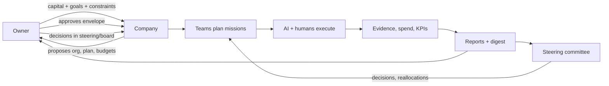
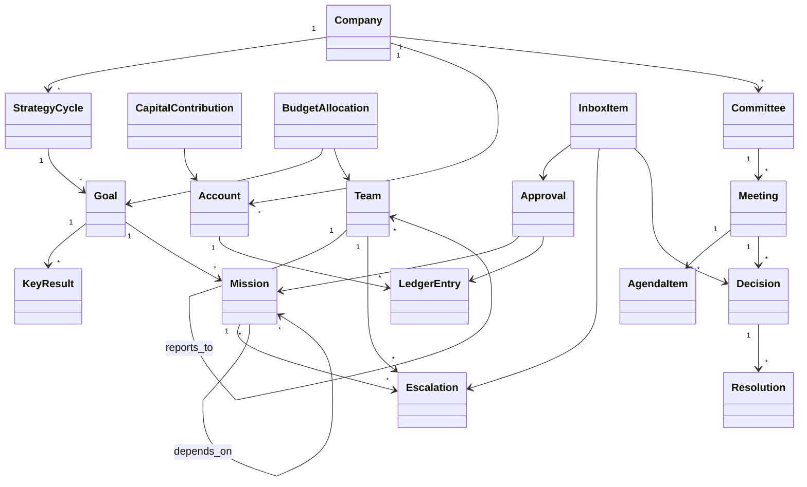
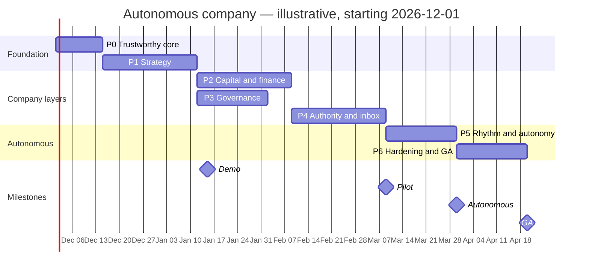

# Autonomous company

**Roadmap to the first AI company management platform**

| | |
| --- | --- |
| **Status** | Proposal — for review and decision |
| **Date** | 2026-11-23 |
| **Baseline** | `7b52488` (`main`, 286 uncommitted paths at time of writing — 130 outside `.codx`) |
| **Scope** | API + client + runtime: strategy with targets, real capital, steering governance, enforced authority, company rhythm |
| **Companion docs** | [ai-company.md](ai-company.md) (operating model), [ai-cofounder-product.md](ai-cofounder-product.md) (product backlog), [autonomous-company-backlog.yaml](autonomous-company-backlog.yaml) (153 actionable tasks) |
| **Owner** | To assign (product/architecture) |
| **Review cadence** | Phase gate; decisions re-opened if an assumption fails |

> **One sentence.** codx-junior can already run AI *work*; it cannot yet run a *company*. This roadmap adds the five missing layers — **strategy with targets, real money, steering governance, enforced authority, and a company clock** — on top of runtimes that already exist, and it starts by making those runtimes trustworthy enough to bet a business on.

---

## 0. Executive summary

### 0.1 Where we are

The repository is further along than a typical "idea" and much further along than most competitors on *execution*:

- a company-first shell is the default experience (`/` → company home, 12 sections);
- a company owns org units, hybrid human/AI teams, projects, missions, spaces and channels;
- a mission dispatches a durable orchestration run that plans, executes and verifies work;
- autonomous actors run scheduled shifts with boards, budgets and reports;
- meetings have real WebRTC audio, AI participants, transcripts, minutes and action items that become tasks;
- cross-project ticketing has a full lifecycle and an autonomous target-side worker;
- a business cockpit tracks revenue, costs, pipeline and metrics;
- AI spend is metered per mission/team/project, with dispatch-time budget gates;
- CISO gates, guardrails and a harness audit already exist.

### 0.2 Why it is not yet a company

All of that is an **excellent AI workspace with a company skin**. The following are either absent or decorative:

| Missing layer | Current reality |
| --- | --- |
| **Strategy** | "Goals" are missions: free-text objective + acceptance, no numeric target, no key results, no baseline, no period, no roll-up. `Mission.progress` mirrors a run, not strategy attainment. |
| **Capital** | Every amount is `cxjcoins` (AI compute). Real money exists only as three hand-typed scalars (`revenue_target`, `revenue_actual`, `costs_actual`). No capital, no cash balance, no ledger, no burn, no runway, no fiat conversion. |
| **Governance** | No steering committee, no board, no agenda object, no decision register, no resolution. Meeting "decisions" are a `List[str]` inside one meeting's minutes and never bind a goal, a budget or a mission. |
| **Authority** | Teams have no reporting line, no manager runtime, no spend authority, no approval matrix. The actor prompt still says *"Do not ask questions: no human will answer during the shift."* Approvals are one boolean, and the maker can be the checker. |
| **Rhythm** | No company clock, standup, weekly planning, monthly business review or board cadence. Autopilot dispatches at most one pre-existing `ready` mission per cycle and never creates work. |

Readiness is roughly **35% overall** and **~15% for the parts that make it a company** (strategy, money, governance, authority). Section 2 quantifies this.

### 0.3 The plan in one table

| Horizon | Phases | Outcome | Engineering | Calendar (3 eng) |
| --- | --- | --- | --- | --- |
| **Demo** | P0 + vertical slices of P1–P3 | Owner creates a company, invests capital, sets goals with targets, runs one steering meeting, sees a decision change the budget | ~13 pw | **6–7 weeks** |
| **Pilot** | P0–P4 | Company runs a week: goals → missions → escalations answered → owner inbox handles exceptions; money and authority enforced | ~24 pw | **12–14 weeks** |
| **Autonomous** | +P5 | Company runs a weekly/monthly rhythm, proposes goals and plans, managers answer within authority, digests and reviews | ~29 pw | **16–18 weeks** |
| **GA** | +P6 | Multi-company, unified audit, scale, pilots A/B, rollback rehearsed, GA release | ~33 pw | **18–22 weeks** |

Assumes **3 engineers + 0.5 designer + 0.5 QA + 0.3 PM**, 70% effective capacity, reuse of existing runtimes. A 2-engineer team should add 30–40%.

### 0.4 What we ask for

1. **Approve the five-layer model** and the decision-rights matrix (§1.4).
2. **Approve the phase order** and the P0 trust gate (§5): no autonomy expansion before P0 exits.
3. **Nominate pilot A** — the internal IT/QA/PM/Management company — and one external, non-IT company for pilot B.
4. **Decide D1–D7** in §10 (defaults are recommended).
5. **Staff the team** and start P0 on 2026-12-01.

---

## 1. The product

### 1.1 The owner's loop



The owner does four things and nothing else:

1. **Defines the destination** — mission, 12-month ambition, 90-day goals with measurable key results.
2. **Funds the company** — invests initial capital, sets the period budget envelope and the per-action limits.
3. **Meets the company** — weekly team reviews, monthly steering committee, quarterly board; chairs the committee and has the final say.
4. **Decides exceptions** — approvals, escalations, pivots, hires above threshold, anything legal or irreversible.

Everything else is the company's job.

### 1.2 What "runs by itself" means

Autonomy is **per action class**, not per company. A company can be fully autonomous on internal work and fully manual on money. The ladder:

| Level | Name | Meaning |
| --- | --- | --- |
| **L0** | Manual | Human creates and dispatches every mission. |
| **L1** | Suggest | AI proposes goals, missions, budgets; human dispatches. |
| **L2** | Supervised execution | AI executes within an approved envelope; human accepts outcomes. |
| **L3** | Autonomous in envelope | AI plans, executes, closes and reports inside goal + budget + policy; human sees exceptions and digests. |
| **L4** | Autonomous with post-hoc audit | AI also re-plans and reallocates inside a hard envelope; human reviews after the fact. |

Rules that never bend:

- the top of every chain is a human — the owner;
- money above a threshold, external communication, legal commitments and irreversible destructive actions are **L0** until explicitly promoted per action class;
- every promotion is earned by measured performance and is revocable;
- an AI may **propose** a goal, a budget, a hire or a decision, but may never approve its own proposal.

**"By itself" for GA means:** five consecutive days in which the owner opens no project, answers fewer than 10 attention items, and the company still plans, executes, reports and pays its bills inside the envelope.

### 1.3 The three meetings that run the company

| Meeting | Cadence | Chair | Inputs | Outputs | Authority |
| --- | --- | --- | --- | --- | --- |
| **Team review** | Weekly, per team | Team lead (AI or human) | Board, mission status, blockers, spend vs budget | Priorities, assignments, escalations | Reassign work inside the team envelope |
| **Steering committee** | Monthly, company | Owner | Board pack: KPIs vs targets, P&L, runway, goal health, risks, decisions needed | Decisions, budget reallocation, goal changes, new missions | Approve budget shifts, goals, hires; can pause the company |
| **Board** | Quarterly, formal | Owner (chair) | Audited quarter: financials, strategy attainment, risk register, prior resolutions | Annual plan and budget approval, strategy changes, formal resolutions | Reserve powers; owner has final vote |

All three share one object model: `Committee` → `Meeting` → `AgendaItem` → `Decision` → `Resolution`. A decision is not a string in minutes; it is a record with options, recommendation, decider, rationale, effective date, review date and links to the goal, budget or mission it changes.

### 1.4 Decision rights

| Decision | Proposes | Decides | Notes |
| --- | --- | --- | --- |
| Mission, vision, annual goals | Owner / AI | **Owner** | AI drafts from the blueprint and market context |
| Quarterly goals and key results | Team leads / CEO agent | **Owner** in steering | AI can adjust team-level KRs inside approved company goals |
| Period budget envelope | CFO agent | **Owner** | Capital allocation is always human |
| Spend below threshold | Any team | Manager agent | Threshold set per action class |
| Spend between thresholds | Team | **Steering / owner** | Maker-checker; no self-approval |
| Spend above hard cap | — | **Owner only** | Never delegated to an AI |
| Hiring an AI profile / team | Manager agent | Manager (inside headcount budget) or owner (new budget) | Probation + review |
| Mission plan and dispatch | Planner / manager | Manager agent | Inside goal + budget + policy |
| External send, publish, outreach | Team | **Owner by default** | Promotable per channel after evidence |
| Deploy to production | Engineering lead | CTO agent inside policy, owner above risk | CISO gate always applies |
| Legal, contracts, tax, payroll | — | **Human only** | The platform prepares and routes, never signs |
| Pause company / revoke autonomy | Anyone | **Owner** | One-click kill switch |

### 1.5 Non-goals for v1

- payroll, tax filing and statutory accounting;
- autonomous legal, financial or medical advice;
- a generic CRM/ERP replacement (connectors and company-built tools cover it);
- multi-tenant SaaS billing, marketplace, mobile app;
- unbounded autonomy: L4 is opt-in, capped and audited.

---

## 2. Where we are today

### 2.1 Readiness scorecard

`Built` = how much of the substrate exists. `Autonomous-ready` = how much is safe and complete enough to run a company on.

| Capability | Built | Autonomous-ready | What is missing |
| --- | --- | --- | --- |
| Company root, shell, onboarding | 85% | 80% | Legacy/dead components; wizard collects too little |
| Org, teams, people | 55% | 30% | Reporting lines, managers, authority, hiring lifecycle |
| Strategy and goals | 25% | 10% | Targets, key results, cycles, check-ins, roll-up, alignment |
| Execution (missions, runs, actors) | 70% | 40% | Reliability, goal linkage, dependencies, retries |
| Meetings — collaboration only | 65% | 45% | Company scope, agenda objects, minutes sign-off |
| Finance and capital | 15% | 5% | Everything real-money: accounts, capital, ledger, burn, runway |
| Governance (steering/board) | 5% | 0% | Committees, decisions, resolutions, board packs |
| Authority, escalation, approvals | 15% | 5% | Policy engine, authority limits, escalation objects, inbox |
| Company rhythm and autonomy | 25% | 10% | Clock, standups, planning, managers, digests, earned autonomy |
| Trust, audit, scale | 45% | 25% | Unified audit, hard budget stops, isolation, regression tests |
| **Overall (judgement)** | **~35%** | **~18%** | |

**Readiness for the owner's three jobs**

| Owner job | Ready | What works today | What is missing |
| --- | --- | --- | --- |
| **Define and steer goals** | ~15% | Missions with objective, acceptance, owner, due date and AI budget; a single revenue target | Goal and key-result model, check-ins, roll-up, alignment tree, strategy cycles |
| **Meet the team and the steering committee** | ~30% | Team channels, WebRTC meetings with AI participants, transcripts, minutes and action items → tasks | Company-scoped meetings, committees, agenda objects, structured decisions, resolutions, board packs |
| **Invest and govern money** | ~5% | AI-cost budgets and a manual revenue/cost cockpit | Capital contributions, accounts, ledger, allocations, approval thresholds, burn, runway, P&L |

The headline: **the execution engine is real, the management system is not.** Most remaining work is company management, not agent technology.

### 2.2 What already works (verified in this checkout)

| Capability | Evidence |
| --- | --- |
| Company-first routing and 12-section shell | `client/src/router/index.ts`, `client/src/views/CompanyView.vue`, `api/tests/test_company_first_web.py` |
| Company document: identity, org units, hybrid teams, projects, missions, spaces, channels | `api/codx/junior/company/models.py` |
| Mission lifecycle, approval gate, dispatch to a durable run | `company/manager.py` (`dispatch_mission`, `cycle`, `snapshot`, `_attention`), `orchestration/service.py` |
| Autopilot with daily budget and concurrency slots | `company/autopilot.py`, `CompanyManager.cycle` |
| Autonomous actors: schedules, shifts, boards, reports, budgets | `api/codx/junior/autonomy/` |
| Meetings: WebRTC, AI participants, transcript, minutes, action items → tasks | `api/codx/junior/meets/`, `docs/features/company-meetings.md` |
| Cross-project ticketing with autonomy worker | `api/codx/junior/ticketing/`, `api/docs/ticketing.md` |
| Business cockpit: revenue, costs, pipeline, metrics | `company/models.py` (`BusinessPlan`), `client/src/components/company/CompanyBusiness.vue` |
| AI spend ledger and dispatch-time budget gates | `CompanyManager.budget_state`, `_ensure_dispatch_budget`, `SpendEntry` |
| CISO gate, guardrails, harness audit | `security/ciso/`, `guardrails/`, `harness/audit.py` |
| Company-first tests | `api/tests/test_company_*.py` (7 files), `client/tests/company-*.test.mjs` (4) |

### 2.3 Surface inventory

**API.** 63 company routes under `/api/companies` cover identity, members, org units, teams, projects, missions (dispatch/accept/reject/approve/deny/transition/sync), autonomy, spaces, assistant, journal and snapshot. Meetings (`/api/meets`), tickets (`/api/tickets`), tasks (`/api/tasks`), orchestration (`/api/orchestration`), actors (`/api/actors`) and harness (`/api/harness`) are separate routers. **There is no route for goals, key results, capital, budgets, accounts, committees, decisions, escalations or approvals as first-class objects.**

**Client.** Twelve company sections: Home, Work, Team, Projects, Files, Business, Activity, Security, Settings, Meet, CoWorking, Calendar. Strong boards, goal drawer and business cockpit. **No owner inbox, no strategy/OKR view, no finance cockpit, no governance room, no org chart, no approvals center.** Six legacy company components (~1.6k lines) are orphaned.

### 2.4 How much is left, in numbers

| Measure | Value |
| --- | --- |
| Remaining actionable tasks | **153** (P0 14, P1 22, P2 27, P3 23, P4 28, P5 24, P6 15) |
| Engineering effort | **~162 person-days** (~32 person-weeks), including tests |
| Design effort | ~8–10 person-weeks |
| QA, docs, pilots | ~10–12 person-weeks |
| New backend modules | 7 (`strategy`, `finance`, `governance`, `org`, `policy`, `inbox`, `rhythm`) |
| New API route families | 8 |
| New client sections | 5 (Inbox/home, Strategy, Finance, Governance, Reports) + org chart |
| Existing code to extend | `company/models.py`, `company/manager.py`, `api/company.py`, `client/src/components/company/`, `client/src/api/modules/companies.js` |
| Existing code to delete | 6 orphan components, `StatusView.vue`, stale `/.codx` task cards |

The estimate assumes no rewrite of the actor, orchestration or meeting runtimes. If those are rewritten, add 8–10 weeks.

---

## 3. Gap analysis by domain

Each domain below states what exists, the concrete gap, the API gap, the client gap, and the "done when" test.

### 3.1 Strategy and goals

**Exists.** Company `mission`, `vision`, `values` (free text). Missions with title, objective, acceptance, team, project, due date, priority, AI budget, approval flag. `BusinessMetric` has a `label/value/target/unit/period` but is not connected to work. `revenue_target` is a single scalar.

**Gap.**
- No `Goal` entity and no `KeyResult`: nothing to express "grow MRR to €40k by Q2" with a baseline, a current value and a confidence.
- No strategy cycle or period; goals are not grouped into a quarter or year.
- No goal hierarchy (company → team → person) and no roll-up.
- No check-in ritual, no history, no trend, no health/at-risk computation.
- No link from mission to the goal it serves, so the owner cannot answer "what did we do for this goal, and did it move?".
- `Mission.progress` is a run mirror, not attainment.

**API gap.** `/companies/{id}/strategy`, `/goals` CRUD, `/goals/{id}/key-results`, `/goals/{id}/check-ins`, `/strategy/cycles`, `/strategy/tree`, `/strategy/review`.

**Client gap.** Strategy section, goal tree with health, KR editor and check-in flow, quarter review, home KPIs driven by KRs.

**Done when.** An owner can create a 90-day goal with three key results, see progress roll up from missions and check-ins, and see at-risk goals in the inbox without opening a project.

### 3.2 Capital and finance

**Exists.** `BusinessPlan` with currency, period, `revenue_target`, `revenue_actual`, `costs_actual`, pipeline deals and metrics. `SpendEntry` ledger for **AI credits** (`cxjcoins`). `budget_state` aggregates spend per mission/project/team. Project/team/mission budgets are dispatch-time gates. `Wallet` (per-user) is also `cxjcoins` only.

**Gap.**
- No real-money account, no capital contribution, no cash balance.
- No ledger: `revenue_actual`/`costs_actual` are typed numbers with no date, category, source or evidence.
- No budget *allocation* object: team/project budgets are period-less floats, and `0` means *no limit*.
- No burn, runway, forecast, P&L, cash flow or break-even.
- No reconciliation between AI spend and money.
- No spend approval or maker-checker; any manager can rewrite the cockpit.
- No separation between capital (equity/loan), revenue and expense.

**API gap.** `/finance/accounts`, `/finance/capital`, `/finance/ledger`, `/finance/budgets`, `/finance/pnl`, `/finance/runway`, `/finance/approvals`.

**Client gap.** Finance section: capital and cash, burn/runway, P&L, budget envelopes per team/goal, transaction ledger with export, expense and approval forms.

**Done when.** The owner invests €50k; the contribution appears as capital (not revenue); teams receive envelopes; every euro of AI and tool spend is a categorized ledger entry; runway is computed and a hard cap stops spend before the next model call.

### 3.3 Governance and steering

**Exists.** Meetings with humans and AI profiles, recording, transcript, minutes (`decisions: List[str]`, `action_items`), and action items that can become tasks. A CISO review surface. Company journal for operational events.

**Gap.**
- Meetings are **project-scoped** (`Meet.project_id`, `team_id`) and have no company link.
- No `Committee`, no membership with roles/votes, no cadence, no quorum.
- Agenda is one textarea; no agenda item object, no board pack, no timeboxing.
- Decisions are strings; no options/recommendation/rationale/decider/review date.
- No decision log, no "why did we do that?", no resolution, no binding effect on goals, budgets or missions.
- No minutes sign-off, no follow-up tracker beyond creating a task.
- AI meeting turns bypass chat budgets and guardrails.

**API gap.** `/governance/committees`, `/governance/meetings`, `/governance/meetings/{id}/agenda`, `/governance/decisions`, `/governance/resolutions`, `/governance/board-pack`, `/governance/calendar`.

**Client gap.** Governance section: committee room, agenda builder, board pack reader, decision inbox/detail, decision log, minutes sign-off.

**Done when.** A monthly steering meeting is scheduled automatically, opens with a generated board pack, records three decisions with options and rationale, and one decision reallocates €5k from one team to another and creates two missions — all audited.

### 3.4 Organization and authority

**Exists.** Org units (tree via `parent_id`), hybrid teams with a lead and roster, company roles (admin/manager/member), per-team autonomy level, per-team approval flag, per-team AI budget.

**Gap.**
- Org chart is decorative: teams have no `reports_to`, no manager, no deputy, no charter interfaces, no SLA.
- No authority envelope: no spend limit, approval limit, can-hire, can-publish, can-deploy, max-risk.
- Actor roles (`coworker` / `manager`) only change the prompt.
- No hiring/probation/review/retirement lifecycle for AI employees.
- No team inbox; nothing wakes a lead when the team is blocked.
- No separation of duties; the same person can create, approve, dispatch and accept.

**API gap.** Org graph CRUD and validation, team reporting lines, authority matrix, hiring lifecycle, performance review.

**Client gap.** Org chart, team editor with reporting/authority, authority matrix, hiring flow, performance review.

**Done when.** A QA team escalates to IT, IT to Project Management, Project Management to the owner; each hop has an owner, an SLA and an authority check; the owner sees one item, not five chats.

### 3.5 Work protocol, escalation and inbox

**Exists.** Missions, tickets, boards, orchestration runs, actors' agendas, a derived "attention" list from missions (`_attention`), company journal.

**Gap.**
- No `Escalation` object: no context packet, options, SLA, route, answer contract or timeout re-route.
- Prompts forbid asking: actors are explicitly told no human will answer during a shift.
- No generic `Approval` object or policy matrix; approvals are per-mission booleans.
- No persisted inbox: `_attention` is recomputed from missions, so approvals/escalations/anomalies have no home, no SLA, no history.
- No takeover/handback: a human cannot join a running agent cleanly.
- No mission dependencies or parent/child; a goal cannot be decomposed into a plan with sequencing.
- Ticket retry path is dead (`next_retry_at` never set).

**API gap.** `/inbox`, `/inbox/{id}/actions`, `/escalations`, `/approvals`, `/policy/evaluate`, mission dependency fields.

**Client gap.** Owner inbox as home, approvals center, escalation center, team inbox, takeover/handback.

**Done when.** A blocked agent raises a structured escalation instead of guessing; the owner answers it in one click; the answer is recorded and the agent resumes; every item has an SLA and an audit entry.

### 3.6 Autonomy and company rhythm

**Exists.** Actor schedules and shifts, autopilot cycles, mission dispatch, meeting action items, daily/weekly budgets, actor reports.

**Gap.**
- No company clock: no cadence model, no standup, no weekly planning, no monthly review, no quarterly planning.
- Autopilot never creates work: it only dispatches existing `ready` + `auto` missions.
- No goal decomposition or long-horizon planning.
- No manager agents answering escalations, no budget reallocation, no retrospective, no company memory.
- No digest/report generation or delivery.
- No earned autonomy: levels are static settings.
- No agent performance review.

**API gap.** `/rhythm`, `/rhythm/{cycle}/run`, `/reports`, `/memory`, `/reviews`.

**Client gap.** Rhythm calendar, reports library, digest reader, autonomy controls with evidence.

**Done when.** The company runs five consecutive days with daily standups, a weekly review, a monthly business review and a digest; the owner only handles exceptions.

### 3.7 Trust, audit and scale

**Exists.** CISO gate, guardrails, harness JSONL audit, per-worker flocks, crash recovery, per-project concurrency.

**Gap.**
- No unified company audit: company journal, harness audit, spend ledger and decisions are separate, with different clocks (UTC vs local naive).
- `0 = no limit` is the default for mission/team/autopilot budgets; an autonomous company can spend without a cap.
- Four independent workers (orchestration, actors, tickets, autopilot) can exceed installation capacity together.
- No maker-checker, no global kill switch, no approval for tool actions.
- `force=True` skips all budget gates; meeting action items with `run: true` bypass approval and budget.
- Company APIs lack role checks on actor/ticket routes.
- Company document grows without bound; spend ledger truncates at 2,000 entries.
- No tests for `dispatch_mission`, `cycle`, `budget_state`, autopilot or the assistant.
- The working tree is dirty (286 paths, 130 outside `.codx`), open IT-team cards report the CISO gate as a false green, and the AI teams are currently hitting runtime errors (`name 'tags' is not defined`, `effort: null`) — autonomy cannot be expanded on this base.

**Done when.** One audit stream answers "who approved what, with which money, under which policy, with which result"; no unauthorized money action is possible; a kill switch stops every worker within one tick; the company passes a security review.

---

## 4. Target architecture

### 4.1 Principles

1. **Extend the company document; do not build a parallel universe.** Goals, finance, governance and inbox are new stores, but they attach to the existing `Company`, `Mission`, `Team` and `Chat` objects.
2. **Money is not compute.** `cxjcoins` stays the AI-cost unit; finance adds a base currency with an explicit conversion rate. Never let capital be recorded as credits.
3. **Enforced, not prompted.** Authority, budgets and approvals are checked in code at the action boundary (tool call, dispatch, payment), not described in a system prompt.
4. **One work object.** `Goal` → `Mission` → `Ticket`/`Chat`; no third work-item type. Add escalation and approval *beside* work, not above it.
5. **Event-sourced audit.** Every state change emits a typed company event; the audit stream is the read model.
6. **Split the monolith before it hurts.** Identity/config stays in `company.json`; strategy, finance, governance, inbox and audit get their own stores with append-only logs.
7. **The owner's attention is the scarcest resource.** Every feature must reduce the number of things the owner must read, or it is not done.

### 4.2 Domain model



### 4.3 New backend modules

```
api/codx/junior/company/
  strategy/     models.py  service.py  store.py  prompts.py  api.py
  finance/      models.py  service.py  store.py  ledger.py  api.py
  governance/   models.py  service.py  store.py  board_pack.py  api.py
  org/          models.py  service.py  authority.py  api.py
  policy/       engine.py  matrix.py  api.py
  inbox/        models.py  service.py  store.py  api.py
  rhythm/       clock.py  planner.py  digest.py  memory.py  api.py
  audit/        stream.py  events.py
```

Keep the existing `company/manager.py` as the facade: it composes the sub-services so callers and tools do not need to change.

### 4.4 Storage layout

```
<companies_root>/<company_id>/
  company.json              identity, org, teams, projects, autonomy (existing)
  strategy.json             cycles, goals, key results
  finance/accounts.json     accounts and balances
  finance/ledger.jsonl      append-only, one entry per money movement
  finance/budgets.json      allocations per period
  governance/committees.json
  governance/decisions.jsonl
  governance/meetings/<id>.json
  inbox/items.jsonl
  audit/events.jsonl        unified company audit
  journal.jsonl             existing operational journal (kept)
```

Migration `company.version: 1 → 2` is additive and idempotent: new files are created empty, old fields are read as a fallback, and a dry-run mode reports what would change.

### 4.5 Runtime changes

| Component | Change |
| --- | --- |
| **Company clock** | A single scheduler in `background.py` emits cadence events (standup, weekly, monthly, quarterly, board) in the company timezone and respects working hours. |
| **Planner** | A `planner` role that decomposes goals into missions with budgets and dependencies; proposes in L1/L2, dispatches in L3. |
| **Manager** | Team-lead actor with an inbox, SLA and authority; answers, delegates, escalates, never self-approves. |
| **Policy engine** | Central `evaluate(action, actor, entity)` → `allow / deny / needs_human`; called by tools, dispatch, payments and external senders. |
| **Inbox** | Persisted `InboxItem` created by escalations, approvals, decisions, anomalies and reports; one API for every surface. |
| **Finance guard** | Hard stop at the tool/model boundary; reserve → settle; no `force` bypass without owner authority. |
| **Audit** | One `CompanyEvent` stream merged with harness and finance; monotonic sequence, hash chain. |
| **Kill switch** | `company.paused` halts dispatch, actors, autopilot and rhythm within one tick. |

### 4.6 New API surface (target)

| Family | Routes |
| --- | --- |
| Strategy | `GET/POST /companies/{id}/strategy/cycles`, `GET/POST/PUT/DELETE /companies/{id}/goals`, `POST /goals/{gid}/key-results`, `POST /goals/{gid}/check-ins`, `GET /strategy/tree`, `GET /strategy/review` |
| Finance | `GET/POST /finance/accounts`, `POST /finance/capital`, `GET/POST /finance/ledger`, `GET/POST /finance/budgets`, `GET /finance/pnl`, `GET /finance/runway`, `POST /finance/approvals` |
| Governance | `GET/POST /governance/committees`, `GET/POST /governance/meetings`, `PUT /meetings/{id}/agenda`, `POST /meetings/{id}/decisions`, `GET /governance/decisions`, `POST /governance/resolutions`, `GET /governance/board-pack` |
| Org / authority | `GET /org/chart`, `PUT /teams/{id}/reporting`, `GET/PUT /org/authority`, `POST /org/hires`, `POST /org/reviews` |
| Policy / inbox | `POST /policy/evaluate`, `GET /inbox`, `POST /inbox/{id}/actions`, `GET /escalations`, `POST /escalations/{id}/answer` |
| Rhythm / reports | `GET /rhythm`, `POST /rhythm/{cycle}/run`, `GET /reports`, `GET /reports/{id}`, `GET /memory` |

All routes reuse the existing company authorization dependency; no route is trusted because it is internal.

### 4.7 Client information architecture (target)

```
/<company>/
  home          Owner inbox + digest + health (replaces the dashboard-only home)
  strategy      Goals, key results, quarter review, alignment tree
  work          Missions board (existing, linked to goals)
  team          Org chart, teams, people, hiring, reviews
  finance       Capital, cash, burn/runway, P&L, budgets, ledger
  governance    Committees, meetings, board pack, decisions, log
  projects      Existing projects/files
  operations    Meet, coworking, calendar (existing)
  reports       Digests, board packs, retrospectives
  settings      Company, autonomy, authority, policy, danger zone
```

`Business` merges into `Finance` (pipeline stays as a commercial panel). `Activity` merges into `Home`/`Reports`. Delete the six orphan components.

### 4.8 Key architectural decisions

| ID | Decision | Recommendation | Why |
| --- | --- | --- | --- |
| **A1** | Goal vs Mission | `Goal` is a strategy object with KRs; `Mission` is an initiative that serves a goal | Avoids stretching one object until it means nothing |
| **A2** | WorkItem vs existing Mission/Ticket | **No new WorkItem** in v1; extend `Mission` and reuse `Ticket` | The `ai-company.md` WorkItem duplicates 60% of Mission; migration cost is high |
| **A3** | Money model | Double-entry-lite ledger in base currency; `cxjcoins` converted at a configured rate as an opex category | Auditable, simple, separates capital from revenue |
| **A4** | Committee authority | Owner chairs and has the final vote; AI members advise and execute | Legal reality and trust |
| **A5** | Autonomy default | L2 supervised; L3 opt-in per team; money L0/L1 above €100 | Safe by default |
| **A6** | Store | Split per domain, append-only logs, `company.json` stays config | The current single document cannot hold finance + audit history |
| **A7** | Runtime | Extend actors/orchestration; no new agent framework | The hard part is already built |

---

## 5. Roadmap

### 5.1 Phases

| Phase | Outcome | Effort (eng pd) | Calendar (3 eng) | Exit gate |
| --- | --- | --- | --- | --- |
| **P0 — Trustworthy core** | The existing runtime is reliable enough to bet on | 14 | 2 weeks | 20 consecutive clean shifts; zero stale agendas; budgets deny-by-default; kill switch works |
| **P1 — Strategy** | Owner defines goals with targets; company aligns work to them | 24 | 3–4 weeks | A goal with 3 KRs rolls up mission progress; at-risk appears in inbox |
| **P2 — Capital & finance** | Owner invests; budgets, ledger, burn and runway are real | 29 | 4–5 weeks | €50k capital → envelopes → every spend categorized → hard stop works |
| **P3 — Governance** | Steering committee and board run on decisions, not minutes | 24 | 3–4 weeks | One board pack, three decisions, one resolution changes budget/goals |
| **P4 — Authority & inbox** | Org chart is executable; escalation and approvals are enforced | 30 | 4–5 weeks | Owner inbox handles 100% of actions; no self-approval; SLA met |
| **P5 — Rhythm & autonomy** | Company runs its own cadence and plans inside the envelope | 23 | 3–4 weeks | 5 days, owner opens no project, digest + reviews generated |
| **P6 — Hardening & GA** | Multi-company, audited, scaled, piloted | 18 | 3 weeks | Two pilots pass; rollback rehearsed; security sign-off |

Phases are sequential on the critical path but P2 and P3 can overlap after P1, and client work can start one sprint behind the API with mocked contracts. The calendars above do not sum linearly: with P2/P3 in parallel the critical path is **≈20 weeks** (§5.3), which is the GA estimate. See §5.4.

### 5.2 Phase detail

#### P0 — Trustworthy core (2 weeks)

**Why first.** There are dozens of error shift cards (49 recorded occurrences of `name 'tags' is not defined`); the autopilot state records `last_status: error`; profiles carry `effort: null`; the actor prompt forbids questions; budget `0` means unlimited; the ticket retry path is dead; the working tree is dirty. Building strategy and finance on this base would multiply the failure surface.

**Scope.**
- Fix effort-tier resolution, `tags` NameError, stale `wake_at`, `update_task` profile loss, tool timeouts.
- Enforce profile tools under actor policy; capture stop reason; surface failed runs.
- Normalize UTC across company/autonomy/tickets.
- Add the company kill switch and deny-by-default budget semantics.
- Fix the ticket retry path and the CISO/clean-tree gate.
- Add the missing regression tests for dispatch/cycle/budget and a runtime health panel.

**Tasks:** AC-001…AC-014. **Exit:** 20 consecutive clean shifts, zero stale agenda re-fires, budget stop proven, kill switch proven, regression suite green.

#### P1 — Strategy (3–4 weeks)

**Scope.**
- `Goal`, `KeyResult`, `StrategyCycle` models; goal tree and health.
- KR check-ins, metric time series, link `BusinessMetric` → KR.
- Goal → mission decomposition; AI goal proposal; owner approval.
- Strategy API and client: section, tree, editor, check-in, quarter review.
- Home KPIs and the wizard driven by goals, not free text.

**Tasks:** AC-101…AC-122. **Exit:** owner creates a 90-day goal with 3 KRs, links two missions, records a check-in, sees attainment and at-risk; AI can propose a goal but cannot approve it.

#### P2 — Capital and finance (4–5 weeks)

**Scope.**
- Finance stores and models: account, capital contribution, ledger entry, budget allocation, period.
- Capital injection, budget envelopes, income/expense, AI spend rollup and conversion.
- Burn, runway, forecast, P&L, cash flow, break-even.
- Budget guard with thresholds, spend approvals, reconciliation and alerts.
- Finance API and client section.

**Tasks:** AC-201…AC-227. **Exit:** owner invests €50k; capital ≠ revenue; envelopes per team/goal; a €200 spend needs approval, a €2,000 spend cannot pass without the owner; runway is computed from the ledger; export reconciles with the AI spend report.

#### P3 — Governance (3–4 weeks)

**Scope.**
- Committee, membership, company-scoped meeting, agenda items, decision, resolution, decision log.
- Cadence scheduling and board pack generation.
- Decision lifecycle, quorum/vote (config), minutes sign-off, resolution application.
- Governance API and client room, board pack reader, decision inbox and log.

**Tasks:** AC-301…AC-323. **Exit:** a monthly steering meeting is auto-scheduled, opens with a board pack built from live goals/finance, records a decision with options and rationale, and applies a resolution to the budget and to two missions.

#### P4 — Authority and inbox (4–5 weeks)

**Scope.**
- Reporting lines, manager/deputy, charter and SLA.
- Authority envelope and policy matrix; policy engine enforced in tools, dispatch, payments and external sends.
- Escalation object, routing, SLA, timeout re-route, top-at-owner.
- Approval object, maker-checker, separation of duties.
- Persisted attention inbox, team inbox, takeover/handback.
- Org chart, authority matrix, escalation/approval centers, owner inbox as home.

**Tasks:** AC-401…AC-428. **Exit:** a QA→IT→PM→owner escalation chain runs end to end; every hop has an owner and an SLA; the owner answers in one inbox; no actor can approve its own request or exceed its authority.

#### P5 — Rhythm and autonomy (3–4 weeks)

**Scope.**
- Company clock, working calendar, standup, weekly planning, monthly review, quarterly planning.
- Autonomous goal proposals and mission planning with dependencies.
- Manager agents that answer within authority and escalate up.
- Budget reallocation proposals, outcome reviews, company memory.
- Digests and reports, delivery, earned autonomy, agent performance reviews, exception-only mode.
- Client rhythm, reports library, digest reader, autonomy controls.

**Tasks:** AC-501…AC-524. **Exit:** five days with no project opened; daily standup, weekly review, monthly business review and digest generated; owner attention items < 10/day and resolved same day; autonomy promotion audited.

#### P6 — Hardening and GA (3 weeks)

**Scope.**
- Multi-company isolation, unified audit with hash chain, scale/indexes/pagination.
- Security review and pen-test, reliability (supervision, idempotency, dead-letter), global admission and cost circuit breaker.
- Observability, migration/upgrade path, docs and API reference.
- Pilot A (internal IT/QA/PM/Management), pilot B (external non-IT), rollback rehearsal, GA packaging.

**Tasks:** AC-601…AC-615. **Exit:** both pilots pass their acceptance script; zero unauthorized money actions; rollback in < 1 hour; security sign-off; GA release.

### 5.3 Illustrative timeline



Add 2–3 weeks of holiday/buffer in December and April. The dates are planning aids, not commitments.

### 5.4 Critical path and parallelism

**Critical path:** P0 → Goal model → Goal→Mission link → Budget allocation → Authority/policy → Escalation/inbox → Rhythm.

Parallel opportunities:

- P2 (finance) and P3 (governance) both depend on P1 but not on each other; run them with separate backend owners.
- Client work starts one sprint after the API contract is frozen, against mocks.
- P0 fixes are independent and can run as a separate pair while P1 models are designed.
- P6 pilots need P4 (inbox) and P5 (reports); start recruiting pilots during P4.

### 5.5 30/60/90-day view

| Window | Deliverable | Demo script |
| --- | --- | --- |
| **Days 1–30** | P0 + goal model + capital model + strategy/finance contracts | Owner creates a company, invests €50k, sets one goal with two KRs; a mission is linked and dispatched. |
| **Days 31–60** | Strategy UI, finance cockpit, committee/decision model, board pack v0 | Owner runs a steering meeting; a decision moves €5k from Team A to Team B and creates two missions. |
| **Days 61–90** | Escalation, approval, inbox, policy engine, pilot A starts | A blocked AI team escalates to the owner; the owner answers in one click; the team resumes; the audit shows who/when/why. |

### 5.6 Team and effort assumptions

| Role | FTE | Notes |
| --- | --- | --- |
| Backend engineers | 2 | Domain services, policy, finance, migration, tests |
| Frontend engineer | 1 | Four new sections, org chart, inbox, finance/governance |
| Designer | 0.5 | Owner inbox, strategy and finance cockpits, governance room |
| QA / DevRel | 0.5 | Contracts, pilots, docs, release |
| Product/architecture | 0.3 | Decisions, phase gates, pilot relationships |

Effort is **~162 engineering person-days** plus ~90 person-days of design, QA and docs, with a 30% integration buffer. That is **18–22 weeks to GA** at 70% effective capacity, **12–14 weeks to pilot**, **6–7 weeks to demo**.

### 5.7 Deliberately deferred

- payroll, tax, statutory accounting, invoicing connectors (v2);
- marketplace, partner API, mobile app;
- full ATS/HRIS;
- multi-tenant SaaS billing;
- autonomous legal/financial commitments (permanent non-goal);
- a generic WorkItem rewrite (A2).

---

## 6. Backlog

The full, actionable list is **[autonomous-company-backlog.yaml](autonomous-company-backlog.yaml)**: 153 tasks with ID, phase, area, size, priority, dependencies, acceptance and evidence.

### 6.1 Conventions

- **ID** — `AC-<phase><number>`; stable, referenced by missions and PRs.
- **Area** — `api`, `client`, `both`, `platform`, `docs`.
- **Size** — `S` ≤ 1 day, `M` 2–3 days, `L` 4–5 days, `XL` > 5 days (split before starting).
- **Priority** — `P0` blocks the phase exit, `P1` required for the phase, `P2` can slip one phase.
- **Definition of done** — code + tests + typed events + audit + API docs + client contract + i18n keys (no hardcoded English) + no regression in the phase gate.

### 6.2 Epics and counts

| Phase | Epic | Tasks | Effort (pd) |
| --- | --- | --- | --- |
| P0 | Runtime trust | 14 | 14 |
| P1 | Strategy and OKRs | 22 | 24 |
| P2 | Capital, budget and P&L | 27 | 29 |
| P3 | Steering, board and decisions | 23 | 24 |
| P4 | Org, authority, escalation, inbox | 28 | 30 |
| P5 | Company clock and autonomous rhythm | 24 | 23 |
| P6 | Hardening, pilots and GA | 15 | 18 |
| **Total** | | **153** | **162** |

### 6.3 First three sprints

**Sprint 1 — trust (P0, 2 weeks).**

| Task | Outcome |
| --- | --- |
| AC-001, AC-002, AC-007 | Clean shifts: effort tiers resolved, no `tags` error, stop reasons surfaced |
| AC-003, AC-006 | Agenda hygiene and task-profile preservation |
| AC-004, AC-005 | Tool policy and discovery timeouts |
| AC-008, AC-009 | Regression tests and UTC normalization |
| AC-010, AC-011 | Kill switch and safe budget defaults |
| AC-012, AC-013, AC-014 | Ticket retry, runtime health panel, clean-tree/CISO gate |

**Sprint 2 — strategy core (P1, 2 weeks).**

| Task | Outcome |
| --- | --- |
| AC-101, AC-102, AC-103 | `Goal`, `KeyResult`, `StrategyCycle` models |
| AC-104, AC-105, AC-114 | Store v2 migration, service, API |
| AC-110, AC-111 | Health machine and goal→mission link |
| AC-115, AC-116 | Strategy section and goal tree in the client |
| AC-121 | Contracts and migration tests |

**Sprint 3 — money core (P2, 2 weeks).**

| Task | Outcome |
| --- | --- |
| AC-201, AC-202, AC-203, AC-204 | Finance stores and models |
| AC-208, AC-209, AC-210 | Service, capital injection, allocations |
| AC-213, AC-214 | Runway and P&L |
| AC-219, AC-220 | Finance section, capital/runway cockpit |
| AC-226 | Ledger and guard tests |

Then interleave P3 (governance) and P4 (authority) as shown in §5.4.

### 6.4 Traceability

Every phase exit maps to a **pilot acceptance script** (§7) and to a **mission** in the company's own board. The roadmap should be executed dogfooding: each epic becomes a mission with the task IDs as acceptance, the phase gate as the review, and the owner as the approver.

---

## 7. Owner journeys (acceptance)

### 7.1 Day one — incorporate and fund

1. Owner creates the company: name, mission, business model, currency, timezone.
2. Owner invests **€50,000** as equity; the finance ledger records a capital contribution (not revenue) and the account balance becomes €50,000.
3. Owner sets a 12-month ambition and one 90-day goal with three key results and a **€15,000** envelope.
4. AI proposes an org (CEO/CFO/COO/CTO agents + sales, delivery, support teams), a 30/60/90 plan and first missions with budgets.
5. Owner edits and approves the envelope.
6. **Exit:** company home shows capital, burn, runway, goal attainment and the first mission; nothing has been spent without an approval record.

### 7.2 Week one — run the rhythm

1. Daily standup is generated at 09:00 in the company timezone; three missions are in flight.
2. One mission is blocked; the manager agent raises an escalation with options; the owner answers in the inbox; the mission resumes.
3. A €200 tool purchase needs approval; the owner approves; the ledger records the expense and the runway updates.
4. Friday: weekly review with evidence, spend vs budget, goal check-in.

**Exit:** no project view opened; owner handled fewer than 8 attention items; every item is audited.

### 7.3 Month one — steer

1. The steering committee is auto-scheduled with a board pack (KPIs vs targets, P&L, runway, goal health, risks, decisions needed).
2. Owner chairs; AI CFO presents burn and runway; AI CEO recommends moving €5k from support to growth.
3. A decision is recorded with options, recommendation, rationale and review date; a resolution reallocates the budget and creates two missions.
4. The decision log answers "why did we cut support?" with the evidence.

**Exit:** board pack generated without manual work; decision applied to budget and goals; audit shows proposer, decider, timestamp and effect.

### 7.4 Quarter one — govern

1. Board meeting with audited quarter: capital, P&L, strategy attainment, risk register, prior resolutions.
2. Owner approves the next quarter's goals and budget; autonomy is promoted for one team from L2 to L3 based on measured performance.
3. Company runs five days without the owner opening a project.

**Exit:** GA acceptance.

---

## 8. Success metrics

### 8.1 Owner outcomes

| Metric | Target |
| --- | --- |
| Owner attention items per day | < 10 by pilot, < 5 by GA |
| Attention items resolved same day | ≥ 80% |
| Days without opening a project | 5 consecutive by GA |
| Time to set up a company with goals and budget | < 1 hour |
| Board pack preparation time | < 5 minutes (generated) |
| Decisions with recorded rationale | 100% |
| Unauthorized money actions | 0 |

### 8.2 Platform health

| Metric | Target |
| --- | --- |
| Clean autonomous shifts | ≥ 95% |
| Stale agenda re-fires | 0 |
| Budget overspend incidents | 0 |
| Escalations answered within SLA | ≥ 90% |
| Mission success without human rescue | ≥ 70% |
| AI cost per completed mission | tracked, downward trend |
| p95 company snapshot latency | < 500 ms at 10k items |
| Company audit completeness | 100% of state changes |

### 8.3 Product proof

- **Pilot A:** internal IT/QA/PM/Management company runs two weeks; QA→IT→PM→owner escalation chain works; owner only handles exceptions.
- **Pilot B:** external non-IT company (travel advisory or agency) runs two weeks; goals, capital and one steering meeting work without engineering help.
- **North star:** an owner can start a company with capital from a brief in under an hour and leave it running for a week.

---

## 9. Risks and mitigations

| Risk | Likelihood | Impact | Mitigation |
| --- | --- | --- | --- |
| Autonomy is not trustworthy yet (error shifts, stale agendas, unlimited budgets) | High | High | P0 gate before any expansion; deny-by-default budgets; kill switch; 20 clean shifts |
| Scope explosion (finance + governance + HR + tool platform) | High | High | Fixed phase exits; non-goals; defer tool platform and connectors to v2 |
| Capital model confuses compute credits and money | Medium | High | Separate ledger and currency; `cxjcoins` only as an opex category with a configured rate |
| Committee/decisions become another chat | Medium | Medium | Decision object with options, decider, rationale, effect and review date; no string decisions |
| Authority is decorative again | High | High | Policy engine at the action boundary; tests that assert deny; no prompt-only rules |
| Single-document store bloats or corrupts | Medium | High | Split stores with append-only logs; migration dry-run; atomic writes |
| Workers exceed capacity or budget together | Medium | High | Global admission, per-company/day caps, circuit breaker, cost alerts |
| Pilot companies need features outside the plan | High | Medium | One external pilot only; capture requests in the backlog, do not fork the roadmap |
| Team is 2 engineers, not 3 | Medium | Medium | Add 30–40%; cut P5 features (memory, earned autonomy) before cutting P0/P2 |
| Security incident during autonomy | Low | Critical | CISO gate in P0; pen-test in P6; no external/legal autonomy; audit hash chain |
| Documentation/code drift (three competing programmes) | High | Medium | This roadmap is the single delivery plan; ai-company and ai-cofounder become design references; one owner; decisions log |

---

## 10. Open decisions

| ID | Decision | Recommendation | Needed by |
| --- | --- | --- | --- |
| **D1** | Is the goal primitive a new `Goal` + `KeyResult`, or an extension of `Mission`? | New `Goal`/`KeyResult`; `Mission` stays the initiative | P1 start |
| **D2** | Do we build a `WorkItem` abstraction? | No for v1; extend `Mission`, reuse `Ticket` | P4 start |
| **D3** | Base currency and `cxjcoin` conversion | One base currency per company; configurable rate; AI cost as opex | P2 start |
| **D4** | Who chairs the steering committee and who has the final vote? | Owner chairs and votes last; AI members advise | P3 start |
| **D5** | Default autonomy level for a new company | L2 supervised; money above €100 needs a human | P4 start |
| **D6** | Where do board/steering meetings live — a new entity or `Meet` with a company link? | New `CompanyMeeting`; `Meet` is one execution mode for it | P3 start |
| **D7** | Do we migrate existing missions to goals automatically? | Link to a single "Legacy operations" goal; never guess | P1 migration |

---

## 11. Immediate next actions (this week)

1. **Approve this roadmap and D1–D7** at the next review; assign the owner.
2. **Freeze the tree and run P0**: clean the dirty tree (286 paths), verify the reported CISO false green, and open the P0 mission with AC-001…AC-014.
3. **Staff the team**: 2 backend, 1 frontend, 0.5 designer, 0.5 QA, 0.3 product.
4. **Nominate pilot A** (internal IT/QA/PM/Management) and start recruiting pilot B.
5. **Write the acceptance scripts** for §7 with the pilot owners, so "done" is testable before code exists.
6. **Create the first missions** in the company board from the backlog (P0 and P1 only), with the phase gate as acceptance.

---

## Appendix A — Evidence index

| Area | Files |
| --- | --- |
| Company model | `api/codx/junior/company/models.py` (`Company`, `Mission`, `CompanyTeam`, `BusinessPlan`, `SpendEntry`, `AutonomyPolicy`) |
| Company services | `api/codx/junior/company/manager.py` (`dispatch_mission`, `cycle`, `snapshot`, `_attention`, `budget_state`) |
| Autopilot | `api/codx/junior/company/autopilot.py` |
| Company API | `api/codx/junior/api/company.py` (63 routes) |
| Actors | `api/codx/junior/autonomy/` (`service.py`, `worker.py`, `prompts.py`, `models.py`) |
| Orchestration | `api/codx/junior/orchestration/` (`service.py`, `worker.py`, `models.py`) |
| Meetings | `api/codx/junior/meets/`, `api/codx/junior/api/meets.py`, `docs/features/company-meetings.md` |
| Tickets | `api/codx/junior/ticketing/`, `api/docs/ticketing.md` |
| Finance primitives | `api/codx/junior/model/wallet.py`, `company/manager.py` (`budget_state`) |
| Client shell | `client/src/views/CompanyView.vue`, `client/src/router/index.ts` |
| Client company components | `client/src/components/company/` |
| Existing blueprints | `docs/transformation/ai-company.md`, `ai-cofounder-product.md`, `company-first-shell.md` |

## Appendix B — Glossary

| Term | Meaning |
| --- | --- |
| **Owner** | The human principal: provides capital, sets goals, chairs the steering committee, holds reserve powers |
| **Goal** | A measurable company/team outcome for a period, with key results |
| **Key result** | A numeric target with baseline, current value, unit and confidence |
| **Mission** | An initiative that serves a goal and dispatches a durable run |
| **Strategy cycle** | A planning period (quarter/year) that groups goals and budgets |
| **Capital contribution** | Money the owner invests (equity/loan), not revenue |
| **Budget allocation** | An envelope of money assigned to a goal/team/org unit for a period |
| **Ledger** | Append-only record of every money movement |
| **Runway** | Cash divided by net monthly burn |
| **Committee** | A governed group (steering, board) with members, cadence and authority |
| **Decision** | A recorded choice with options, recommendation, decider, rationale and effects |
| **Resolution** | A binding decision that changes goals, budgets, missions or policy |
| **Escalation** | A structured request for a human/manager answer when an agent is blocked |
| **Approval** | A maker-checker gate for an action that exceeds routine authority |
| **Policy engine** | Code that evaluates an action against authority, budget and risk |
| **Attention inbox** | The owner's single queue of approvals, escalations, decisions, anomalies and reports |
| **Company clock** | The scheduler that runs standups, reviews, planning and board cadence |
| **Earned autonomy** | Promotion to a higher autonomy level based on measured performance |
| **cxjcoin** | The internal AI-compute cost unit; never real money |

---

_Made with ❤️ by codx-junior — roadmap for review, not a commitment._
