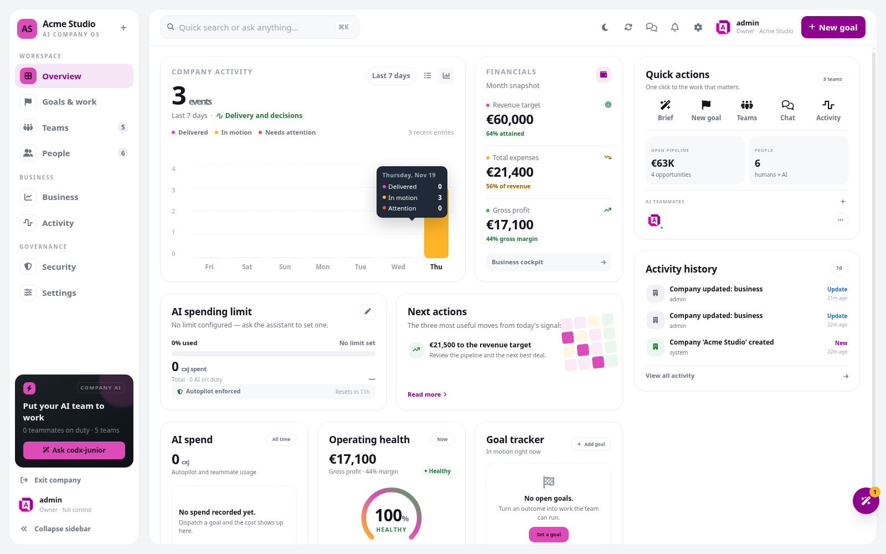
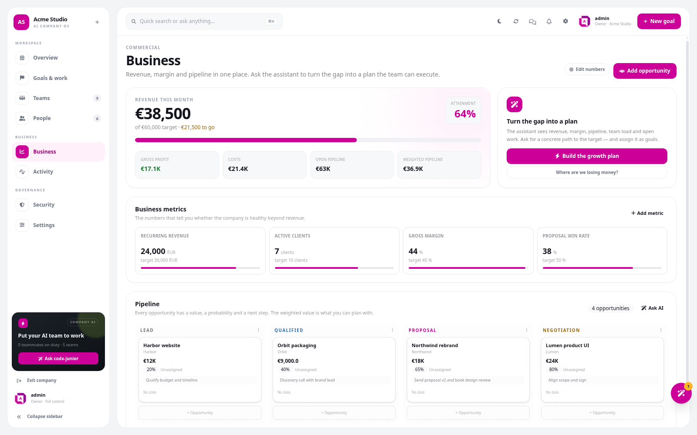

# Company view — AI company command center

**Implementation note · 2026-11-19**

The company shell has been rebuilt as a business operating system rather than an
assistant-first dashboard. It is designed for owners and managers with no
technical background: one place to see the truth, decide, talk to the team,
review delivery and grow revenue.

> The reference dashboard included a fake “My card” / “Add card” block. It is
> intentionally not implemented: codx-junior has no card functionality. The
> useful shortcuts and AI-teammate block stay, and the remaining tiles are all
> backed by real company data.

## What the owner gets

| Workspace | What it answers |
| --- | --- |
| **Home** | How is the company doing? What needs me now? What is moving? Where is the money? |
| **Goals & work** | What are we trying to achieve, who owns it, what is blocked, what is ready to review? |
| **Teams** | Who is in each team, who leads it, what is it working on, how is it performing? |
| **People** | Who are the humans and AI teammates, what are their roles, who is on duty? |
| **Business** | Revenue vs target, gross profit, pipeline, business metrics and the growth plan. |
| **Activity** | What was delivered, what changed, what was decided — in plain language. |
| **Security** | Cross-project CISO posture, findings and scan actions. |
| **Settings** | Company context, the AI provider/model/key codx-junior needs, autonomy envelope and AI budget. |

The workspace has a local **light/dark theme** (brand magenta and the design-system
surfaces) and an explicit **Exit company** link to simple mode or the desktop
workspace. The **assistant is always one click away** (a floating companion on desktop and
mobile). It opens with live signals (decisions waiting, revenue gap, blocked
goals), four one-click actions and a conversation grounded in the company
document, teams, missions, pipeline, budget and recent journal.

## The business layer

The company document now includes a persistent `business` plan:

- currency, period, revenue target / actual, costs;
- pipeline opportunities with value, stage, probability, owner and next step;
- owner-defined business metrics with targets;
- derived gross profit, pipeline value, weighted pipeline and revenue gap.

It is edited from the Business workspace (`Edit numbers`, `Add opportunity`,
`Add metric`) and is part of the same company JSON document, so it follows the
company across projects and is visible to the assistant.

## Assistant behaviour

- **Strategic questions go to reasoning, not a keyword router.**
  "How is the team doing?", "Where are we losing money?", "What should we focus
  on?" are answered from live context. Commands such as "show teams", "add a
  person" or "create a goal" keep their deterministic, safe flows.
- The context includes company direction, counts, teams and rosters, open
  missions with run/approval state, attention items, budget, autonomous actors,
  business numbers, pipeline, metrics and recent activity.
- The system prompt is a chief-of-staff contract: bottom line, why, next move;
  a brief mode with **What matters now / What I would do / Risks**; explicit
  grounding rules; no invented numbers.
- All action flows remain validated by the company API: no AI-generated claim
  is treated as an executed action.

## Key implementation

| Area | Files |
| --- | --- |
| Shell, navigation, goal dialog, team builder, chat panel | `client/src/views/CompanyView.vue` |
| Home command center | `client/src/components/company/CompanyHome.vue` |
| Goals, mission board and review drawer | `client/src/components/company/CompanyWork.vue`, `CompanyGoalDialog.vue` |
| Teams and team room lobby | `client/src/components/company/CompanyTeams.vue`, `CompanyChatPanel.vue` |
| People and AI teammates | `client/src/components/company/CompanyPeople.vue` |
| Business cockpit | `client/src/components/company/CompanyBusiness.vue` |
| Activity / delivered work | `client/src/components/company/CompanyActivity.vue` |
| Settings / autonomy | `client/src/components/company/CompanySettings.vue` |
| Assistant | `client/src/components/company/CompanyAssistant.vue` |
| Business domain model | `api/codx/junior/company/models.py` (`BusinessPlan`, `PipelineDeal`, `BusinessMetric`) |
| Assistant context and routing | `api/codx/junior/company/assistant.py` |
| Company API update | `api/codx/junior/api/company.py` (`CompanyUpdateRequest.business`) |
| Business tests | `api/tests/test_company_business.py` |

## Verification

- `npx vue-tsc --noEmit --skipLibCheck` passes.
- `npx vite build` passes.
- The full desktop flow was exercised in headless Chromium against a live API:
  Home, Goals & work + mission drawer, Teams + team drawer, People, Business +
  opportunity modal, Activity, Settings, Security.
- Mobile (390×844) was exercised: no desktop sidebar, hamburger navigation,
  horizontal section pills, floating assistant.
- The business model was exercised through the company API (`PUT /companies/{id}`
  with a `business` payload) and the snapshot returns the derived numbers.

> The screenshots use a demo company (“Acme Studio”) seeded in an isolated test
> container. They are product references, not production customer data.
